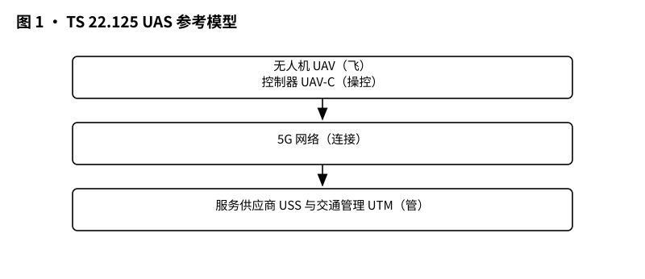
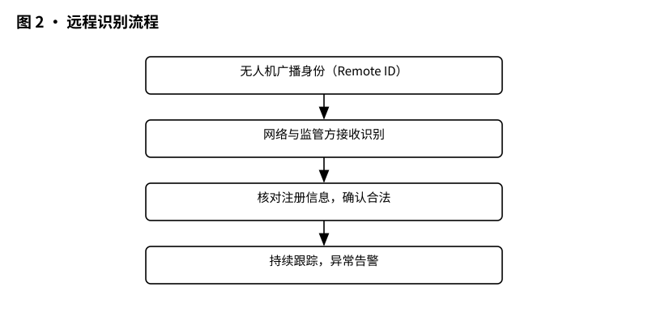
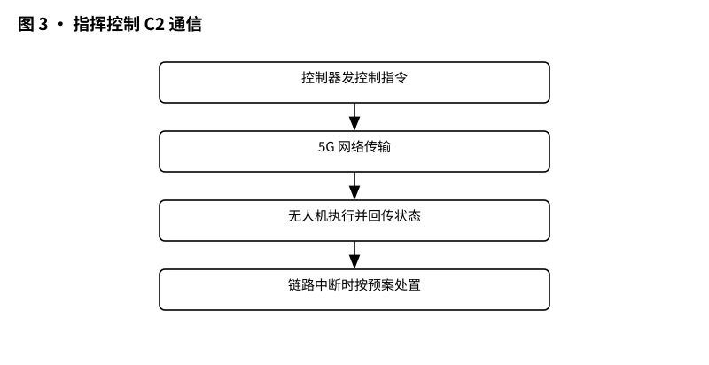
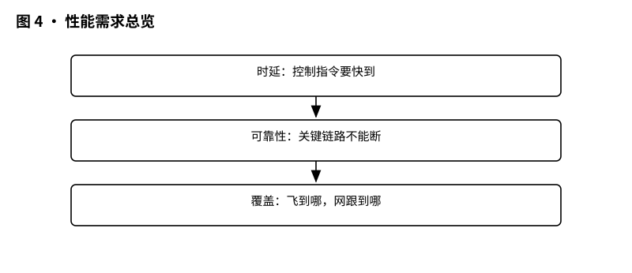

# 3GPP TS 22.125 解读：UAS 业务需求——无人机上天之前，网要先定好规矩

> 版本：v1.0 ｜ 更新：2026-10-28 ｜ 基线：TS 22.125 v19.2.0（Rel-19，已冻结）｜ 原文：whatthespec.net 抓取的关键条款

**TS 22.125 是 UAS（无人机系统）的“业务需求说明书”，规定无人机联网要做到三件事——能被认出来、能被管得住、飞得稳。**

## 1. 它要解决什么问题

无人机越来越多：谁在飞、飞哪去、归谁管、出了事找谁？如果每家运营商、每个厂家、每个监管系统各说各话，天上就会乱套。TS 22.125 干的事，就是先把“联网无人机业务要满足什么”写清楚：不是写某个网元叫什么、接口叫什么，而是写需求——比如系统必须能让 UTM（无人机交通管理）识别并关联一个 UAV 和它的 UAV 控制器，并把这个组合认作一个 UAS [R-5.1-001][§5.1]；系统必须能向 UTM 提供 UAS 的身份 [R-5.1-002][§5.1]；而且系统还要能根据认证/授权等级不同，让 UAS 向 UTM 发送不同的 UAS 数据 [R-5.1-005][§5.1]（原文对认证/授权等级的示例说明可见 [§5.1] 注 0）。

为什么现在才写？因为无人机尺寸从“小玩具”到“大商业机”都有，监管要求又各地不同，通信上既要管 C2（指挥与控制），又要管无人机回传的上下行数据，还得考虑 BLoS（超视距）飞行时“备份链路/切换链路”的可靠性 [§4.1]。没有这层统一需求，后面的架构和安全都无从谈起。

## 2. 它在 UAS 家族中的位置

3GPP 做无人机不是一篇规范搞定，而是分层接力：

- **Stage 1（需求）**：本篇 TS 22.125，只回答“要什么”。
- **Stage 2（架构）**：TS 23.256 回答“系统怎么搭、网元怎么连”（详见第 6 节）。
- **Stage 3（安全与协议）**：TS 33.256 回答“安全怎么保证”；具体接口、协议、消息在对应实现规范里继续细化（本篇不做实现级定义）。

还要分清一个“近亲”：TS 22.137 是通感（ISAC）方向，偏“用网络去感知”；TS 22.125 是 UAS 业务方向，偏“无人机联网的业务、识别、C2 与性能”。本篇 §6.6 也提到可向 UTM/UAV 提供由 5G 系统收集或生成的信息（例如基于感知结果），例如 3GPP UAV 与其他目标之间的位置或相对距离 [R-6.6-002][§6.6]；但那是 UAS 业务语境下的能力要求，不等于本篇通篇在讲 ISAC 总体方案。

## 3. 核心概念大白话

先把人名对上脸（图 1 就看这些角色）：

- **UAV（无人机本体）**：天上那架飞机。规范把它定义为“无人驾驶、可由操作员通过 UAV 控制器控制、并具备一定自主飞行能力”的飞行器 [§4.1]。
- **UAV-C / UAV controller（无人机控制器）**：地面那头。可以是手持遥控器，也可以是 PC/工作站等；“由谁接管控制”的机制不属于 3GPP 范围（见 Annex A 注）[A.1]。
- **UAS（无人机系统）**：UAV + UAV controller 的组合。规范里的参考模型就是“一个 UAS = 一架 UAV + 一个 UAV controller”的示例关系 [A.1]。
- **UTM（无人机交通管理）**：天上的“交警+调度+档案库”。它提供识别跟踪、授权、执法、运行监管等服务，并允许授权用户（空管、公共安全机构）查询 UAV 及其控制器的身份与元数据 [§4.1]。
- **远程识别（Remote ID）**：不靠人眼、靠系统把“这是谁的飞机、现在在哪、要去哪”识别出来并可跟踪。需求侧的硬目标是：系统要让 UTM 能关联 UAV 与 UAV 控制器并识别为一个 UAS [R-5.1-001][§5.1]，还要能提供 UAS 的身份 [R-5.1-002][§5.1]。
- **C2（指挥与控制通信）**：控制飞机的关键双向链路；可以发给 UAV 控制器、UTM，或两者都有，且可能不是周期性的 [§7.2]。
- **USS（UAS Service Supplier，无人机系统服务供应商）**：提供 UAS 相关服务的角色；在架构篇 TS 23.256 里，它是无人机注册认证与配对授权的对接方（以应用功能 AF 的形式出现）。

*图 1 · UAS 参考模型：无人机 UAV、控制器 UAV-C、服务供应商 USS、交通管理 UTM、5G 网络。*

## 4. 远程识别怎么工作

流程用大白话讲成三步，每步都有对应需求“卡点”：

**第一步：飞机上桌，先亮身份。** 系统要能让 UAS 向 UTM 发送 UAV 数据，内容可以包含：唯一标识（可能是某个 3GPP 标识）、UAV 的 UE 能力、厂家型号、序列号、起飞重量、位置、所有者身份/地址/联系方式/认证、起飞地点、任务类型、航线数据、运行状态 [R-5.1-003][§5.1]。同时还要能发 UAV 控制器数据：唯一标识、控制器 UE 能力、位置、所有者信息、UAV 运营者身份/执照/认证、UAV 飞手身份/执照/认证、飞行计划 [R-5.1-004][§5.1]。规范还要求系统支持把发往 UTM 的 UAS 数据“可扩展”，以适配未来 UTM 及其应用演进 [R-5.1-006][§5.1]。

**第二步：网络把“人”和“机”认成一个系统。** 光有飞机数据不够，还要能把 UAV 与 UAV 控制器关联起来，并作为一个 UAS 被识别 [R-5.1-001][§5.1]；并且系统能向 UTM 提供该 UAS 的身份 [R-5.1-002][§5.1]。规范还要求：在法规与安全保护前提下，系统要能让 UAS 向 UTM 发送标识，标识可以是 IMEI、MSISDN、IMSI 或 IP 地址 [R-5.1-007][§5.1]。

**第三步：监管/授权方跟踪，飞到哪说到哪。** 系统要让 UAS 能向 UTM 更新 UAV 及其控制器的实时位置 [R-5.1-012][§5.1]；并且网络应能向 UTM 提供 UAV 与其控制器的补充位置信息（补充可以是“基于信任”，也可以是基于网络信息的位置信息）[R-5.1-013][§5.1]。规范还允许运营方（MNO）在满足策略时增强上报数据，例如加入基于网络定位的 UAV/控制器位置信息（基于信任或如 OTDOA、小区坐标、同步源等网络信息）；但该增强不适用于 UAS 与 UTM 之间不经 MNO 的直接控制连接场景 [R-5.1-009][§5.1]（其注 1、注 2 解释了增强的两种形态与适用边界）。另外，系统要让 UTM 能把“运行授权结果”告知 MNO [R-5.1-010][§5.1]，并且 MNO 只有在存在合适订阅信息时才允许 UAS 授权请求 [R-5.1-011][§5.1]；这样“谁有资质、能不能飞、飞完告诉谁”就闭环了。

*图 2 · 远程识别流程：无人机发身份 → 网络识别 → 监管方跟踪。*

一个现实细节：无人机和它的控制器不一定在同一家运营商。规范明确要求：3GPP 网络应支持 UAV 与对应 UAV 控制器同时接入不同 PLMN（不同运营商网络）[R-5.1-014][§5.1]，并且在后续需求条目中以“3GPP 系统应支持”的方式重申同一能力 [R-5.1-014a][§5.1]。用大白话讲：飞机在 A 网、遥控器在 B 网，系统也得认成同一个 UAS。

## 5. 关键时刻的能力：典型用法 + 性能需求

### 5.1 指挥控制 C2：链路怎么走，备份怎么接

C2 不是“一条线跑到底”，规范把用 5G 网络支撑 UAS 服务时的 C2 通信模式分成三类（保证 C2 的 QoS）[§4.2]：

- **Direct C2（直连）**：控制器与无人机建立直接 C2 链路，两者都注册到 5G 网络，并使用网络为直连 C2 配置/调度的无线资源 [§4.2]。
- **Network-Assisted C2（网络辅助）**：控制器与无人机分别注册并建立各自的单播 C2 链路，通过 5G 网络互通；两者甚至可经不同 NG-RAN 节点接入，5G 网络需要支持可靠路由机制 [§4.2]。
- **UTM-Navigated C2（UTM 导航）**：无人机拿到预排飞行计划（例如 4D 多边形序列）自主飞，但 UTM 仍与它保持 C2 链路，用于周期监测飞行状态、用最新动态限制核对状态、给航路更新、必要时导航 [§4.2]。

可靠性怎么保？规范说：为了 C2 的服务可用性与可靠性，特别是 BLoS 场景，可以从 UAV 控制器或 UTM 到 UAV 的任意 C2 链路都“可建立冗余 C2 链路”；并且可激活不止一条 C2，把一条作备份或在链路间切换（原文举例：可先用 Direct C2，再切到 Network-Assisted C2）[§4.2]。落到需求侧，就是系统要支持预定义 C2 模型（例如 UAV 与控制器间直接 ProSe 通信、UTM 基于飞行计划的导航式 C2）以所需 QoS 提供 C2 [R-6.5-001][§6.5]；并且在切换 C2 模式时仍保证所需 QoS [R-6.5-002][§6.5]；还要支持让 UTM 请求对 C2 通信进行监控（按预定义模型的所需 QoS）[R-6.5-003][§6.5]。

*图 3 · 指挥控制 C2 通信：控制器与无人机之间的控制链路怎么走。*

### 5.2 无人机典型用法：视频回传、测绘、AI 巡检、远程操控

规范把无人机业务分成两类数据来理解 [§7.1]：

- **UAV originated QoS**：上行，从无人机到网络（例如摄像头拍到的图片/视频/文件，或管理数据）。
- **UAV terminated QoS**：下行，从网络到无人机（例如应用触发的设备开关、转动、升级/降级控制等）。

同时强调：同一片区域里，5G 系统可在服务无人机的同时服务地面其他用户，且不降低服务 [§7.1]。大白话：天上飞的要 100 Mbps 上行，不等于地上的手机就断网。

表 7.1-1 给出若干用例的 KPI（节选）[§7.1]：

- **8K 视频直播**：上行 100 Mbps、端到端 200 ms；下行 600 kbps、20 ms；高度 AGL <100 m；场景城市/景区 [§7.1]。
- **激光测绘/高清巡检**：上行 120 Mbps、200 ms；下行 300 kbps、20 ms；高度 30–300 m；城市/农村/景区 [§7.1]。
- **4×4K AI 监控**：上行 120 Mbps、20 ms；下行 50 Mbps、20 ms；高度 <200 m；城市/农村 [§7.1]。
- **远程高清视频操控无人机**：上行 ≥25 Mbps、100 ms；下行 300 kbps、20 ms；高度 <300 m；且该用例下无人机绝对飞行速度可达 160 km/h（原文指向另一条款说明）[§7.1]。
- **实时视频/视频流/周期照片**：例如实时视频上行 0.06 Mbps、100 ms；视频流按 720p/1080p 对应 4/9 Mbps、100 ms；周期照片上行 1 Mbps、1 s、高度 <120 m [§7.1]。

表 7.1-1 还给出通用边界条件：主动无人机密度 10/200 km²、最大高度 300 m、平均飞行速度 60 km/h（原文在表注中说明）[§7.1]。

*图 4 · 性能需求总览：时延、可靠性、覆盖三条线。*

### 5.3 C2 的 KPI：飞得快，消息不能断

C2 的 KPI 在表 7.2-1 中给出 [§7.2]。先看“硬底线”：5G 系统应支持无人机至少在 AGL 120 m（约 400 ft）高度运行，服务要能提供并表征到 3000 ft AGL [§7.2]。

以“航点转向（Steer to waypoints）”这类控制为例 [§7.2]：

- **UAV terminated C2（发给无人机的下行控制）**：典型消息间隔 ≥1 s；最大地速 300 km/h；典型消息大小 100 byte；端到端时延 1 s；可靠性 99.9%；需要 Positive ACK（正确认）。
- **UAV originated C2（无人机发的上行报告）**：典型消息间隔 1 s；消息大小 84–140 byte；端到端时延 1 s；可靠性 99.9%；不需要 Positive ACK。

这里最直观的读法是：下行控制“必须确认收到”（Positive ACK Required），上行报告“丢了可重发/不强制确认”（Not Required）[§7.2]。规范还说明，UAV 控制器与 UTM 的通信可能同时发生且 QoS 要求不同；任务专属通信（例如区域监控高清视频）是额外附加的 [§7.2]。

### 5.4 网络还能帮什么忙：第三方监控、限制区提醒、UxNB

除了识别和 C2，规范还把“网络侧能力”写成需求，方便第三方与监管使用：

- **第三方实时监控**：系统要提供手段让第三方请求并获取对某架 UAV 状态信息的实时监控（例如位置、通信链路状态）[R-6.2-001][§6.2]。
- **按策略给区域/时间的服务状态**：在运营方策略下，系统要提供手段向第三方给出“某地理区域、某时段内 UAV 的服务状态”；服务状态指网络是否能以某 QoS 向 UAV 提供通信服务 [R-6.2-002][§6.2]（原文注解释服务状态含义）。
- **沿航路预测 QoS**：在运营方策略下，5G 系统应能支持预测、监控网络条件与 QoS（如比特率、时延、可靠性），并在 UAV 预期飞行期间的特定时刻，沿连续的地理规划航路向第三方报告 [R-6.2-003][§6.2]。
- **三维空间定位与限制预警**：网络应能支持对 UAV 上 UE 的网络侧 3D 空间定位（例如高度 30–300 m）[R-6.3-001][§6.3]；并且系统应能向授权第三方提前通知“潜在停止连接服务”——在 UAV 上 UE 进入未授权区域（例如因高度原因）之前就提醒 [R-6.3-002][§6.3]。
- **UxNB（机载基站）要可控、省电、少干扰**：5G 系统应能支持 UxNB 提供增强且更灵活的无线覆盖 [R-6.4-001][§6.4]；系统要能提供合适手段控制 UxNB 运行（启动、停止、替换等）[R-6.4-002][§6.4]；要能降低 UxNB 功耗（优化运行参数、优化业务投递）[R-6.4-003][§6.4]；还要能最小化因 UxNB 改变位置而引起的干扰 [R-6.4-004][§6.4]。

## 6. Stage 1 需求 vs Stage 2 架构的区别

一句话区分：**22.125 说“要什么”，23.256 说“系统怎么搭”。**

- 你在本文看到的几乎全是“shall/should”式句子，例如“系统应能让 UTM 关联 UAV 与 UAV 控制器并识别为 UAS”[R-5.1-001][§5.1]；“系统应能支持 UxNB 以增强覆盖”[R-6.4-001][§6.4]。这些都是可测试、可验收的业务需求，不指定实现。
- TS 23.256（架构篇）才去定义为了实现这些需求，系统里出现哪些功能实体、数据如何流动、UE 与网络如何交互的结构化方案（具体网元名、接口名、协议/消息名以 TS 23.256 及实现规范为准）。
- TS 33.256（安全篇）则回答：识别、授权、订阅校验、位置与监控信息“如何安全地做”。例如本篇已出现安全相关需求锚点：MNO 只允许在存在合适订阅信息时处理 UAS 授权请求 [R-5.1-011][§5.1]；UTM 要把运行授权结果告知 MNO [R-5.1-010][§5.1]。

## 7. 它不管什么（边界）

- **不管实现细节**：本篇给的是业务需求与 KPI，不写某个接口叫什么、某条消息怎么编（协议/消息名以实现规范为准）。
- **不管“谁来当 controller”的接管机制**：Annex A 明确说，确保哪个 UAV 控制器处于激活并控制 UAV 的机制超出 3GPP 范围 [A.1]。
- **不管所有场景都走 3GPP**：规范的 UAS 模型也考虑 UAV 控制器经 3GPP 范围外机制控制 UAV 的场景 [§4.1]；同时 5.1 注 2 也把“不经 MNO 的直接控制连接”排除在某位置增强需求之外 [§5.1]。
- **不替代地区法规**：不同尺寸/重量、不同地区，监管要求不同，通信需求是“支持业务”，不是替你写空管法规 [§4.1]。

## 8. 怎么往下读

建议按“需求 → 架构 → 安全 → 实现”的路线读：

1. 先读本篇 TS 22.125：抓住远程识别、C2、UxNB、第三方监控、KPI 五类需求。
2. 再读 TS 23.256：看这些需求在系统架构里如何承载（网元与数据流）。
3. 再读 TS 33.256：看授权、订阅、位置/监控信息的安全保护如何落地。
4. 需要实现级信息时，再去查对应接口/协议/消息的实现规范；本文不替代实现规范。

**来源与版本（只使用下列事实）**

- 规范：**TS 22.125 v19.2.0**，属于 **Rel-19（已冻结）**。
- 原文摘要来源：whatthespec.net 对 TS 22.125 的条款抓取。
- 文内条款引用格式示例：[R-5.1-001][§5.1] 表示“需求条目 R-5.1-001，位于 TS 22.125 第 5.1 节”。
