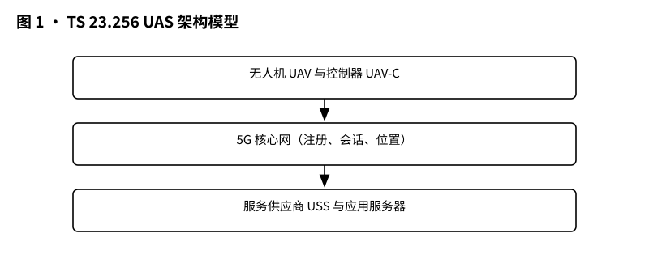
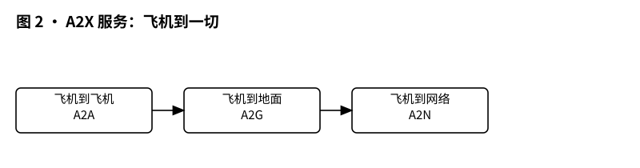
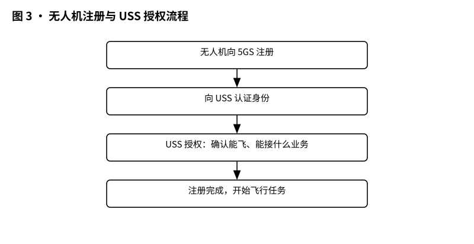
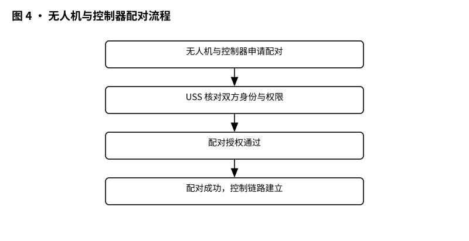

# 3GPP TS 23.256 解读：UAS 架构——无人机联网的系统是怎么搭起来的

> 版本：v1.0 ｜ 更新：2026-10-28 ｜ 基线：TS 23.256 v19.5.0（Rel-19，已冻结）｜ 原文：whatthespec.net 抓取的关键条款

**TS 23.256 是 5G 系统中关于“无人机系统”（UAS）的架构增强规范，它规定了无人机如何注册入网、如何获得服务供应商（USS）的授权、如何与地面控制器配对，以及网络如何支持无人机的定位、追踪和广播标识。 [§1]**

**1. 它要解决什么问题**

你可能觉得，无人机不就是个带摄像头的飞行器吗？为什么需要专门的通信标准？

想象一下，如果天上飞满了各家各户的无人机，没有规则，会发生什么？撞机、隐私泄露、甚至被恶意操控。3GPP 之前已经通过 TS 22.125 定义了“我们需要什么”（比如需要知道哪架飞机在飞、需要能追踪它），但 TS 23.256 要解决的是“怎么实现”的问题。 [§1]

具体来说，它要搭起一个能跑的系统，解决以下核心痛点：
*   **身份确认**：网络怎么知道这架无人机是合法的？不是非法入侵者？
*   **服务授权**：无人机想飞，得先拿到“飞行许可”。这个许可不是由基站随便给的，而是由专门的“无人机服务供应商”（USS）给的。网络怎么把这两者连起来？
*   **追踪与识别**：警察或空管部门需要知道某架无人机在哪里。网络怎么提供位置信息？
*   **断链处理**：如果无人机和地面控制器的连接断了，或者无人机想从 A 空域飞到 B 空域（归属不同的服务商），系统怎么平滑切换？

TS 23.256 就是把这些功能拆解成具体的网元交互流程，确保无人机能安全、有序地接入 5G 网络。 [§1]

**2. 它在 UAS 家族中的位置**

在 3GPP 的标准家族里，TS 23.256 处于“Stage 2”阶段。

*   **上游（需求）**：TS 22.125 是“Stage 1”，它像是一份产品需求文档（PRD），说：“我们要支持无人机识别、追踪、授权”。 [§1]
*   **本篇（架构）**：TS 23.256 是“Stage 2”，它是系统架构设计图。它定义了新引入的功能实体（如 UAS NF）、接口和数据流，告诉工程师“谁来做、怎么连”。
*   **下游（安全）**：TS 33.256 是安全规范，详细规定认证和授权过程中的加密、密钥管理等安全机制。TS 23.256 引用它，但不重复定义安全细节。
*   **旁系（其他业务）**：不要把它和 TS 23.280（MCX，Mission Critical Communication，关键任务通信）搞混。虽然都涉及专用通信，但 MCX 主要用于警察、消防等场景，而 TS 23.256 专门针对无人机（UAS）的特定需求，如空中识别、地理围栏等。

*图 1 · UAS 架构模型：无人机、控制器、USS、5G 核心网、应用服务器。*

**3. 核心概念大白话**

在深入流程前，先搞懂几个关键名词。别被英文缩写吓到，它们其实很直白：

*   **UAV (Uncrewed Aerial Vehicle)**：无人机本体。在 3GPP 里，它就是一个特殊的 UE（用户设备）。
*   **UAV-C (Uncrewed Aerial Vehicle Controller)**：地面控制器。可以是手持遥控器，也可以是地面站。它负责发送控制指令（C2）。
*   **USS (Uncrewed Aerial System Service Supplier)**：无人机服务供应商。这是最关键的新角色。你可以把它理解为“空中交通管制员 + 航空公司地勤”。它负责发放飞行许可、监控无人机状态、处理紧急事件。它不是电信运营商，而是提供无人机服务的一方。
*   **UUAA (USS UAV Authentication & Authorization)**：无人机认证与授权。这是 USS 和无人机之间的一次“握手”。UE 的网络身份（如 SIM 卡）是基础，但 UUAA 是额外的“飞行执照”验证。
*   **C2 (Command and Control)**：指挥与控制。就是地面给无人机发指令：“起飞”、“左转”、“降落”。
*   **A2X (Aircraft-to-Everything)**：飞机到一切。这是无人机与周围的其他实体（其他飞机、地面车辆、行人、传感器）进行通信的服务。
*   **CAA-Level UAV ID**：民航局级无人机 ID。这是一个全球唯一的标识符，就像无人机的“身份证号”，由监管机构分配，用于在 USS 那里进行认证。

*图 2 · A2X 服务：飞机到一切，哪些对象可以互通。*

**4. 一次无人机注册与配对怎么走**

这是 TS 23.256 最核心的部分。无人机怎么从“离线”变成“在线且被授权”？

**第一步：开机与尝试注册**

无人机开机后，首先尝试像普通手机一样向 5G 网络注册。但是，它不能只靠 SIM 卡。它必须在注册请求中携带自己的 **CAA-Level UAV ID**。如果它是为了无人机服务注册的，它还可能携带 USS 的地址。 [§5.2.2.1]

*图 3 · 无人机注册与 USS 授权流程：注册 → 认证 → 授权 → 可用。*

**第二步：UUAA 流程（关键中的关键）**

网络收到注册请求后，AMF（接入和移动性管理功能）会检查策略。如果策略要求对 UAV 进行 USS 授权（UUAA-MM），AMF 不会直接注册成功，而是暂停，转交给 **UAS NF**（UAS 网元）。 [§5.2.2.1]

UAS NF 是 5G 核心网里新引入的一个逻辑功能（或独立网元），它专门负责与 USS 对话。UAS NF 会把无人机发来的认证信息（基于 CAA-Level UAV ID 的凭证）转发给 USS。 [§5.2.2.1]

USS 收到后，会验证：
1.  这个 UAV ID 有效吗？
2.  这架无人机现在可以飞吗？（比如是否在禁飞区、是否有飞行计划许可）
3.  凭证正确吗？

如果 USS 说“OK”，UAS NF 就会在核心网中存储该无人机的 **UUAA Context**（授权上下文）。此时，无人机才算真正“入网”并获得了 UAS 服务的资格。 [§5.2.2.1]

**注意**：UUAA 可以在注册时做（UUAA-MM），也可以在建立 PDU 会话时做（UUAA-SM）。运营商可以根据策略选择。如果运营商要求注册时就必须授权，那无人机必须在注册请求里提供 UAV ID，否则 AMF 会拒绝注册或仅允许其作为普通 UE 注册（无 UAS 服务）。 [§5.2.1, §5.2.2.1]

**第三步：与控制器配对（Pairing）**

无人机入网后，还需要和地面的控制器（UAV-C）建立连接。这通常通过 PDU 会话建立（PDU Session Establishment）来完成。在这个阶段，如果之前没做 UUAA-SM，现在可能会触发一次认证。 [§5.2.1]

配对不仅仅是建立连接，还涉及到 **C2 通信的授权**。USS 可以指定哪些控制器可以控制这架无人机。如果控制器换了（比如从 A 操作员换到 B 操作员），可能需要重新进行认证或授权更新。 [§4.1]

*图 4 · 无人机与控制器配对流程：申请配对 → USS 授权 → 配对成功。*

**第四步：飞行中上报位置**

一旦开始飞行，无人机需要持续向 USS 上报位置。TS 23.256 定义了三种追踪模式： [§4.1]
1.  **位置报告模式**：无人机主动上报坐标。
2.  **存在监控模式**：网络监控无人机是否还在指定区域内（好比一道电子围栏）。
3.  **地理区域列表**：查询某一块区域里有哪些无人机在飞。

网络通过位置服务（Location Services）和事件通知（Event Notification）来支持这些功能。比如，当无人机飞出指定区域时，网络会通知 USS，USS 再决定如何处置。 [§4.1]

**5. 关键时刻的能力**

除了基本的注册，TS 23.256 还定义了一些在飞行中至关重要的能力。

**C2 通信可靠性**

C2（指挥控制）通信是生命线。如果 C2 链路断了，无人机可能会失控。TS 23.256 支持通过 5G 网络（Uu 接口）或侧行链路（PC5 接口）进行 C2 通信。 [§4.1]

特别地，它支持 **Direct C2 Communication**（直接 C2 通信），即无人机和控制器之间可以直接通过 PC5 通信，不经过基站转发，以降低延迟。这在远距离或弱信号环境下很有用。 [§4.1]

**A2X 服务：飞机到一切**

除了控制无人机，无人机还需要“看”到周围的环境。A2X 服务允许无人机与其他实体通信，实现“检测与避让”（Detect and Avoid, DAA）。 [§4.1, §6.1.1]

A2X 有两种模式：
*   **PC5 模式**：无人机直接与其他设备（如其他无人机、地面车辆）通信。这不需要网络连接，即使没有 5G 覆盖也能工作。 [§6.1.1]
*   **Uu 模式**：通过 5G 网络进行通信，适用于需要高带宽或广域覆盖的场景。 [§6.1.1]

A2X 还支持 **Broadcast Remote ID**（广播远程识别）。无人机可以通过 PC5 或 MBS（多播广播服务）广播自己的身份和位置，让周围的所有设备都能“看到”它。这就像飞机上的防撞灯，但是数字化的。 [§4.1, §6.1.1]

**漫游与迁移**

如果无人机从 A 城市飞到 B 城市，而 A 和 B 由不同的 USS 服务怎么办？TS 23.256 支持 **USS 切换**（Changeover）。无人机可以在飞行过程中，从旧的 USS 卸载，向新的 USS 注册并获取授权。 [§4.1]

这要求网络能够无缝处理不同 USS 之间的鉴权和上下文传递。虽然具体细节可能在后续版本或实现中细化，但架构上已预留了接口。 [§4.1]

**无 UICC 的情况**

有些无人机可能没有 SIM 卡（UICC）。TS 23.256 也支持这种情况，但仅限于使用 PC5 接口进行 A2X 通信（如广播 ID、DAA），且必须在预配置的区域和授权范围内。它们不能通过 Uu 接口访问核心网服务。 [§6.1.1]

**6. Stage 2 架构 vs Stage 1 需求的区别**

很多读者容易混淆 TS 22.125 和 TS 23.256。

*   **TS 22.125 (Stage 1)** 是“需求说明书”。它说：“我们需要支持无人机识别，我们需要能追踪无人机，我们需要防止非法飞行。” 它不关心怎么做，只关心“要什么”。 [§1]
*   **TS 23.256 (Stage 2)** 是“系统架构图”。它说：“为了实现识别，我们要引入 UAS NF 网元；为了实现追踪，我们要定义位置上报接口；为了实现授权，我们要定义 UUAA 流程。” 它定义了网元、接口、消息流程。 [§4, §5]

打个比方：
*   Stage 1 是买房需求：“我要一个三室两厅，朝南，带阳台。”
*   Stage 2 是建筑图纸：“客厅朝东，主卧朝西，阳台在西侧，水电走向如下……”

TS 23.256 就是那张建筑图纸。它不规定“阳台要多大”（那是 Stage 1 的事），也不规定“钢筋用什么牌子”（那是实现层的事），它规定的是“阳台怎么和客厅连接，水管怎么走”。

**7. 它不管什么（边界）**

明确边界很重要，避免读者产生误解。TS 23.256 **不** 负责以下内容：

*   **安全机制细节**：认证用的算法、密钥交换、加密方式等，由 TS 33.256 定义。TS 23.256 只规定“在这里要调用安全功能”，但不规定“怎么加密”。
*   **地理围栏的具体逻辑**：TS 23.256 提供位置服务和事件通知作为“使能器”（Enablers），但具体的围栏形状、触发条件、惩罚机制（如切断信号）是由 USS 决定的，不属于 3GPP 规范定义的范围。 [§4.1 NOTE]
*   **应用层协议**：A2X 或 C2 应用层的具体数据格式（比如飞控指令的字节结构）由其他标准组织或厂商定义，3GPP 只管传输层和网络层架构。
*   **无人机自身硬件**：传感器、电池、飞控算法等，完全不在通信标准范围内。
*   **监管政策**：各国空管法规不同，TS 23.256 提供通用的架构，具体哪些区域禁飞、谁有权限飞行，由当地监管机构和 USS 决定。 [§5.2.1]

**8. 怎么往下读**

如果你想深入理解 TS 23.256，建议按以下顺序阅读：

1.  **本篇（TS 23.256）**：先建立整体架构概念，理解 UAS NF、UUAA、A2X 这些核心概念。
2.  **TS 22.125 (UAS Use Cases and Service Requirements)**：回过头看需求，看看架构是如何满足那些具体场景的（如“警察追踪非法无人机”、“物流无人机自动避障”）。
3.  **TS 33.256 (Security Aspects of UAS)**：深入安全细节，理解 UUAA 过程中的认证和授权是如何保护隐私和防止重放攻击的。
4.  **TS 23.501 / TS 23.502 (5G System Architecture / Procedures)**：如果你熟悉 5G 核心网，可以对比普通 UE 的注册流程，看看 UAV 注册多了哪些步骤（主要是 UAS NF 的介入）。
5.  **TS 23.285 / TS 23.287 (PC5 / V2X)**：了解 A2X 中使用的 PC5 接口细节，特别是侧行链路资源分配。

**版本与来源说明**

*   **文档版本**：TS 23.256 v19.5.0
*   **版本状态**：Rel-19（已冻结）
*   **主要参考**：
    *   TS 22.125: UAS use cases and service requirements
    *   TS 33.256: Security aspects of UAS
    *   TS 23.285: V2X communication over PC5
    *   TS 23.287: Evolved packet system support for V2X services

本文档基于 whatthespec.net 抓取的 TS 23.256 v19.5.0 关键条款摘要整理而成，旨在以通俗语言解读技术规范，具体实施请以 3GPP 官方原文为准。
