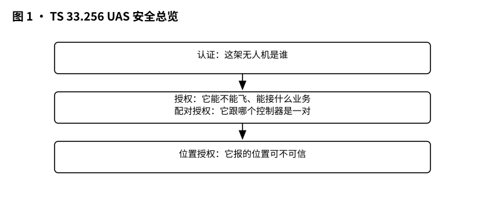
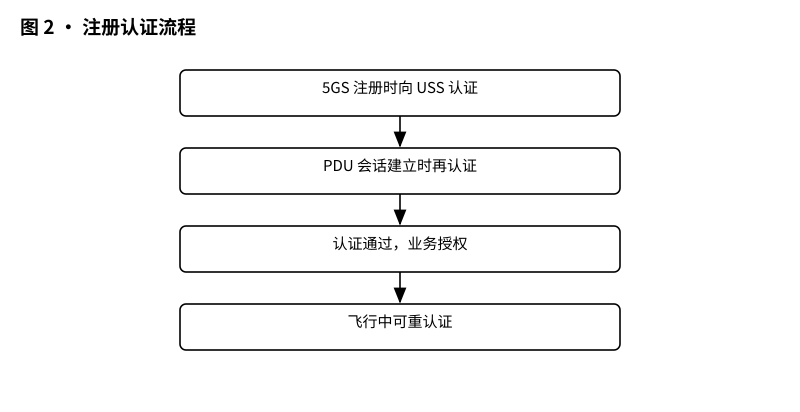
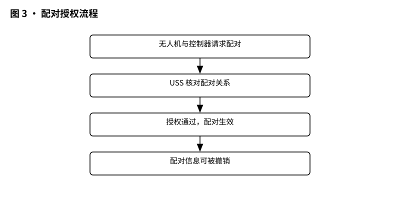
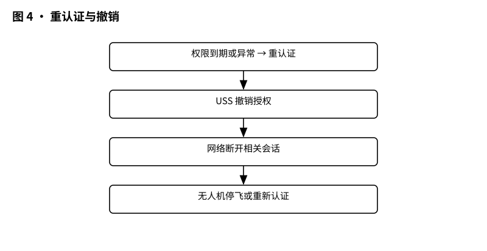

# 3GPP TS 33.256 解读：UAS 安全——这架无人机是谁的、能不能飞，网怎么验

> 版本：v1.0 ｜ 更新：2026-10-28 ｜ 基线：TS 33.256 v19.2.0（Rel-19，已冻结）｜ 原文：whatthespec.net 抓取的关键条款

**TS 33.256 是面向无人机系统（UAS）的安全规范：规定无人机（UAV）怎么向服务供应商（USS）做认证与授权、无人机与控制器（UAV-C）怎么配对并获批、位置信息怎么授权与核验，从而把“这架无人机是谁的、能不能飞”这件事在 5G 网络里验明白 [§1][§4]。**

## 1. 它要解决什么问题（天上飞的不能是“黑飞”）
无人机一旦接入运营商网络，用网、管控、识别和跟踪都会成为网络安全问题。TS 33.256 要回答四个硬问题：
- 身份要验：无人机得证明自己是“合法那架”，不是冒牌货 [§4]。
- 配对要批：无人机和控制器想“牵手”，得有 USS 授权这道“家长签字” [§4]。
- 位置要真：不能随便报假坐标；涉及位置信息提供和基于网络的位置，要按授权来 [§4]。
- 权限能收回：发现风险，能及时重认证、必要时撤销授权 [§4][§5.2.1.1]。

*图 1 · UAS 安全总览：认证、授权、配对、位置四道关。*

范围上，它依据 TS 23.256 的架构增强，支持 UAS 的连接、识别、跟踪与配对授权，并对应 TS 22.125 的使用场景与服务需求 [§1]。

## 2. 它在 UAS 家族中的位置（安全篇）
把它想象成建楼：
- TS 22.125 是“需求清单”，告诉你楼要满足哪些使用场景 [§1]。
- TS 23.256 是“架构图纸”，告诉你楼怎么搭、流程怎么走 [§1][§4]。
- TS 33.256 是“安保方案”，告诉你门禁怎么验、钥匙怎么发、违规怎么处置 [§1][§4]。

它覆盖的新功能安全包括：
- UAV 与 USS 在 5GS 注册时的认证与授权；
- UAV 与 USS 在 PDU 会话建立、PDN 连接建立时的认证与授权；
- 上述流程的重认证、重授权与撤销；
- USS 对 UAV 与 UAV-C 配对的授权；
- 提供位置信息与提供基于网络的位置的授权，以缓解谎报位置；
- 在 3GPP 系统中经由 PC5 的 C2（指挥与控制）通信的安全与隐私；
- 传输广播远程识别（Broadcast Remote Identification）的安全与隐私；
- 检测与避让（DAA）流量的安全与隐私；
- 面向不同地理区域、服务不同 USS 的安全，即沿飞行路径由多个 USS 服务时，UAV 从一个 USS 切换到另一个 USS 的安全 [§4]。

还有一条一般原则：保护 UAS 业务流量是 USS/UAV 提供方的责任；他们要保证这层数据保护不依赖 3GPP 网络是否提供保护，从而在任何情况下都安全 [§5.1]。

## 3. 核心概念大白话
- USS（UAS 服务供应商）：你可以把它当“无人机的运营商/管家”，负责认证、授权和安全管理 [§4]。
- UAV-C（无人机控制器）：操纵无人机的地面或空中控制端，和 UAV 建立 C2 关系 [§4]。
- UUAA（UAV-USS 认证与授权）：无人机给 USS 验明正身并取得业务授权的过程。它发生在 5GS 注册或 PDU 会话建立阶段，必须在主认证（TS 33.501  clause 6.1 描述）成功之后进行 [§5.2.1.1]。
  - 触发者：注册时可由 AMF 触发；PDU 会话建立时可由 SMF 触发；已认证过 UAV 的 USS 也可以发起重认证 [§5.2.1.1]。
  - 强制/可选：网络在注册时支持 UUAA 是可选，在 PDU 会话建立时是必选；UE 在注册和 PDU 会话建立时支持 UUAA 都是必选 [§5.2.1.1]。
  - 条件：当 UAV 具备 Aerial UE 订阅，并在 Registration Request 或 PDU Session Establishment Request 中提供 CAA-Level UAV ID 以请求 UAS 服务时，AMF 或 SMF 会触发 UUAA [§5.2.1.1]。
  - 做法：UUAA 在 UAV 与 USS 之间进行；基于 CAA-Level UAV ID 以及与该 ID 关联的凭据进行认证；认证消息放在透明容器（transparent container）里，经由 3GPP UAS NF 在 UAV 与 USS 之间传递 [§5.2.1.1]。
  - 边界：CAA-Level UAV ID、凭据，以及执行 UUAA 需要发送的具体认证方法和信息的提供，不在 3GPP 规范范围内 [§5.2.1.1]。
  - 结果：UUAA 成功后，USS 可以在 UUAA Authorization Payload 中给 UAV 发送 UAS 安全信息；其内容不在 3GPP 规范范围内 [§5.2.1.1]。
- 配对授权（Pairing Authorization）：UAV 与 UAV-C 想建立控制关系，需要 USS 批准，确保“谁和谁绑在一起”是合法、可审计的 [§4]。
- 重认证/重授权/撤销： USS 或网络在任意时刻可以要求再验一次（重认证），或者把之前给的权限撤回（撤销） [§4][§5.2.1.1]。
- 位置信息授权与基于网络的位置：是否允许提供位置信息、是否允许使用网络定位来辅助核验，都需要授权，目标是降低无人机谎报位置的可能 [§4]。

## 4. 一次无人机注册认证怎么走（5GS 注册 → PDU 会话 → 配对）
### 4.1 注册阶段
1. UE 发 Registration Request 给 AMF。UE 可以提供 CAA-Level UAV ID，并可选提供 USS 地址/IP 地址，表示要注册 UAS 服务 [§5.2.1.1]。
2. 如果配置要求 CAA-Level UAV ID 和/或 USS 地址/IP 不明文发送（例如 USS 地址或 IP 地址不对外暴露），那么这些信息应在 NAS 安全建立之后再发送 [§5.2.1.1]。
3. AMF 完成安全 setup，包括按需进行的主认证 [§5.2.1.1]。
4. 主认证成功后，AMF 决定是否需要 UUAA。UAV 只有在完成主认证之后，才被允许与 USS/UTM 进行 UUAA [§5.2.1.1]。
5. 若需要 UUAA，由 AMF 触发；UAV 与 USS 之间通过透明容器经 3GPP UAS NF 传递认证消息，完成认证与授权 [§5.2.1.1]。
6. UUAA 成功后，USS 可以下发 UAS 安全信息（具体字段与格式不在 3GPP 范围） [§5.2.1.1]。

*图 2 · 注册认证流程：5GS 注册时向 USS 认证授权。*

### 4.2 PDU 会话建立阶段
- 在 PDU Session Establishment 过程中，SMF 可以触发 UUAA；网络在此阶段支持 UUAA 是强制的 [§5.2.1.1]。
- UE 同样必须支持 PDU 会话建立时的 UUAA [§5.2.1.1]。
- 触发条件与注册类似：UAV 有 Aerial UE 订阅，并在 PDU Session Establishment Request 里提供 CAA-Level UAV ID，请求接入 UAS 服务 [§5.2.1.1]。
- 走法与注册一致：UAV 与 USS 之间基于 CAA-Level UAV ID 及关联凭据进行认证，消息放在透明容器里，经由 3GPP UAS NF 传递 [§5.2.1.1]。

### 4.3 配对授权阶段
- 当 UAV 与 UAV-C 要建立控制关系，TS 33.256 要求支持 USS 对这次配对进行授权 [§4]。
- 也就是说，光“你情我愿”不够，还要 USS 点头，确保配对关系合法、可追溯 [§4]。

*图 3 · 配对授权流程：无人机与控制器配对要 USS 批准。*

## 5. 关键时刻的能力（重认证、撤销、位置授权与核验）
- 重认证与撤销：在初始注册之后的任何时间，USS 或 AMF（当网络支持注册时的 UUAA）可以发起对 UAV 的重认证；AMF 发起的重认证在 clause 5.2.1.2，USS 发起的在 clause 5.1.2.4 [§5.2.1.1]。配合重授权与撤销机制，权限可以被及时收回 [§4]。
- 位置信息授权与基于网络的位置：规范支持对“提供位置信息”和“提供基于网络的位置”做授权，目的是降低无人机上报虚假位置数据的风险 [§4]。也就是说，不是“想说在哪就在哪”，而是要在授权范围内提供位置，并可借助网络定位能力做核验 [§4]。
- C2、广播遥识、DAA 的安全与隐私：规范覆盖经由 PC5 的 C2 通信的安全与隐私、广播远程识别的传输安全与隐私、以及 DAA 流量的安全与隐私 [§4]。这些内容保证“控制链路不被窃听/篡改”“对外识别不泄露隐私”“避让流量不被攻击” [§4]。
- 多 USS 服务与切换：当 UAV 的飞行路径跨越不同地理区域，可能由多个 USS 提供服务；规范给出多 USS 的安全支持，包括 UAV 从一个 USS 切换到另一个 USS 的安全 [§4][§5.2.1.1]。

*图 4 · 重认证与撤销：权限怎么收回、怎么重新认证。*

## 6. 安全规范 vs 架构规范的区别（怎么验 vs 怎么走）
- TS 23.256 管“流程怎么走”：给出支持 UAS 的参考架构、消息流，描述 UAV 如何注册、如何建立会话、如何触发安全流程 [§4]。
- TS 33.256 管“怎么验、怎么锁”：明确 UUAA 的触发条件与强制性、UAV 与 USS 之间的认证关系、消息怎么封装与传递、成功后 USS 如何下发安全信息、以及重认证/撤销/配对/位置等安全能力 [§4][§5.2.1.1]。

打个比方：23.256 是“路线图”，告诉你走到哪一步该做什么；33.256 是“安检规则”，告诉你这一步要验什么、用什么材料、过了之后能拿到什么权限 [§1][§4]。

## 7. 它不管什么（边界）
- 不管 Stage 1 需求：使用场景与服务需求在 TS 22.125 定义，TS 33.256 只是据此把安全做实 [§1]。
- 不管架构细节：参考架构、网元关系、接口/流程细节在 TS 23.256；本规范只描述这些新功能的“安全部分” [§1][§4]。
- 不规定实现选型：CAA-Level UAV ID 与凭据如何提供、实际采用的认证方法与需要发送的信息，都不在 3GPP 规范范围 [§5.2.1.1]。USS 在 UUAA 成功后发送的 UAS 安全信息内容，同样不在 3GPP 规范范围 [§5.2.1.1]。
- 不替代业务侧保护：UAS 业务流量的保护由 USS/UAV 提供方负责，要确保无论 3GPP 网络是否提供保护，这层数据保护都到位 [§5.1]。

## 8. 怎么往下读（路径与版本）
- 先读本篇：抓“身份、授权、配对、位置、撤销”的安全主线 [§1][§4]。
- 再读 TS 23.256：看架构与流程，理解 UUAA 在注册/PDU 会话中怎么被触发、消息如何流转 [§1][§4][§5.2.1.1]。
- 最后回到 TS 22.125：核对使用场景与服务需求，确保安全机制与业务需求一一对应 [§1]。

版本与来源：
- 本文依据 TS 33.256 v19.2.0（Rel-19，已冻结）整理。文中条款号均指该版本规范章节。
- 背景需求与架构分别见 TS 22.125 与 TS 23.256；UUAA 的主认证关联见 TS 33.501 clause 6.1 [§1][§4][§5.2.1.1]。
