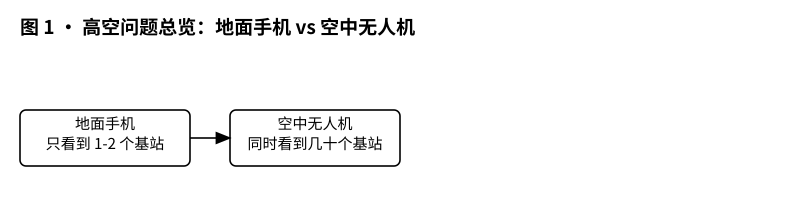
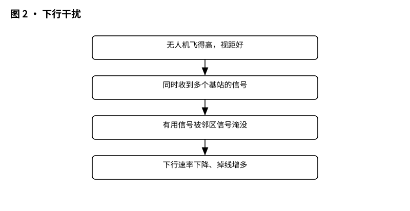
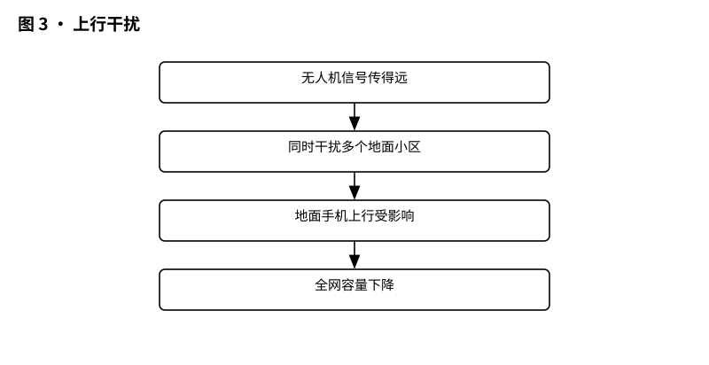
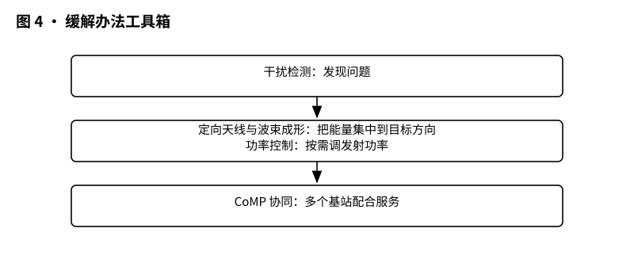

# 3GPP TR 36.777 解读：无人机上天后，地面基站为什么会“看花眼”

> 版本：v1.0 ｜ 更新：2026-10-28 ｜ 基线：TR 36.777 v15.0.0（Rel-15，2017-12，已冻结；研究报告，非强制性规范）｜ 原文：whatthespec.net 抓取的关键条款（TR 36.777 为 3GPP 官方存档原文转换）

**TR 36.777 是一份“体检报告”：它研究了无人机（UAV）飞上天后，现有的 LTE 网络会遇到哪些麻烦（主要是干扰和频繁切换），并列出了一些缓解办法；这些结论供后续版本参考，不是强制要求 [§1]。**

---

## 1. 它要解决什么问题

想象一下，你拿着手机走在街上。周围虽然有基站，但建筑物挡住了视线。你通常只能清晰看到最近的一两个基站，其他基站的信号被墙壁、树木削弱了。这就是 LTE 网络设计时的基本假设：**大部分用户在地面，信号传播是非视距（Non-LoS）的，干扰相对可控。**

现在，架无人机飞到了 300 米的高空 [§4.1]。
这时候，情况完全变了：
1.  **视野大开**：无人机没有遮挡，能直接“看见”周围几十个基站的信号。
2.  **下行干扰（别人吵你）**：因为能看到太多基站，无人机同时收到很多基站的信号。虽然你想听服务基站的话，但周围那些基站的信号就像周围的噪音一样，让你的接收机很难分清哪个是主信号，哪个是干扰。
3.  **上行干扰（你吵别人）**：无人机为了把信号传回地面，往往需要较大的发射功率。因为飞得高，它的信号能覆盖很广的区域，可能会同时干扰到周围好几个基站的其他用户。
4.  **切换频繁**：因为信号变化快（飞得快、天线方向性影响），无人机可能一会儿觉得 A 基站信号好，一会儿觉得 B 基站信号好，导致频繁切换，甚至切换失败。

TR 36.777 的核心任务，就是量化这些“看花眼”的现象，并找办法让网络适应这种新情况 [§1]。

---

*图 1 · 高空问题总览：地面手机 vs 空中无人机，看到的基站数量天差地别。*

## 2. 它在 UAS 家族中的位置

在 3GPP 的无人机（UAS, Unmanned Aerial Systems）标准家族中，TR 36.777 属于**研究类报告（Study Report）**。

*   **不是强制规范**：它不规定设备必须怎么做，而是记录“我们研究了什么，发现了什么，建议怎么做”。它是后续制定强制性规范（TS）的基础 [§1]。
*   **聚焦无线接入网（RAN）**：这份报告由 RAN1（物理层）和 RAN2（协议层）工作组主导，主要关注空口（Air Interface）的性能问题，比如信号怎么传、干扰怎么算 [§1]。
*   **与核心网/业务需求的关系**：
    *   它**不管**业务需求（比如无人机要传多少兆的视频流），那是 TS 22.125 的事。
    *   它**不管**核心网架构（比如怎么鉴权、怎么计费），那是 TS 23.256 的事。
    *   它只关心：**在现有的 LTE 架构下，无线信号层面怎么优化才能支撑这些业务。**

简单来说，TS 22.125 说“我要飞”，TS 23.256 说“怎么管飞行的车”，而 TR 36.777 说“车在上空跑，路面（无线电波）该怎么修才不堵车” [§1]。

## 3. 核心概念大白话

为了看懂后面的分析，先搞懂几个关键词：

*   **空中 UE（Aerial UE）**：就是无人机。在 LTE 术语里，它就是一个“飞在天上的用户终端”。
*   **下行（DL）干扰**：基站发信号给无人机。如果周围太多基站也在发信号，无人机就听不清自己的基站说什么。就像你在嘈杂的广场上听朋友说话，旁边太多人在聊天，干扰很大。
*   **上行（UL）干扰**：无人机发信号给基站。如果无人机功率太大，或者位置太高，它的信号可能会“溢出”，干扰到旁边基站正在接收的其他地面用户。就像你在 KTV 唱歌太大声，隔壁包间的人都听见了。
*   **FD-MIMO（全维度 MIMO）**：一种高级天线技术。基站有很多根天线，可以像手电筒聚光灯一样，把信号精准地“打”给特定的用户，同时把干扰“避开”。
*   **定向天线**：无人机自己用的天线。如果无人机也装上“聚光灯”天线，只对准服务基站，就能减少接收到的无关干扰，也能减少发射时的能量浪费。
*   **CoMP（协同多点传输）**：几个相邻基站“商量好”，一起发信号给用户，或者一起沉默（Muting），以减少干扰。
*   **切换（Handover）**：从一个基站的服务范围转到另一个基站的服务范围。就像你走路时，从 A 咖啡馆的 WiFi 切换到 B 咖啡馆的 WiFi。

## 4. 干扰问题是怎么来的

TR 36.777 花了大量篇幅分析干扰的来源。这里用大白话拆解一下物理原因：

### 4.1 视距传播（LoS）是罪魁祸首

在地面，信号传播主要是“绕射”和“散射”，衰减很快。但在高空，信号传播主要是**视距（Line-of-Sight）**，也就是直线传播。
*   **后果**：无人机能直接收到远处基站的信号，这些信号衰减得很小，强度很高。
*   **数据**：研究显示，在 50 米以上的高度，无人机可能同时检测到多达 16 个基站的高强度干扰信号 [§6.1]。相比之下，地面用户通常只受 1-2 个邻区干扰。

*图 2 · 下行干扰：无人机同时收到多个基站的信号。*

### 4.2 下行干扰：无人机“听不清”

*   **现象**：由于接收到来自多个小区的强干扰，无人机的下行几何条件（Geometry）比地面用户差得多。统计学上，5% 分位数的下行几何条件显著劣于地面用户 [§6.2]。
*   **影响**：为了维持相同的吞吐量，网络需要分配更多的无线资源（如更多的子帧、更多的 MCS 级别）。如果无人机占比高，地面用户的资源就会被挤占，导致地面用户的吞吐量也下降 [§6.2]。
*   **简单说**：无人机不仅自己听不清，还“占着茅坑不拉屎”（占用资源但效率低），导致大家网速都变慢。

### 4.3 上行干扰：无人机“吵翻天”

*   **现象**：上行链路中，无人机因为距离远，往往需要更高的发射功率。由于高空视距，这个强信号会辐射到周围多个基站。
*   **对比**：地面用户通常只干扰服务基站和相邻的一两个基站。但高空无人机可能同时干扰好多个基站的上行接收 [§6.3]。
*   **后果**：周围基站的地面用户上行信号会被无人机的信号淹没，导致上行吞吐量大幅下降。

*图 3 · 上行干扰：无人机的信号同时干扰多个基站。*

### 4.4 移动性噩梦：频繁切换与乒乓

*   **现象**：
    1.  **信号波动大**：由于高空视距，信号强度变化非常剧烈（快衰落）。
    2.  **测量报告受限**：现有 LTE 规范中，UE 上报的测量结果数量有限（比如只报最强的几个）。无人机看到的可能都是强信号，但其中很多是干扰源，而不是潜在的服务基站。
    3.  **乒乓效应**：无人机可能在 A 基站和 B 基站之间反复横跳，导致切换失败（HOF）或无线链路失败（RLF）率上升 [§5.2]。
*   **原因**：地面用户的信号变化相对平缓，有建筑物遮挡。无人机飞得快（最高 160 km/h [§4.1]），加上信号变化快，现有的切换算法（基于 RSRP 的门限）容易“误判”。

## 5. 研究给出的缓解办法

TR 36.777 不是一个“银弹”解决方案，而是一个“工具箱”。它评估了多种潜在的技术手段，看看哪些有效，哪些需要进一步标准化。

*图 4 · 缓解办法工具箱：干扰检测、定向天线、功率控制、CoMP。*

### 5.1 干扰检测：先知道谁在捣乱

要解决问题，先得发现问题。研究提出了一些方法来识别“空中 UE”以及它们造成的干扰 [§7.1]。

*   **基于 UE 的检测**：
    *   利用 UE 上报的测量信息（如 RSRP, RSRQ, CSI）。
    *   利用 UE 的其他信息：速度估计、位置信息、移动性历史。如果一个 UE 速度很快且高度很高，网络可以推断它是空中 UE [§7.1.2]。
*   **基于网络的检测**：
    *   基站之间通过 X2 接口交换信息。比如，基站 A 告诉基站 B：“我这边有个 UE 功率很大，可能是无人机，你那边注意一下上行干扰。”
    *   基站可以观察上行参考信号（SRS）的特征来判断 UE 是否在空中 [§7.1.3]。

**大白话**：就像小区保安，看到一个人跑得快、个子高（速度、高度信息），或者听到他嗓门特别大（上行功率），就标记为“可疑人员”（空中 UE），并通知其他保安注意。

### 5.2 下行干扰缓解：让无人机听得清

这是研究的重点。几种方案被评估过：

1.  **FD-MIMO（全维度 MIMO）** [§7.2.2]
    *   **原理**：基站用很多天线，做波束赋形。把信号能量集中对准无人机，同时把干扰信号“零陷”（Null）对准。
    *   **效果**：研究显示，使用 FD-MIMO 后，即使空中 UE 比例达到 50%，地面用户的平均吞吐量损失可以限制在 6% 以内（如果不使用，损失可能高达 23%）[§7.2.2]。
    *   **结论**：这是一个非常有效的方案，且 LTE Rel-13 已经支持，不需要新的规范增强。

2.  **无人机端定向天线** [§7.2.3]
    *   **原理**：无人机不用全向天线（360 度接收），而用定向天线，只对准服务基站接收。
    *   **效果**：能显著减少来自其他基站的干扰，提高无人机的吞吐量，同时减少对地面用户的干扰。
    *   **结论**：这是终端实现层面的优化，规范层面可能不需要特别增强，但需要终端厂商支持 [§8]。

3.  **接收波束赋形（Receive Beamforming）** [§7.2.4]
    *   **原理**：无人机端如果有多个天线，也可以做波束赋形，选择性接收服务基站信号，抑制干扰。
    *   **结论**：同样属于终端实现优化，有益但非强制 [§8]。

4.  **CoMP（协同多点传输）** [§7.2.5]
    *   **原理**：相邻基站协同工作。比如，干扰基站暂时沉默（Muting）或降低功率，让无人机能清晰收到服务基站信号。
    *   **效果**：能同时提升空中和地面用户的吞吐量。
    *   **结论**：LTE 已支持，但需要更精细的协调机制。

5.  **覆盖增强技术** [§7.2.6]
    *   **原理**：使用 LTE Rel-13 的覆盖增强技术，帮助信号弱的边缘用户（包括高空用户）完成同步与初始接入。
    *   **效果**：仿真显示，用上覆盖增强后，空中 UE 的同步与初始接入可达到 100% 覆盖概率。

### 5.3 上行干扰缓解：让无人机别太吵

*   **增强功率控制** [§7.3.2]
    *   **原理**：现有的 LTE 功率控制是基于路径损耗的。对于高空 UE，路径损耗模型不同。研究评估了更精细的功率控制算法，限制无人机的发射功率，避免其信号辐射过远。
    *   **效果**：能显著降低对周围基站上行链路的干扰。
    *   **结论**：这是一个关键的标准化方向，需要在规范中明确针对空中 UE 的功率控制参数。

### 5.4 移动性优化：减少无效切换

*   **识别机制**：网络需要知道 UE 是空中的，才能应用不同的移动性算法。
*   **参数调整**：针对空中 UE，可能需要调整切换门限、迟滞时间（Hysteresis）等参数，以适应信号快速变化的特点 [§7.4]。
*   **测量报告增强**：允许 UE 上报更多的测量结果，或者上报包含高度、速度信息的测量报告，帮助网络做出更准确的切换决策 [§7.1.2]。

## 6. 这份研究带来了什么

TR 36.777 作为 Rel-15 的一部分，其结论直接影响了后续 LTE 和 5G 的设计。

1.  **确认了“空中 UE”是一个独立的性能类别**：
    *   以前的 LTE 规范主要考虑地面用户。Rel-15 开始，明确引入了 Airborne UEs 的需求和评估指标 [§5]。
    *   定义了具体的性能要求：例如，控制信令（C&C）的时延要求 50ms，可靠性要求 10^-3 的误包率 [§5.1]。

2.  **给出了 FD-MIMO 和 CoMP 的仿真依据**：
    *   研究用仿真数据证明，现有的 Rel-13/14 技术（如 FD-MIMO）在应对空中干扰时非常有效，为后续部署与标准化提供了依据。

3.  **为后续标准铺路**：
    *   TR 36.777 识别的问题（干扰、移动性）与工具箱，成为后续 LTE 增强与 5G NR 设计时的参考输入；具体哪些建议被采纳，要到后续 TS 里查。
4.  **明确了“识别”的重要性**：
    *   研究强调，网络必须能识别出哪些 UE 是空中的，并专门留了一节讨论空中 UE 识别的潜在增强 [§7.5]。

## 7. 它不管什么（边界）

为了防止误解，必须明确 TR 36.777 **不**包含以下内容：

1.  **不是强制规范**：
    *   这是一份研究文档（TR），不是技术规范（TS）。它不规定 UE 或 eNB 必须实现什么功能。它只是说“我们发现这样做有效，建议后续规范考虑” [§1]。
    *   具体的强制性要求会在后续的 TS 36.211（物理层）、TS 36.331（RRC）等文档中体现，如果 3GPP 决定采纳这些建议。

2.  **不管业务需求**：
    *   它不规定无人机要传 4K 视频还是 8K 视频，不规定上传频率是多少。这些业务需求由 **TS 22.125**（UAS 服务需求）定义 [§1]。
    *   TR 36.777 只是假设了一些典型的数据速率（如 50 Mbps 上行 [§5.1]），用于评估网络性能，而不是业务承诺。

3.  **不管核心网架构**：
    *   它不涉及核心网（EPC/5GC）的修改。比如，怎么给无人机鉴权、怎么计费、怎么与运营商的 UTM（无人机交通管理）系统对接，这些是 **TS 23.256**（UAS 核心网架构）和 **TS 22.125** 的范围 [§1]。
    *   TR 36.777 只关心空口（Radio Access Network, RAN）层面的信号传输问题。

4.  **不管非 3GPP 技术**：
    *   它只研究 LTE（Rel-14 基线）和潜在的 LTE 增强。它不涉及 Wi-Fi、LoRa 或其他非 3GPP 技术。

## 8. 怎么往下读

如果你想深入了解无人机通信，建议按以下顺序阅读：

1.  **本篇：TR 36.777**
    *   **目的**：理解空中场景下的无线信道特性和干扰问题。
    *   **重点章节**：第 4 章（部署场景）、第 6 章（问题识别）、第 7 章（潜在增强）。
    *   **适合人群**：无线通信工程师、标准研究者、对空口技术感兴趣的人。

2.  **TS 22.125：UAS 服务需求**
    *   **目的**：了解无人机通信到底要解决什么业务问题（控制、视频、导航）。
    *   **重点**：理解“控制面”和“用户面”的业务分离，以及不同场景下的性能指标。
    *   **适合人群**：产品经理、系统架构师、业务规划者。

3.  **TS 23.256：UAS 核心网架构**
    *   **目的**：了解核心网如何支持无人机，包括鉴权、计费、与 UTM 系统的接口。
    *   **重点**：理解 UE 如何被识别为 UAS，以及核心网如何处理 UAS 特有的会话。
    *   **适合人群**：核心网工程师、网络安全专家。

4.  **后续 LTE/5G 规范（如 TS 36.300, TS 38.300）**
    *   **目的**：查看 TR 36.777 中的建议是否被采纳，以及具体如何落地。
    *   **重点**：查找关于“Aerial UE”、“UAS”的条款，看功率控制、测量报告、切换算法是否有针对空中场景的特殊处理。

---

## 版本与来源

*   **文档标题**：Study on Enhanced Support for Aerial Vehicles
*   **文档编号**：3GPP TR 36.777
*   **版本**：v15.0.0
*   **发布版本**：Rel-15
*   **冻结时间**：2017-12
*   **文档性质**：研究报告（Study Report），非强制性规范。
*   **主要贡献方**：TSG RAN WG1 (RAN1) 和 WG2 (RAN2)。
*   **关键参考文档**：
    *   RP-170779: New SID on Enhanced Support for Aerial Vehicles [§2]
    *   TR 38.901: Study on channel model for frequencies from 0.5 to 100 GHz [§2]
    *   TR 36.873: Study on 3D channel model for LTE [§2]

**注**：本文依据 TR 36.777 v15.0.0 官方原文逐条核实整理，具体实施请以 3GPP 官方最新规范为准。
