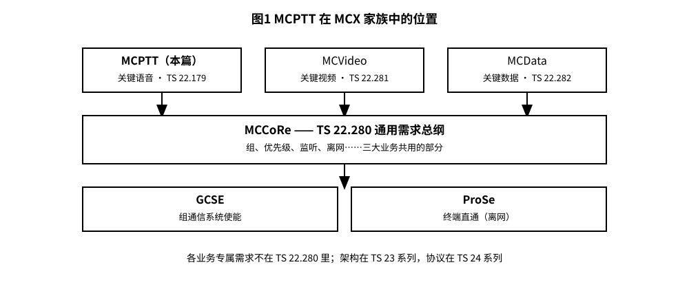
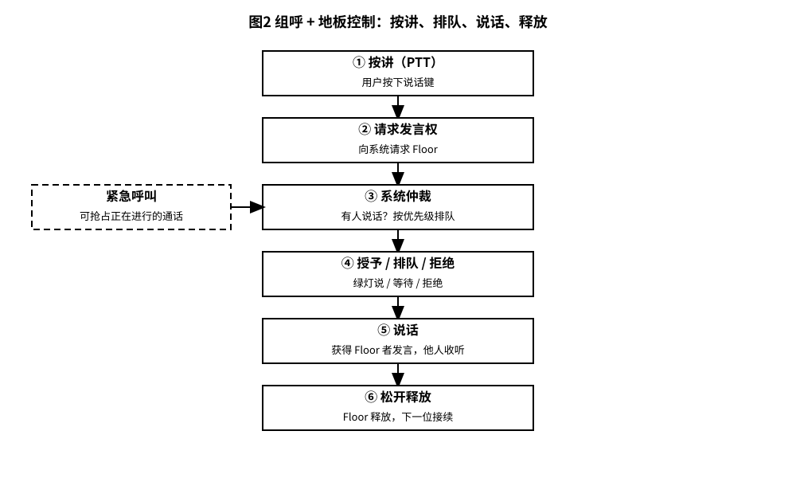
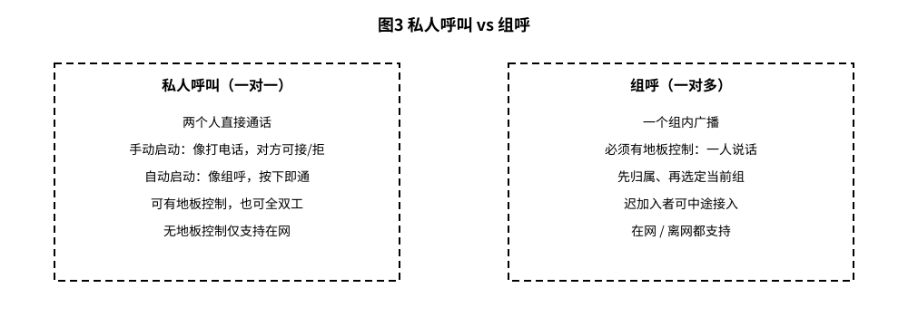
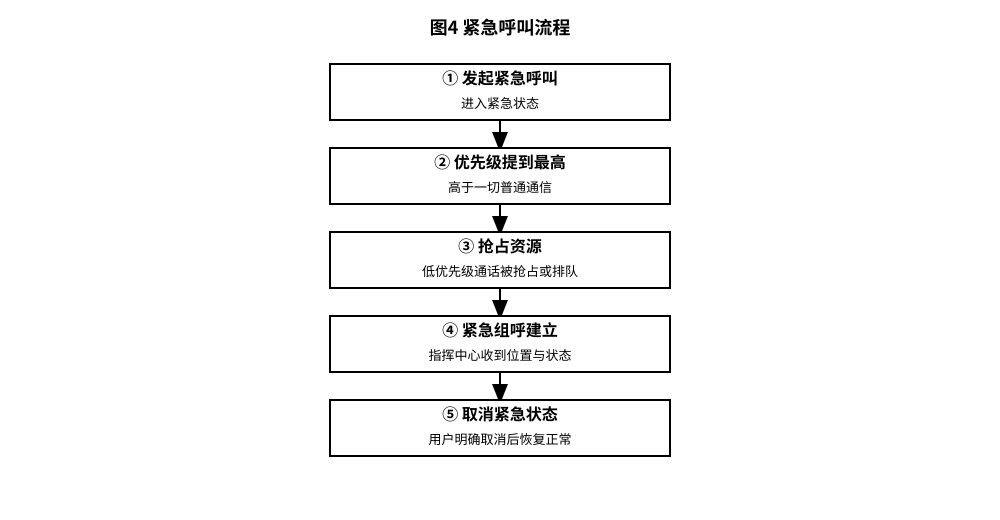

# 3GPP TS 22.179 解读：关键型对讲机 MCPTT——按一下，全组都听见

> 版本：v1.0 ｜ 更新：2026-10-28 ｜ 基线：TS 22.179 v20.0.0（Rel-20 口径；Rel-21 v21.0.0 仅跟踪）｜ 原文：whatthespec.net 抓取的关键条款

**MCPTT 就是走 3GPP 蜂窝网络（4G/5G）的“警用对讲机”，核心功能是**按讲即说（Push To Talk）**，让指挥中心能和分散在各地的警员/消防员/船员实时通话 [§1]。**

## 1. 它要解决什么问题

**传统对讲机（LMR/Land Mobile Radio）的痛点：**
1.  **覆盖有限**：自带基站，出远门没信号。
2.  **孤岛效应**：不同品牌、不同频率的对讲机互相听不懂，跨部门协作难。
3.  **无智能优先级**：传统对讲机靠“谁嗓门大谁先说”或简单的频道扫描，缺乏系统级的紧急抢占机制。
4.  **运维麻烦**：加人、改组、改权限，往往要拿电脑连线设备重新编程 [§4.2]。

**MCPTT 的目标：**
把对讲机的“即时性”和蜂窝网络的“广覆盖、高可靠、可管理”结合起来。
*   **广覆盖**：只要有 3GPP 信号（4G/5G），就能说话，警察出城、消防员进深山都不怕 [§1]。
*   **强优先级**：系统知道谁是队长、谁是新人，谁在着火现场、谁在办公室，自动分配话语权 [§4.6]。
*   **易管理**：指挥中心（Dispatcher）可以远程调整群组、推送权限，不用跑现场改设备 [§4.1]。

> **注意**：MCPTT 不仅用于公共安全（警察、消防、急救），也用于商业场景（电力抢修、铁路调度、海事通信） [§1]。

## 2. MCPTT 在 MCX 家族中的位置

3GPP 为关键通信（Mission Critical）设计了一套家族标准，统称为 **MCX**。TS 22.179 只负责定义 **MCPTT（语音）** 的需求，它不是孤立的，而是站在“巨人肩膀”上：

*   **顶层（应用层）**：
    *   **MCPTT**：语音对讲（本篇主角） [TS 22.179]。
    *   **MCVideo**：视频对讲。
    *   **MCData**：数据共享。
*   **中间层（通用使能层）**：
    *   **MCCoRe (Mission Critical Services Common Requirements)**：通用需求定义在 **TS 22.280** 中。比如用户鉴权、群组管理、位置服务、紧急状态标记等，这些是 MCPTT、MCVideo 共用的，所以 TS 22.179 不会重复写这些通用需求 [§1]。
*   **底层（基础能力层）**：
    *   **GCSE (Group Communications System Enablers)**：提供群组通信的基础能力。
    *   **ProSe (Proximity Services)**：提供近场通信能力，用于**离网**（无基站覆盖）场景下的直通通信 [§1], [§4.1]。

**架构与协议在哪？**
*   **架构（怎么连的）**：看 **TS 23.379**。
*   **协议（怎么说话的）**：看 **TS 24.379**。
*   **本篇（TS 22.179）**：只讲**需求（Requirements）**，即“系统必须做到什么”，不讲“具体怎么实现” [§1]。

*图 1 · MCPTT 在 MCX 家族中的位置：顶层 MCPTT（本篇）/ MCVideo / MCData，中间 MCCoRe 通用层（TS 22.280），底层 GCSE + ProSe。*

## 3. 核心概念大白话

### 3.1 组呼（Group Call）
*   **定义**：一个群组里的用户互相通话。
*   **大白话**：就像微信群语音通话，但只有一个人能说话，其他人听。
*   **状态**：用户必须先是“组成员（Member）”，然后“附属（Affiliate）”到该组，才能接收；如果要说话，必须将该组设为“选中组（Selected Group）” [§4.3]。
*   **特点**：一对多广播。

### 3.2 地板控制（Floor Control）
*   **定义**：决定谁有资格说话的机制。
*   **大白话**：就像会议室里的“发言权”。你想说话，得先举手（请求 Floor），主持人（系统/Dispatcher）点头（授予 Floor），你才能开口。如果两个人同时举手，系统根据优先级决定谁先说，另一个排队或被拒绝 [§4.1], [§7.3]。
*   **为什么叫“地板”？** 源于会议术语“holding the floor”（占据发言权）。

### 3.3 私人呼叫（Private Call）
*   **定义**：两个用户之间的一对一通信，不经过群组。
*   **大白话**：就像打私人电话，但走的是对讲机通道。
*   **两种模式**：
    1.  **手动启动（Manual Commencement）**：像打电话，对方会响铃，对方可以接、拒、或忽略 [§5.6.1]。
    2.  **自动启动（Automatic Commencement）**：像对讲机组呼，按下即通，没有响铃等待，立即传输语音 [§5.6.1]。
*   **注意**：私人呼叫也可以有地板控制（半双工），也可以没有（全双工，像普通电话）。但**无地板控制的私人呼叫仅支持在网（On-network）使用** [§5.6.1]。

### 3.4 紧急呼叫与迫近危险
*   **紧急呼叫 (Emergency Call)**：用户进入紧急状态，通信获得最高优先级，可以抢占正在进行的低优先级通话 [§4.6]。紧急状态会一直保持，直到用户明确取消 [§5.6.1 相关：见 TS 22.280 §5.6.1]。
*   **迫近危险 (Imminent Peril)**：比紧急状态稍低一级，但仍高于普通通信，用于处理迫在眉睫的危险（TS 22.179 §5.7.2.2 单列了迫近危险组呼的要求）。
*   **离网直通 (ProSe)**：没有基站覆盖时，设备之间通过 ProSe 无线直连通信，这是“离网模式”，不是“迫近危险”——两者不要混淆 [§4.1]。

### 3.5 动态重组
*   **定义**：指挥中心可以动态创建、合并、拆分群组。
*   **场景**：火灾现场，把“消防一组”和“消防二组”临时合并成“火灾突击组”，任务结束后自动解散 [§4.2]。

### 3.6 迟加入（Late Join）
*   **定义**：用户可以在通话进行中加入群组。
*   **大白话**：会议开了一半，新同事进来，他也能听到并请求发言。

## 4. 一次组呼是怎么完成的

*图 2 · 组呼 + 地板控制流程：按讲 → 请求发言权 → 系统仲裁 → 授予/排队/拒绝 → 说话 → 松开释放。*

（地板控制的请求/授予/排队/抢占机制见 §7.3 离网地板控制；在网组呼的地板控制见 §6.4，机制相同。）

**步骤详解：**

1.  **准备阶段（Affiliation）**：
    *   用户开机后，向网络注册，并“附属”到其所属的多个群组（如“巡逻一组”、“指挥室”） [§4.3]。
    *   此时，用户能**听**到这些群组的语音，但不能**说**。

2.  **选中阶段（Selection）**：
    *   用户通过按键或菜单，将“巡逻一组”设为**选中组（Selected Group）** [§4.3]。
    *   现在，用户具备了在“巡逻一组”中请求发言的资格。

3.  **请求发言（Request to Talk）**：
    *   用户按下 PTT 键（或触控屏上的“说话”按钮） [§6.15.3.1]。
    *   UE（用户终端）向网络发送“请求发言权”消息。

4.  **仲裁过程（Arbitration）**：
    *   如果当前没人说话，系统立即授予发言权（Floor Granted）。
    *   如果有人在说话，系统根据**优先级**判断：
        *   如果新用户优先级高（如紧急呼叫），可能触发**抢占（Override）**。
        *   如果优先级低，请求被**排队（Queued）**或**拒绝（Rejected）**。
    *   用户会收到反馈：绿灯亮（可以说话）或红灯/提示音（等待/拒绝）。

5.  **传输语音（Transmission）**：
    *   获得 Floor 的用户开始说话，音频数据通过 3GPP 网络传输给群组内其他附属用户 [§4.1]。
    *   其他用户听到语音，但他们的 PTT 键被逻辑“锁定”，直到当前说话者释放。

6.  **释放发言权（Release）**：
    *   用户松开 PTT 键，系统释放 Floor。
    *   如果队列中有等待者，下一个高优先级用户获得 Floor。

**关键指标：**
*   **MCPTT Access Time (KPI 1)**：从按下 PTT 到得到“可以说话”信号的时间 [§6.15.3.1]。
*   **End-to-end Access Time (KPI 2)**：从按下 PTT 到第一个接收者听到声音的时间 [§6.15.3.1]。

## 5. 关键时刻的能力

### 5.1 紧急呼叫（Emergency Call）
*   **触发**：用户发起紧急呼叫，进入紧急状态 [§4.6]。
*   **效果**：
    *   系统自动将用户优先级提升至最高。
    *   可以**抢占**正在进行的低优先级通话（Floor Override） [§7.3.3]。
    *   自动通知指挥中心（Dispatcher）用户位置和紧急状态 [§4.6]。
*   **取消**：紧急状态由用户明确取消。

### 5.2 地板抢占（Floor Override）
*   **定义**：高优先级用户强制中断低优先级用户的发言 [§7.3.3]。
*   **规则**：
    *   系统预配置优先级层次，至少包含 **4 个级别** [§7.3.3-003]。
    *   只有被授权的用户/设备才能触发抢占 [§7.3.1-001]。
    *   抢占后，被抢占者的语音被切断，抢占者的语音开始传输 [§7.3.3]。

### 5.3 离网直通（Off-network / ProSe）
*   **场景**：地震、洪水导致基站瘫痪，或深入无覆盖区域 [§4.1]。
*   **机制**：
    *   设备通过 **ProSe（近距离服务）** 进行无线直连 [§4.1]。
    *   功能与在网时尽量保持一致（如群组管理、优先级），但性能可能受限 [§4.1]。
    *   **地板控制在离网时依然有效**，由本地设备或主设备仲裁 [§7.3.1]。

### 5.4 与电话互通
*   **Dispatcher 接口**：指挥中心可以通过非 3GPP 方式（如普通电话、IP 电话）接入 MCPTT 系统 [§4.1]。
*   **用户侧**：普通用户通常使用 MCPTT UE（专用对讲机或手机 App），但管理员可以通过标准接口管理 [§4.1]。

## 6. MCPTT 与普通对讲机、与微信语音的区别

| 特性 | 传统 LMR 对讲机 | 微信/WhatsApp 语音 | MCPTT (TS 22.179) |
| :--- | :--- | :--- | :--- |
| **覆盖范围** | 有限（几公里~几十公里） | 广（依赖互联网） | 广（依赖 4G/5G），支持离网 ProSe |
| **发言控制** | 无仲裁，谁按谁说，易冲突 | 无仲裁，多人同时说话混音 | **地板控制**，严格仲裁，一人说话 |
| **优先级** | 无（或简单频道隔离） | 无 | **四级以上动态优先级**，支持紧急抢占 [§7.3.3] |
| **群组管理** | 本地编程，难变更 | 手动拉人，无角色 | **远程动态管理**，支持合并/拆分/推送 [§4.2] |
| **可靠性** | 高（专用频段） | 低（尽力而为） | **关键型（Mission Critical）**，高可靠 [§1] |
| **状态感知** | 无 | 无 | **知道谁在线、位置、紧急状态** [§4.6] |
| **离网能力** | 有（但仅限同频同品牌） | 无（需互联网） | **有（ProSe 近场直连）** [§4.1] |

*图 3 · 私人呼叫 vs 组呼：一对一悄悄话 vs 一对多广播；地板控制主要在组呼中体现。*

## 7. 它不管什么（边界）

1.  **Stage 1 只提需求**：TS 22.179 是 **Stage 1** 规范，只定义“必须做什么”（如“延迟必须小于 X ms”），不定义“怎么做”（如“用 SIP 还是 XMPP 协议”） [§1]。
2.  **音频编解码细节**：虽然提到了 MOS-LQO 和 AMR-WB 的性能要求 [§5.14]，但具体的编解码算法实现、参数配置在 **Stage 2/3** 规范中 [§5.14]。
3.  **通用需求**：用户鉴权、位置服务、紧急状态管理、群组配置等通用功能，定义在 **TS 22.280 (MCCoRe)** 中，TS 22.179 引用而不重复 [§1]。
4.  **具体协议**：信令流程、消息格式在 **TS 24.379** 中定义 [§1]。
5.  **架构设计**：网络实体连接关系、接口定义在 **TS 23.379** 中 [§1]。
6.  **GSM/UMTS**：本规范**不适用于** GSM 或 UMTS 网络，仅限 3GPP 系统（LTE/5G 及 ProSe） [§1]。

## 8. 怎么往下读

**建议阅读顺序：**

1.  **本篇（TS 22.179 v20.0.0）**：理解 MCPTT 的核心概念、流程、KPI 和优先级模型。这是“为什么”和“做什么”。
2.  **TS 22.280 (MCCoRe)**：理解通用使能器，如用户状态、位置、紧急处理、群组管理的通用需求。这是“公共基础”。
3.  **TS 23.379 (Architecture)**：看系统架构图，了解 MCPTT Server、AS（应用服务器）、UE 之间如何连接。这是“怎么连”。
4.  **TS 24.379 (Protocols)**：看具体的信令消息、SIP 扩展、状态机。这是“怎么说话”。

**版本说明：**
*   本文基于 **TS 22.179 v20.0.0** (Rel-20 基线) 解读。
*   Rel-21 (v21.0.0) 已出现，但本文仅跟踪，不纳入详解。
*   知识库原基线为 Rel-19 (v19.3.0)，本文按 Rel-20 口径更新。

**来源：**
*   3GPP TS 22.179: "Mission critical push to talk (MCPTT); Service requirements"
*   3GPP TS 22.280: "Mission critical communications (MCCoRe); Service requirements"
*   whatthespec.net 抓取的关键条款摘要

---

### 附录：关键条款速查

*   **[§1] Scope**: 定义 MCPTT 适用范围，排除 GSM/UMTS。
*   **[§4.1] General**: 定义 MCPTT 基于 3GPP 系统，支持在网/离网，支持 Dispatcher 接入。
*   **[§4.2] Typical use**: 描述警用典型场景，群组数量多，需远程管理。
*   **[§4.3] Overview**: 定义 Group Call, Private Call, Affiliation, Selected Group 概念。
*   **[§4.6] Priorities**: 定义动态优先级模型，支持与 CAD 系统交互。
*   **[§5.6] Private Call**: 定义私人呼叫的两种启动模式（手动/自动）。
*   **[§5.14] Audio quality**: 定义音频质量要求（MOS-LQO, AMR-WB）。
*   **[§6.15] Performance**: 定义 KPI 1 (Access Time) 和 KPI 2 (End-to-end Access Time)。
*   **[§7.3] Floor control**: 定义地板控制机制，包括请求、仲裁、抢占（Override），抢占优先级至少 4 级。

*图 4 · 紧急呼叫流程：发起紧急呼叫 → 优先级提到最高 → 抢占资源 → 组呼建立 → 取消紧急状态。*
