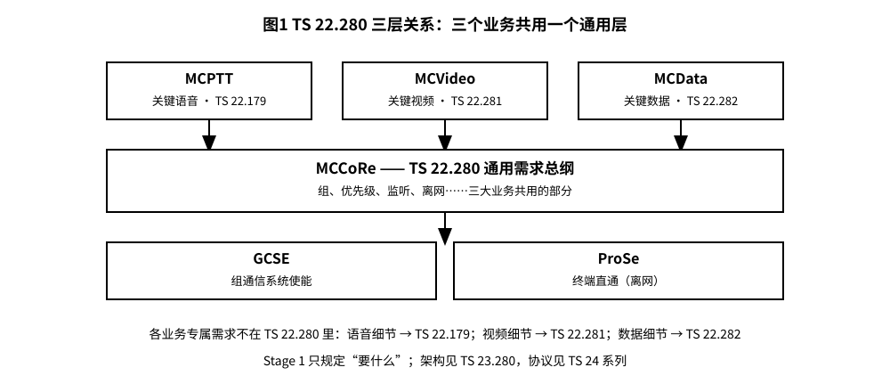
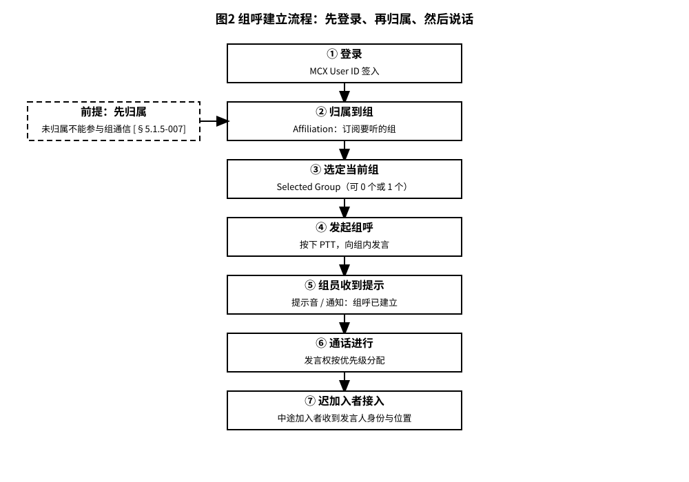
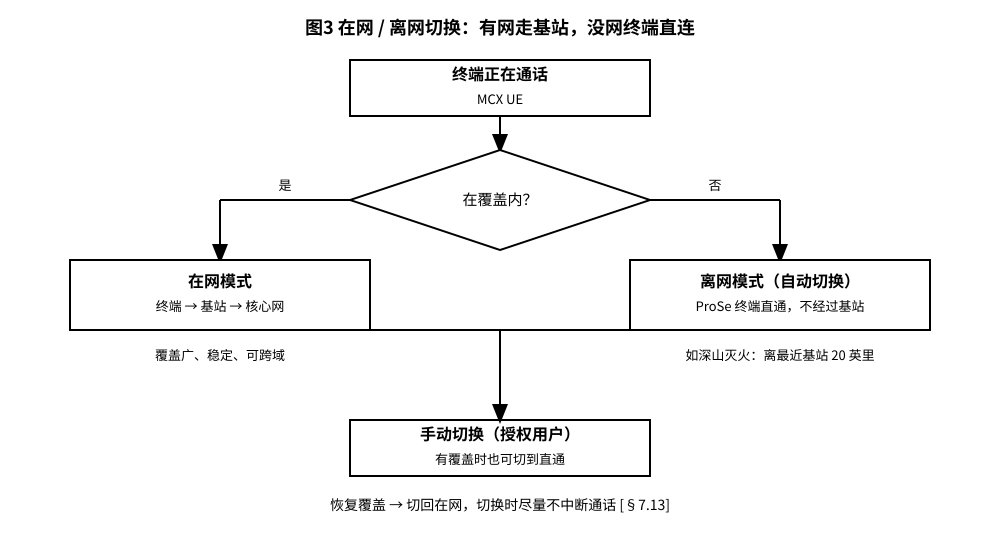
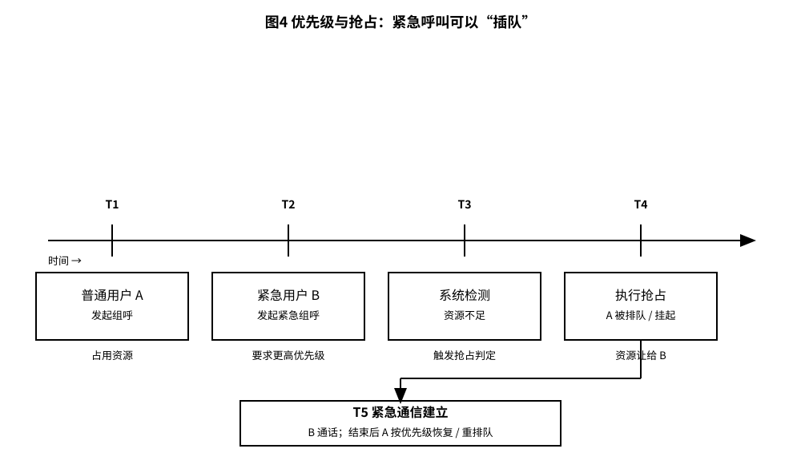
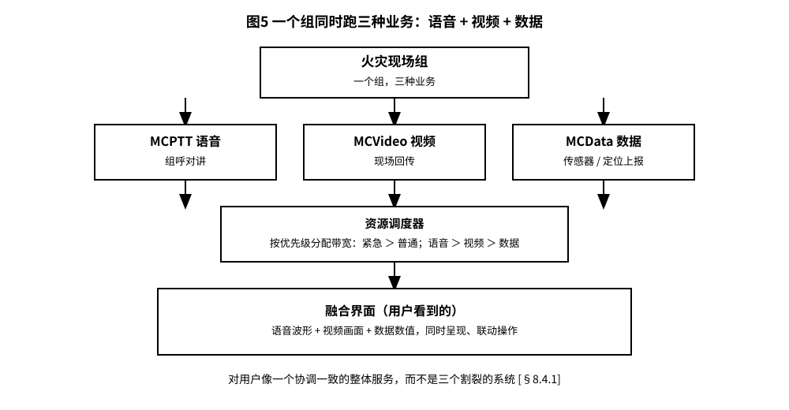

# 3GPP TS 22.280 解读：给警察、消防员和铁路的“通用对讲机”规则手册

> 版本：v1.0 ｜ 更新：2026-10-28 ｜ 基线：Rel-20 v20.2.0（2026-03-27）｜ 原文：whatthespec.net 抓取的 v20.2.0 全文关键条款

**TS 22.280 是 3GPP 为任务关键型服务（Mission Critical Services，简称 MCX）制定的**通用需求总纲**，它定义了 MCPTT（关键语音）、MCVideo（关键视频）和 MCData（关键数据）这三兄弟必须共同遵守的基础规则 [§1]。**

---

## 1. 它要解决什么问题
想象一下，你手里有三台不同的设备：一台是对讲机（MCPTT），一台是高清摄像头（MCVideo），一台是数据终端（MCData）。

如果这三样东西的底层逻辑（比如怎么登录、怎么加入小组、怎么抢信号）各写各的，那开发团队就得重复造轮子，用户用起来也会觉得割裂。TS 22.280 的出现，就是为了把这些**重复的部分抽离出来**。

以前，MCPTT 的需求全写在 TS 22.179 里。后来发现了 MCVideo 和 MCData，发现它们很多需求跟 MCPTT 是一模一样的（比如“我要能加入一个组”）。于是，3GPP 把这些共同的需求从 TS 22.179 里“搬”到了 TS 22.280 里，并在 TS 22.179 中把对应条款作废，只保留一个指向 TS 22.280 的索引 [§4.1]。

这样做的好处是：**“一次定义，多处复用”**。只要 TS 22.280 改了，所有三大业务的需求描述就同步更新了，避免了版本混乱 [§4.1]。

---

## 2. 三大业务与通用层的关系
为了搞清楚 TS 22.280 管什么、不管什么，我们需要理清三层关系。

*   **顶层：具体业务**
    *   **MCPTT (Mission Critical Push To Talk)**：关键型按讲对讲。这是最基础的，就像传统的警用对讲机，但走的是 3GPP 网络 [§1]。
    *   **MCVideo (Mission Critical Video)**：关键型视频。用于现场回传，比如无人机拍到的火灾现场 [§1]。
    *   **MCData (Mission Critical Data)**：关键型数据。传输非音视频的结构化数据，比如传感器读数、定位信息 [§1]。

*   **中间层：MCCoRe (Mission Critical Services Common Requirements)**
    *   这就是 TS 22.280 本身。它不关心你传的是声音、图片还是数据包，它只关心**通用的服务逻辑**：你怎么认证？你怎么加入组？谁的优先级高？离网了怎么办？ [§1, §4.1]

*   **底层：能力支撑**
    *   这些服务运行在 **GCSE (Group Communications System Enablers)** 和 **ProSe (Proximity Services)** 之上。GCSE 提供组通信的基础能力，ProSe 提供终端直通通信的能力 [§1]。

**专属需求在哪里？**
TS 22.280 只管“共性”。
*   MCPTT 特有的需求在 **TS 22.179** [§1]。
*   MCVideo 特有的需求在 **TS 22.281** [§1]。
*   MCData 特有的需求在 **TS 22.282** [§1]。

*图 1 · 三层关系：顶层三个业务（MCPTT / MCVideo / MCData），中间 MCCoRe 通用层（TS 22.280），底层 GCSE + ProSe 承载。*

---

## 3. 核心概念大白话
TS 22.280 里有几个核心概念，用生活类比来解释最清楚。

### 3.1 组与归属 (Membership/Affiliation)
*   **大白话**：你想听某个频道的广播，就得先“订阅”这个频道。在 MCX 里，这个动作叫“归属”（Affiliation）。
*   **规则**：
    *   用户必须先归属到某个组，才能参与该组的通信 [§5.1.5-007]。
    *   一个人可以同时归属多个组，但管理员可以限制你最多能加入多少个组（Nc2） [§5.1.5-004, §5.1.5-008]。
    *   你可以选择其中一个作为“当前选中组”（Selected Group），平时主要用它 [§5.1.5-006]。
    *   **生活类比**：就像你的微信群。你可以加很多群（归属多个组），但你的置顶群就是“当前选中组”。如果你想发一条消息给所有群，你得先确认哪些群是你被允许发的 [§5.1.1-002]。

### 3.2 职能别名 (Functional Alias)
*   **大白话**：有时候你不想用“张三”这个名字广播，而是想用“29号列车驾驶员1”这个身份。
*   **规则**：
    *   职能别名是绑定任务或角色的标签，比如 `DRIVER1_TRAIN29` [§5.9a.1]。
    *   用户登录后可以激活一个或多个别名 [§5.9a.1]。
    *   同一个别名可以分给多个人用（比如三班倒的值班调度员都叫同一个别名），由管理员决定 [§5.9a.1]。
    *   授权用户还可以把别人的别名接管过来，但“共用”和“接管”两种模式不能同时配给同一个别名 [§5.9a.1]。
    *   **生活类比**：就像你在公司钉钉上，平时显示“李四-市场部”，但当你去支援消防队时，你可以切换成“李四-临时救援组A”。别人看到你是“李四-临时救援组A”，就知道该按救援组的规矩跟你说话，而不是按市场部的规矩 [§5.9a.1]。

### 3.3 优先级与抢占 (Pre-emption)
*   **大白话**：火警电话来了，正在排队查快递的客服得让路。
*   **规则**：
    *   系统支持多级优先级 [§6.8.1-001]。
    *   资源不足时，有抢占权限的组呼可以抢占低优先级通信占用的资源来完成本次通信 [§6.8.1-005]。
    *   抢占不是随意的，必须在管理员设定的层级范围内进行 [§6.8.1-003]。
    *   **生活类比**：高速公路上的应急车道。平时没人走，但救护车（高优先级）来了，它可以直接开进去，而正在堵车的小轿车（低优先级）必须靠边让行或等待。

### 3.4 动态重组 (Dynamic Regrouping)
*   **大白话**：临时拉个“作战小组”，任务结束就解散。
*   **规则**：
    *   授权用户可以把现有的组或用户临时拼成一个新的临时组 [§6.6.1-001]。
    *   这个临时组会一直存在，直到被授权用户手动解散 [§6.6.1-002]。
    *   临时组的优先级由创建者在管理员设定的范围内决定 [§6.6.1-003]。
    *   **生活类比**：你在微信群里建了一个“今晚聚餐群”，把几个朋友拉进去。吃完饭后，你解散了群。这个群在解散前是一个独立的实体，可以单独设置免打扰等属性 [§6.6.1-004]。

### 3.5 私人通信 (Private Communication)
*   **大白话**：一对一的悄悄话，不经过组广播。
*   **规则**：
    *   调度员或授权用户可以配置哪些内容源（比如现场摄像头）可以直接向特定用户发送内容 [§5.5.1-001]。
    *   私人通信通常用于指挥调度，而不是大众广播。

### 3.6 广播组与迟加入 (Broadcast Group & Late Entry)
*   **大白话**：广播组就像单位的大喇叭，只有一个人能喊话，其他人只能听；迟加入就是会议开到一半你推门进来，系统得立刻把“谁在说话、在哪个组、人在哪”告诉你。
*   **规则**：
    *   广播组通信里只有发起成员能发言，除非被主管等授权人改写 [§5.2.1-002]。
    *   已归属的组员可以中途加入正在进行的组通信 [§5.3-001]；迟加入者会收到正在发言人的身份、组名、别名、所属机构，如果允许还能拿到发言人的位置 [§5.3-002, §5.3-003]。
    *   如果有人开会时暂时掉线或正在更高优先级的通话里，系统会在他们可用时把他们补加进来 [§5.3-004]；通话中新归属的成员也会被加进来 [§5.3-005]，其他参与者可能收到“有人加入”的提示 [§5.3-006]。

*图 2 · 组呼建立流程：登录 → 归属 → 选定当前组 → 发起组呼 → 组员收到提示 → 通话 → 迟加入者中途接入。*

---

## 4. 在网 vs 离网
这是 MCX 服务最酷炫也最实用的特性：它不依赖单一的传输路径。

### 4.1 在网模式 (On-Network)
*   **原理**：走基站，走核心网。就像你平时用 5G 打电话一样。
*   **特点**：覆盖广，稳定，可以跨越城市甚至国家边界。

### 4.2 离网模式 (Off-Network)
*   **原理**：走 **ProSe Direct**（终端直通）。手机/终端之间直接通信，不经过基站 [§7.1]。
*   **场景**：
    *   **无覆盖区**：消防员在深山灭火，离最近的基站有 20 英里，手机没信号，但消防员之间的对讲机还能用，因为他们是 ProSe 直连 [§7.1]。
    *   **受限空间**：警察在密闭建筑内部抓捕，信号被墙体阻挡，基站信号进不来，但警察之间的终端可以近距离直连。
*   **切换机制**：
    *   当终端检测到脱离网络覆盖时，可以**自动切换**到 ProSe 直连模式 [§7.13-001]。
    *   授权用户也可以**手动切换**到 ProSe 直连，即使有网络覆盖（比如为了省电或提高局部可靠性） [§7.13-002]。
    *   切换时系统要尽量减小对正在进行中的通信的中断 [§7.13-004, §7.13-005]。

*图 3 · 在网 / 离网切换：在覆盖内走基站；检测到无覆盖自动切 ProSe 直通；恢复覆盖切回，切换尽量不中断通话。*

---

## 5. 关键时刻的能力
在生死攸关的时刻，TS 22.280 规定了一系列“保命”功能。

### 5.1 紧急组呼与迫近危险 (Emergency & Imminent Peril)
*   **紧急状态 (Emergency State)**：
    *   当用户按下紧急按钮，系统进入“紧急状态” [§5.6.1]。
    *   此时，用户的通信会获得**更高的资源获取优先级** [§5.6.1]。
    *   紧急警报（Emergency Alert）即使用户未登录也能发送；如果用户认证没通过，会被当作权限受限的临时用户处理 [§5.6.1]。
    *   警报包含用户 ID、可能有的组 ID、所属机构名和终端最新位置 [§5.6.1]。
*   **迫近危险 (Imminent Peril)**：
    *   比紧急状态稍低一级，但仍高于普通通信，用于处理迫在眉睫的危险 [§5.6.1]。

### 5.2 悄悄监听 (Discreet Listening)
*   **原理**：授权用户（如督导员）可以监听目标用户的所有通信，但**目标用户毫不知情** [§6.15.1-001a]。
*   **用途**：监督执法规范性、调查内部违规行为。
*   **规则**：
    *   监听者可以看到目标和第三方之间的媒体和元数据 [§6.15.1-001, §6.15.1-002]。
    *   目标用户不知道自己在被监听 [§6.15.1-001a]。
    *   支持录音和回放，用于事后分析 [§6.15.1-005]。
    *   如果目标用户有多个设备，监听者能看到是哪个设备在通信 [§6.15.1-006]。

### 5.3 环境监听 (Ambient Listening)
*   **原理**：这是比悄悄监听更隐蔽的功能。它让目标用户的终端**变成一部麦克风**，把周围环境的声音传回给监听者，但终端上**没有任何提示** [§6.15.2.1]。
*   **场景**：
    *   警察被扣押，手机被没收或关机。
    *   或者，警察在卧底，需要知道周围发生了什么，但不能让嫌疑人发现他在录音。
*   **规则**：
    *   终端上没有任何传输指示 [§6.15.2.2.1-002]。
    *   如果别人试图关掉正在被环境监听的终端，终端会**假装关机**，但监听仍在继续 [§6.15.2.2.1-003]。
    *   这种通信是单向的，信息只发给监听者 [§6.15.2.2.1-001]。

### 5.4 IOPS 孤岛模式 (Island Operation)
*   **原理**：当基站断了回传（Backhaul），基站变成一个“孤岛”。
*   **规则**：
    *   MCX 服务必须在 IOPS 模式下继续工作 [R-10-001]。
    *   虽然服务可能降级（比如带宽不足），但基本的组通信必须可用 [R-10-001 NOTE]。
*   **生活类比**：就像一座岛上的电台，虽然跟大陆断了联系，但岛上的人还能通过电台互相喊话。

### 5.5 空地空通信 (Air-Ground-Air)
*   **原理**：支持飞机和直升机之间的实时通信，以及空地之间。
*   **规则**：
    *   支持高度最高 **15,000 英尺**，速度最高 **450 km/h** 的通信 [R-9.2-001]。
    *   这是为了确保应急救援飞机在高速飞行中不掉线。

*图 4 · 优先级与抢占：普通组呼占用资源时，紧急组呼到达、资源不足，系统抢占低优先级通信，紧急通信建立后低优先级再恢复。*

---

## 6. 一个组同时跑三个业务
TS 22.280 的第 8 章描述了**业务间互通 (Inter-MCX Service Interworking)**。

### 6.1 单组多业务
*   **大白话**：一个“消防组”，既包含语音对讲（MCPTT），又包含视频回传（MCVideo），还包含传感器数据（MCData）。
*   **规则**：
    *   用户归属到一个组时，这个组可以同时支持多种业务 [§8.4.1]。
    *   对用户来说，这应该看起来像是一个**协调一致的整体服务**，而不是三个割裂的系统 [§8.4.1]。
    *   例如，用户加入“火灾现场组”，他既能听到调度员的语音，又能看到现场视频，还能看到温度数据，且这些操作是联动的。

### 6.2 业务间优先级
*   当一个组里同时有语音、视频和数据流量时，系统需要决定谁优先。
*   第 8 章指出，MCData 内部的多个应用也可能存在互通限制，因此第 8 章的要求也应作为 MCData 内部互通的指导原则 [§8.1]。
*   这意味着，**优先级管理是跨业务的**，不仅仅是组与组之间，也是业务与业务之间。

*图 5 · 单组多业务协同：同一“火灾现场组”内语音、视频、数据并行，经资源调度器按优先级分配带宽，用户看到一个融合界面。*

---

## 7. 它不管什么（边界）
TS 22.280 是 **Stage 1** 规范，即**业务需求规范**。它只告诉开发者“**要做什么**”（Shall），而不告诉开发者“**怎么做**”（How）。

*   **不管架构**：具体的网络架构、实体定义、接口定义在 Stage 2 规范 **TS 23.280** 中。
*   **不管协议**：具体的信令协议、编解码细节在 Stage 3 的 TS 24 系列中（MCPTT 用 TS 24.379、MCVideo 用 TS 24.281、MCData 用 TS 24.282，通用部分用 TS 24.483 / TS 24.484）。
*   **不管非 3GPP 网络**：本规范不适用于 GSM 或 UMTS 网络 [§1]。
*   **不管具体应用逻辑**：TS 22.280 只是通用需求，具体的业务逻辑在各自的 TS 22.x 规范中 [§1]。
*   **不管监听的授权层级**：悄悄监听可以设多级授权，但这属于 3GPP 范围之外的事 [§6.15.1 NOTE]。

**重要提示**：
TS 22.280 文末的附录 A/B/C 分别列出了适用于 MCPTT、MCVideo、MCData 的需求清单。阅读时，必须结合附录来确定某个需求是否适用于你关注的特定业务。

---

## 8. 怎么往下读
如果你是标准工程师或产品经理，建议按以下路径阅读：

1.  **先读本篇 (TS 22.280)**：
    *   重点看 **第 5 章（通用需求）**、**第 6 章（在网专属）**、**第 7 章（离网专属）**。
    *   理解“组”、“优先级”、“监听”等核心概念。
    *   查看附录，了解哪些需求适用于 MCPTT，哪些适用于 MCVideo。

2.  **再读各业务专属规范**：
    *   **MCPTT**：读 **TS 22.179**。注意其中被作废的条款，它们已移至 TS 22.280 [§4.1]。
    *   **MCVideo**：读 **TS 22.281**。
    *   **MCData**：读 **TS 22.282**。

3.  **深入架构与协议**：
    *   **架构**：读 **TS 23.280**，了解如何搭建这套系统。
    *   **协议**：读 **TS 24.379 / 24.281 / 24.282 / 24.483 / 24.484**，了解信令细节。

4.  **版本说明**：
    *   本文解读基于 **Rel-20 基线**，版本号为 **TS 22.280 v20.2.0**，发布于 **2026-03-27**。
    *   **Rel-21** 版本 v21.0.0 已于 **2026-10-02** 发布，本文不纳入其内容，仅作跟踪。
    *   其他版本数字一律不予讨论，以确保信息的准确性和时效性。

---

## 来源与版本
*   **标准文档**：3GPP TS 22.280 v20.2.0
*   **标题**：Mission Critical Services Common Requirements (MCCoRe)
*   **基线**：Rel-20
*   **发布日期**：2026-03-27
*   **适用范围**：MCPTT, MCVideo, MCData 的通用需求
*   **不适用于**：GSM, UMTS
*   **数据来源**：whatthespec.net 抓取的 v20.2.0 全文关键条款

*(注：本文为 ELI5 风格解读，旨在帮助非专业读者理解核心概念，具体实施请以 3GPP 官方规范原文为准。)*
