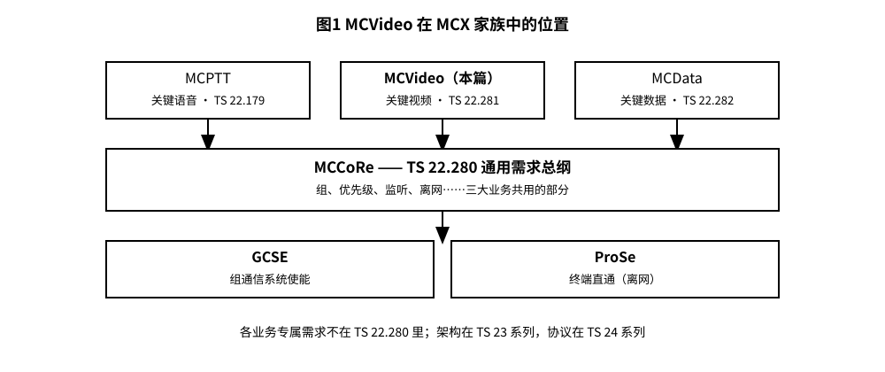
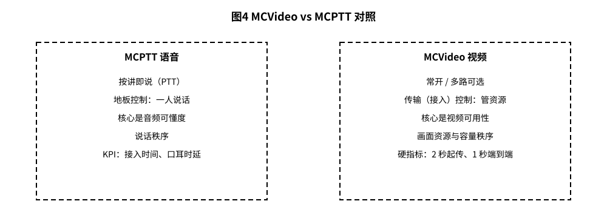
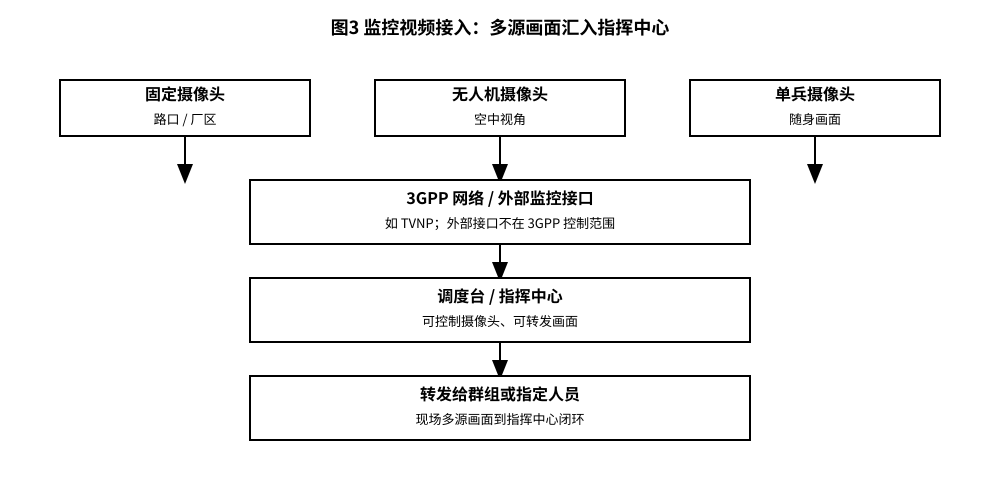
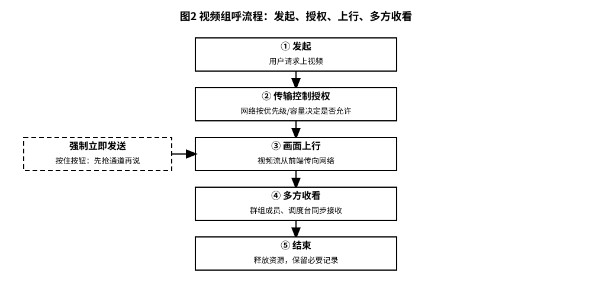

# 3GPP TS 22.281 解读：关键型视频 MCVideo——把现场画面实时传回指挥中心

> 版本：v1.0 ｜ 更新：2026-10-28 ｜ 基线：TS 22.281 v19.0.0（Rel-19）｜ 原文：whatthespec.net 抓取的关键条款

**MCVideo 是一套“给警察、消防、急救等关键任务场景用的实时视频对讲服务需求”。它不是普通的视频会议，而是把“人在现场、画面回传、多方可见、随时可用、足够安全”这些要求写进 3GPP 服务标准里，让通信网络知道：这路视频很重要，要保证优先级和可靠性 [§4.1]。**

你可以理解成：对讲机从“只听声音”升级到“声音+画面”，而且这套画面要能在紧急、拥塞、移动甚至离网情况下尽量不掉链子 [§4.1]。

---

## 1. 它要解决什么问题

### 1.1 语音有时候真的不够用

火场有多大、浓烟从哪冒、嫌疑人穿什么、车牌是多少、前方道路塌方没有——这些信息，语音很难准确传达，或者传递起来很慢。MCVideo 的目标，就是把现场画面实时传回去，让指挥中心“看见现场”并快速做判断 [§4.1]。

### 1.2 “关键任务”意味着更高的门槛

MCVideo 里的 Mission Critical（关键任务）指的是满足公共安全等机构的需要，例如警察、消防、急救等（不限于此）。这些需要包括：高可达性（找得到人/连得上）、高可用性与可靠性（尽量不中断）、低时延（能实时指挥）、实时操作能力、高安全性、与其他系统互通、私密与群组通信、应急处理，以及能提供优先级、抢占、排队与 QoS（服务质量）保障 [§4.1]。

### 1.3 谁可以用、跑在哪类网上

- MCVideo 可用于公共安全、海事安全，也可用于一般商业场景，例如公用事业公司、铁路、海事相关用途 [§1]。
- 这套规范的需求不适用于 GSM 或 UMTS [§1]。
- MCVideo 设计用于在商用或专用 3GPP 传输网络上传输；虽然服务本身“预计不局限于只在 3GPP 网络上使用”，但本文件在制定时并未考虑在其他传输网络上的性能表现 [§4.1]。

一句话：它偏爱 3GPP 网络（4G/5G 这类系统），但标准也承认现实里可能不只走 3GPP；至于“不走 3GPP 时表现如何”，本规范没负责评估 [§4.1]。

---

## 2. MCVideo 在 MCX 家族中的位置

### 2.1 MCX 家族：一套“关键任务通信”的组合拳

MCVideo 不是凭空造轮子。它复用了一组已经存在的“群组通信能力”，并加上视频专属的需求。标准原文说：MCVideo 使用群组通信系统使能能力（Group Communication System Enablers，GCSE）、邻近服务（Proximity Services，ProSe）、面向公共安全的隔离 EUTRAN 运行（Isolated EUTRAN operation for Public Safety），以及关键任务服务通用需求（Mission Critical Services Common Requirements，MCCoRe），并在此基础上增加 MCVideo 服务特有需求 [§1]。

为了让你快速建立“家族树”的概念，可以先看一张位置图：

*图 1 · MCVideo 在 MCX 家族中的位置：顶层 MCPTT / MCVideo（本篇）/ MCData，中间 MCCoRe 通用层（TS 22.280），底层 GCSE + ProSe。*

### 2.2 MCVideo 与 MCPTT：同一套底座，两种“现场沟通方式”

MCVideo 使用了许多最初为 MCPTT 定义、如今大多在 MCCoRe 规范中做 Stage 1 描述的能力，包括但不限于：群组通信、群组管理、成员隶属（Affiliation）、安全与保密。并且 MCVideo 还允许同一用户配置多个用户档案，并同时使用多个终端（UE） [§4.2]。

但两者也有明显差异，尤其在“现场秩序怎么维持”这件事上：

- MCPTT（语音）：靠“地板控制（floor control）”来保证秩序。群里多人同时讲话会让语音听不清，所以需要一种机制决定“此刻谁可以说、谁必须等”，用秩序和优先级来管理现场沟通 [§4.2]。
- MCVideo（视频）：控制方式更“多样”，用“接入控制（admission control）”来根据用户优先级与终端能力管理对网络资源的合理接入；在某些情况下，这可能包括限制群组内不同用户同时发送视频（通常是出于网络容量或终端能力限制）。从用户角度看，同一群组内未必需要像语音那样严格限制“同时发、同时看”——如果终端能拿到多路视频流，用户可以自己选择看哪路、是否同时看多路 [§4.2]。

为了直观对照，建议看：

*图 4 · MCVideo vs MCPTT 对照：语音按讲 vs 视频常开、地板控制 vs 传输控制、音频可懂度 vs 视频可用性。*

### 2.3 规范之间的分工（避免读错书）

本篇解读的对象是 TS 22.281，它主要是“服务需求（service requirements）”层面的规范，回答“MCVideo 应该能做什么、要满足哪些关键指标”。

家族关系分工：
- 通用需求层对应 TS 22.280（MCCoRe）；
- 系统架构对应 TS 23.281（知识库基线：Rel-20 v20.5.1）；
- 协议细节对应 TS 24.281（知识库基线：Rel-20 v20.1.0）。
注意：本篇是 Rel-19 v19.0.0，架构与协议的基线版本是 Rel-20，阅读时以各规范自身的版本为准。

---

## 3. 核心概念大白话：把“视频关键任务”拆成几件事

MCVideo 服务包含的能力很多，标准列出了从“拍到传再到存”的一系列环节 [§4.1]。我们可以把它们揉碎，按使用者视角理解成五类核心概念。

### 3.1 视频组呼（Group Video）：不是开会，是“现场多视角共享”

MCVideo 可以是一个单独的视频群组服务，也可以作为多媒体 MCX（MCX）群组服务中的一种媒体流存在：一路 MCVideo 视频流可以关联到一个独立的 MCVideo 用户群组，也可以是某个多媒体 MCX 群组中的一路流 [§4.1]。

大白话：
- 有任务时，前线几个人同时开视频，指挥中心可以同时看到不同角度；
- 有的场景是“一路主画面”，有的场景是“多路供选择”，终端能收到多路时，用户自己挑着看 [§4.2]。

### 3.2 传输控制（视频版的“地板控制”）：管的不是“谁说话”，而是“谁上画面、占多少资源”

如上一节所述，MCVideo 用接入控制来按优先级与终端能力分配网络资源，并可能在容量紧张时限制同时上传送的视频路数 [§4.2]。

你可以把“地板控制”想成“话筒权限管理”；MCVideo 的传输控制则更像“画面权限+网络资源闸门”：
- 平时：允许有资格的人把画面发给群组；
- 紧急时：允许“强制立即发送”（详见第 4 节）；
- 拥塞时：网络可以限制同时视频数量，避免所有人都在传画面导致谁都看不了 [§4.2]。

### 3.3 视频监控接入（Video surveillance）：把摄像头也拉进关键任务体系

监控摄像头也可以使用 MCVideo 服务。此时除了摄像头原本的存储与监控活动之外，授权用户还可以接入、控制、接收视频，并将其转发给个人或群组 [§4.3]。

监控能力还包括：
- 本地/远程自动或按需触发视频流；
- 控制摄像头的方位、光学与视频参数；
- 识别视频特征（对画面内容做特征识别） [§4.3]。

摄像头可以完全属于 MCVideo 系统，也可以通过现有外部接口接入（例如监控摄像头网络的外部接口）。这种情况下，外部接口需要能提出控制请求并转发视频流，并与摄像头原有的控制网络协同管理；该外部接口不在 3GPP 控制范围内，且可能使用既有标准来实现部分或全部功能，例如 TVNP [§4.3]。

为方便理解现场拓扑，可参考：

*图 3 · 监控视频接入：固定摄像头、无人机、单兵摄像头三类视频源汇入，经网络或外部接口到调度台，再转发给群组。*

### 3.4 私人视频、用户档案与终端配置：谁能看、看什么、怎么看

MCVideo 不仅讲“群”，也讲“个人”：
- 服务支持与关键任务/公共安全级别的功能，例如群组会话、成员隶属、端到端保密、应急类型通信等 [§4.1]。
- 同一用户可以有多个用户档案，并可同时使用多个终端 [§4.2]。
- MCVideo 终端（MCVideo UE）是具备视频采集（比如有摄像头）、视频呈现（有显示屏）或两者兼备的设备，通常还具备编解码、通信与存储能力 [§4.1]。

大白话：你可以把“档案”理解成“不同任务身份/角色”，不同身份能看到不同的内容、加入不同的群；同一人拿着手机和随身摄像头，也能同时参与不同侧的任务视角。

### 3.5 视频质量与性能：不是“看起来差不多”，而是“关键时刻必须能用”

MCVideo 对视频编解码与传输提出了非常“现场导向”的要求，挑几条容易感知的：

- 编解码应能压缩/记录分辨率从很低到很高的实时视频信息，并且要适应不同移动条件（从静止到高移动）以及从昏暗到眩光高亮的光照变化 [R-5.1.1.1-001]。
- 视频编解码要能支持车牌识别、人脸与指纹识别以及场景概览 [R-5.1.1.1-002]。
- 服务要支持只能接收视频的终端（没有摄像头）、只能发送视频的终端（例如交通摄像头）、以及收发都支持的终端 [R-5.1.1.1-002a/b/c]。
- 服务要支持传输所有 3GPP 规定的视频帧率与分辨率 [R-5.1.1.1-002d]。
- 在允许传输已存储视频、刚采集视频或两者兼有时，编解码要能在带宽与时延受限时通过降低分辨率/改变色度来更快传输 [R-5.1.1.1-003]。
- 终端应支持以业界广泛使用的格式渲染视频片段 [R-5.1.1.1-004]。
- 解码要能做到“细节导向的可懂性”，让人能看清关键细节 [R-5.1.1.1-005]。
- 编码器应提供自动自适应与手动设置，并且能迅速且可预测地反映参数变化 [R-5.1.1.1-006]。
- 压缩率与质量至少应与符合 H.264 的编解码实现“通常合理预期”的水平相当 [R-5.1.1.1-007]。
- 在能力、容量与配置允许时，终端应可支持未压缩或无损压缩视频的生成、存储、传输与呈现 [R-5.1.1.1-008]。

换句话说，MCVideo 不仅要求“能传视频”，还要求“传的视频在关键时刻看得清、传得快、能适应极端光照与移动场景，并且不同终端都能接入”。

---

## 4. 一次视频组呼是怎么完成的

这里用一个典型流程讲清楚：前线发起视频 → 网络做传输控制（接入控制）→ 画面上行 → 多方收看 → 结束。

*图 2 · 视频组呼流程：发起 → 传输控制授权 → 画面上行 → 多方收看 → 结束。*

### 4.1 发起：用户“想上画面”，终端先准备好

MCVideo 终端通常具备采集、编解码、通信与存储能力 [§4.1]。当用户希望把现场画面给某个群组时，终端需要把视频采集并编码，然后请求网络把视频流传给相应群组 [§4.1]。

### 4.2 传输控制授权：网络决定“现在能不能传、怎么传”

MCVideo 采用接入控制来管理对网络资源的合理接入，可能包括限制不同用户同时发送视频的情况 [§4.2]。

大白话：就像高峰期的收费站——不是谁想上都能一股脑全上，得看优先级、看容量、看终端能力，避免“大家都传导致谁都看不了”。

### 4.3 画面上行：普通发送与“按住强制立即发送”

标准描述了两种很典型的用户动作：

- 普通方式：用户按下发送视频，然后等待网络按接入控制策略允许其向所属群组进行流传输 [§4.2]。
- 强制立即：用户可能能够“强制”立即传输视频信息，例如通过按住发送视频的按钮。此时终端会立即行动，在允许的情况下尽快采集视频并转发；同时终端会把“这是立即/紧急性质”的信息告知网络。网络可以选择授权接入并在本地存储后再转发，或者立即向相关群组进行流传输 [§4.2]。

这带来一个非常实用的含义：关键时刻，你可以先“抢通道”，让现场画面尽快进入系统；至于是否立即广播给群组、还是先存后转，网络可以按策略决定 [§4.2]。

### 4.4 多方收看：群组内“多路可选”，看哪路由用户决定

如前所述，MCVideo 不假定必须像语音那样严格限制同一时刻多人发言；如果终端能拿到不同视频流，用户可以选择看哪一路，或同时观看多路 [§4.2]。同时，MCVideo 也可以作为多媒体 MCX 群组服务中的一路流存在，支持更复杂的多媒体协同 [§4.1]。

### 4.5 结束：撤下画面，但关键证据要“留得住”

会话结束后，重点是：关键任务场景经常需要留存证据。MCVideo 明确包含“安全操作”，使得视频信息在用于证据程序时可以被合理地视为难以质疑（reasonably un-impeachable） [§4.1]。

大白话：不是随手录个像就行，而是从采集、传输、存储到使用的链路里都要有“安全与可追溯”的意识，让证据链更稳。

### 4.6 关键时刻的硬指标：启动要快、端到端要短、音视频要同步

MCVideo 对紧急实时视频给出几条非常硬的时延要求：
- 紧急实时视频传输应在请求后 2 秒内开始传输 [R-5.4.2-001]。
- 从发送 UE 到接收 UE 或控制台的端到端时延不超过 1 秒 [R-5.4.2-002]。
- 如果发送终端被配置为从用户请求传输开始就立即存储视频，那么端到端时延不应超过 1 秒加上开始延迟（最多 2 秒） [R-5.4.2-003]。
- 非紧急但具有实时优先级的视频，端到端时延不超过 10 秒 [R-5.4.2-004]。
- 在接收终端或控制台播放时，音视频同步应在 50 毫秒内 [R-5.4.2-005]。

---

## 5. 关键时刻的能力：监控、紧急视频、离网、互通

### 5.1 监控摄像头接入：从“被动监控”到“可被调度的现场眼睛”

第 3.3 节已经讲了 MCVideo 能把监控摄像头纳入体系：可远程/本地触发视频流、可控制摄像头参数、可识别视频特征，并且支持通过外部接口接入既有监控网络（如 TVNP 示例） [§4.3]。

工程意义在于：
- 指挥中心不只是“调录像”，还能在关键时刻“远程看实时画面”；
- 能对摄像头云台、光学参数进行控制，相当于远程转动“眼睛”、调焦、适应光线；
- 外部接口把既有监控系统拉进来，减少重建成本，但该接口不在 3GPP 控制范围内 [§4.3]。

### 5.2 紧急视频：可以“强制立即发”，网络按紧急策略处理

MCVideo 明确支持紧急类型的通信，并包含应急处理能力 [§4.1]。结合前面讲的“按住强制立即发送”，你可以把紧急视频理解成：
- 用户触发“立即”动作；
- 终端立刻采集并上报“立即性质”；
- 网络决定立即转发，或先授权接入并本地存储后再转发 [§4.2]。

同时，紧急实时视频要满足“2 秒内开始传输、端到端不超过 1 秒”这类硬指标 [R-5.4.2-001/002]。

### 5.3 离网视频：不指望“永远有网”，但要求能力尽量一致

标题里出现“on network and off network”的章节，表明 MCVideo 的需求里考虑了在网与离网两类情形下的服务能力 [§5.1]。

但要注意边界：MCVideo 设计用于商用或专用 3GPP 传输网络；服务本身“预计不局限于 3GPP 网络使用”，不过本规范并未考虑在其他传输网络上的性能表现 [§4.1]。

大白话：标准承认现场可能脱离网络覆盖，并希望关键能力尽量可用；但“离开 3GPP 网络后到底表现如何”，不在本服务需求规范的评估范围内。

### 5.4 与非 3GPP 视频系统互通：能用外部接口“接进来”，但不替外部标准背书

监控摄像头的例子最能说明互通态度：可以通过现有外部接口从 MCVideo 服务连接到既有监控摄像头网络；该外部接口预计提供控制请求与视频转发能力，并与摄像头原有控制网络协同。这个接口在 3GPP 控制范围之外，且可能采用既有标准（例如 TVNP）实现部分或全部功能 [§4.3]。

换句话说：
- 3GPP 负责把“需求”说清楚：我需要能接入、能控制、能转发；
- 真要跟既有监控体系对接，可能要用行业既有接口/标准（如 TVNP 这类示例），但 3GPP 不在这里替你规定外部世界怎么实现 [§4.3]。

---

## 6. MCVideo 与普通视频通话、与行车记录仪的区别

### 6.1 MCVideo vs 普通视频通话：不是“能不能打视频”，而是“关键时刻能不能顶住”

MCVideo 面向关键任务，标准明确列出其需要包括高可达性、可用性与可靠性、低时延、实时操作能力、高安全、互通性、私聊与群聊、应急处理，以及优先级、抢占、排队与 QoS 等能力 [§4.1]。

把这些词翻译成生活对比：
- 普通视频通话：更多是“一对一、尽量顺畅”；
- MCVideo：更像“任务系统里的视频总线”，要能在拥挤、紧张、移动、强安全要求下，给到关键用户优先权与更稳的体验 [§4.1]。

另外，MCVideo 在编解码策略上强调“转码不受欢迎（not desirable）”，理由包括复杂度与效率，以及为了支持端到端加密（end-to-end ciphering） [§4.9]。这意味着关键视频更希望“端到端一致、一路安全到底”，而不是中间被迫转码增加风险与时延 [§4.9]。

### 6.2 MCVideo vs 行车记录仪：一个是“证据留存”，一个是“任务可视与指挥闭环”

行车记录仪（或类似设备）也能录视频，但它通常是单机、事后看；MCVideo 强调的是：
- 实时回传与多方可见（群组/控制台） [§4.1]；
- 支持关键任务功能（群组会话、隶属、端到端保密、应急通信等） [§4.1]；
- 支持把监控摄像头、单兵摄像头、无人机等多源画面接入并转发 [§4.3]；
- 对移动场景有明确指标：支持收/发终端以不同速度（从 0 km/h 到 160 km/h）进行一对一或群组视频通信；并注明“假设通过特殊设计，高速列车通信可能实现” [R-5.4.1.2-001/002]。

当然，MCVideo 也包含“安全存储”等能力，因此它并非不重视记录；区别是：它把“记录”放进一个可被调度、可被授权、可被转发、可被加密、可被纳入任务流程的体系里 [§4.1]。

---

## 7. 它不管什么（边界与阅读预期）

### 7.1 Stage 1 主要是“需求”，不在这里把实现细节写死

本规范是服务需求规范（提供 MCVideo 服务运行的服务需求） [§1]。这意味着它回答的是“要什么、要达到什么指标、要支持哪些能力”，而大量实现细节会落在后续阶段与配套规范中。

### 7.2 编解码：本规范给出策略与指标，具体清单/实现细节通常在 Stage 2/3

第 4.9 节说明了 MCVideo 的编解码思路：终端一般可支持多种视频编解码（或同一编解码的不同模式），其中一些可能是可选的，一些可能因本地/区域法规而强制，并且 3GPP 会通过隐式（引用）或显式（详细规范）标准化方式规定一个“全球强制的通用互通视频编解码器”。终端参与视频会话时，可能需要协商或依赖默认值/其他规则来建立共同编解码。为了复杂度、效率以及支持端到端加密，转码不受欢迎。服务还支持对视频与音频流进行组合处理（效率与同步）或分离处理（当视频分量无法/不愿接收时） [§4.9]。

至于“到底列了哪些编解码、每个模式怎么跑、接口怎么协商”，通常是 Stage 2/3 以及编解码规范去细化。本解读不在本篇展开；如需要精确清单，请回到对应 Stage 2/3 规范核对。

### 7.3 已搬去通用层的通用需求：不在本文重复

MCVideo 复用了 MCCoRe（关键任务服务通用需求）等通用能力 [§1]。因此，当你读 MCVideo 时，很多“共通的”关键任务需求其实在通用层规范里已经定义；本规范主要聚焦视频特有需求。

### 7.4 非 3GPP 网络性能不在本文评估范围

再次强调：MCVideo 设计用于在商用或专用 3GPP 网络上传输；服务预计不局限于 3GPP 网络，但本文件并未考虑在其他传输网络上的性能表现 [§4.1]。

---

## 8. 怎么往下读（阅读路径与版本说明）

### 8.1 推荐阅读路径

1) 先读本篇 TS 22.281：建立“MCVideo 服务需求地图”——要支持什么、关键指标是什么、与 MCPTT 的差异在哪里 [§4.1][§4.2][§5.4]。

2) 再读 MCCoRe 通用需求层（常见对应 TS 22.280）：把群组通信、成员隶属、安全保密、优先级抢占等通用能力补齐，避免把“通用需求”误当成“视频独有需求” [§4.2]。

3) 再读系统架构（常见对应 TS 23.281）：回答“网络里有哪些功能实体、数据怎么走、控制怎么管”。

4) 最后读协议（常见对应 TS 24.281）：回答“终端和网络之间具体怎么对话、消息怎么发、状态怎么迁”。

（以上 22.280/23.281/24.281 的对应关系是 Stage 1/2/3 的常规分工；具体条目细节请以对应版本规范为准。）

### 8.2 版本与来源

- 本解读基于 TS 22.281 v19.0.0（Rel-19）。在 whatthespec 上仅列出此一版，没有 Rel-20 版本；Rel-21 未出现。
- 本文所有技术要点均对应 whatthespec.net 抓取到的条款内容，条款号引用包括：§1、§4.1、§4.2、§4.3、§4.9、§5.1、§5.4，以及 [R-5.1.1.1-001/002/002a/002b/002c/002d/003/004/005/006/007/008]、[R-5.4.1.2-001/002]、[R-5.4.2-001/002/003/004/005]。

来源：whatthespec.net 抓取的 3GPP TS 22.281 条款文本（TS 22.281 v19.0.0，Rel-19）。
