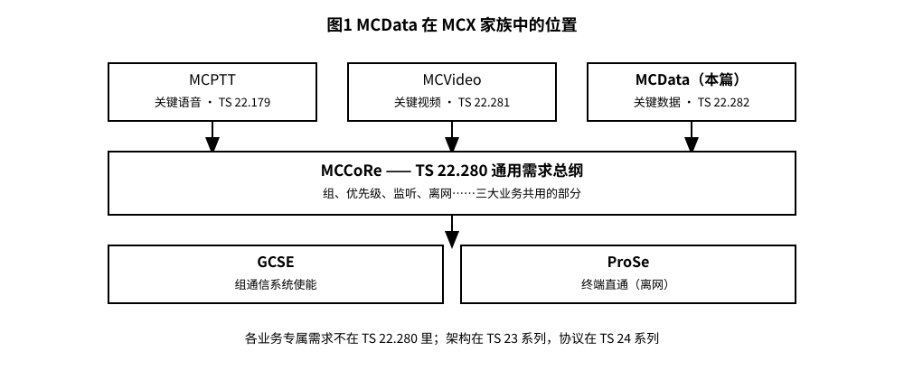
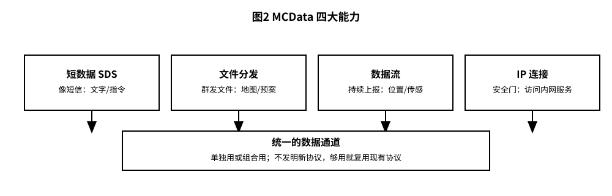
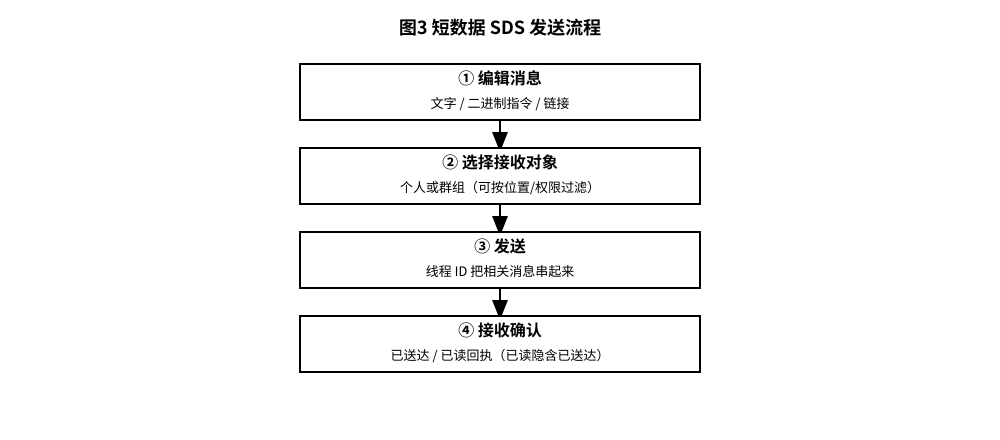
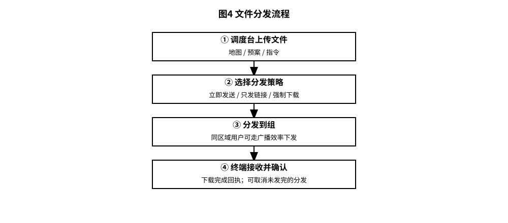

# 3GPP TS 22.282 解读：关键型数据 MCData——不说话不传视频时，数据自己在跑

> 版本：v1.0 ｜ 更新：2026-10-28 ｜ 基线：TS 22.282 v19.0.0（Rel-19）｜ 原文：whatthespec.net 抓取的关键条款

**MCData（Mission Critical Data，关键型数据服务）是 3GPP 定义的一种专门用于传输“非语音、非视频”数据的关键业务，它让现场设备能像打电话一样可靠地传文件、传状态、传控制指令，而不需要人一直盯着屏幕说话 [§1]。**

## 1. 它要解决什么问题

想象一下火灾现场或铁路调度中心。现场不仅有对讲机在喊话（MCPTT），还有无人机在飞、传感器在测温度、警察在查车牌。这些设备产生大量数据：定位坐标、传感器读数、短文字指令、现场照片、监控视频流。

过去，这些数据往往走商业网络（4G/5G 普通数据），或者使用老旧的专用低速网络。但关键任务场景有两个痛点：
1. **可靠性要求高**：普通网络“尽力而为”，关键时刻可能丢包或延迟不可控。
2. **管理难度大**：现场有很多“哑终端”（没有屏幕或屏幕很小的设备），需要一种统一的方式，让指挥中心能批量下发文件（如地图、预案），并确认谁收到了 [§4]。

MCData 就是为了解决这个问题而生。它提供了一个统一的“数据通道”，让关键任务用户能管理现场所有的数据连接，把资源给到最需要的人 [§4]。它不替代语音，而是和语音互补。当人不需要说话时，数据自己在跑 [§4]。

## 2. MCData 在 MCX 家族中的位置

3GPP 的关键任务通信（MCX）是一个大家族，通用需求在 TS 22.280（MCCoRe，Mission Critical Services Common Requirements）。

*   **MCPTT**：对讲机，管语音。
*   **MCVideo**：视频会议，管视频。
*   **MCData**：本规范，管数据。

它们都建立在共同的底座上：
*   **MCCoRe 通用层**（TS 22.280）：定义了通用的安全、鉴权、群组管理等功能。MCData 直接复用这些功能，比如端到端加密、密钥管理 [§4]。
*   **底层支撑**：GCSE（群组通信系统使能器）和 ProSe（邻近服务）等 [§1]。

*图 1 · MCData 在 MCX 家族中的位置：顶层 MCPTT / MCVideo / MCData（本篇），中间 MCCoRe 通用层（TS 22.280），底层 GCSE + ProSe。*

本规范 TS 22.282 只定义 MCData 的**服务需求**（Stage 1），即“这个业务应该具备什么能力”。具体的网络架构在 TS 23.282，具体的信令协议在 TS 24.282 [§1]。

## 3. 核心概念大白话：四大能力

MCData 不是一堆杂乱的功能，而是由四个核心“能力”（Capabilities）组成的积木。你可以把它们想象成四个不同的工具，用户或应用可以单独用，也可以组合用 [§5.1]。

*图 2 · MCData 四大能力：短数据 SDS、文件分发、数据流、IP 连接。*

### 1. 短数据服务 (SDS, Short Data Service)
**一句话：像微信短信，但更短、更可控，支持群组。**
这是 MCData 最基础的功能。它传输的是小尺寸、可变内容的消息。内容可以是纯文本，也可以是给应用看的二进制数据 [§5.2.1]。
*   **用途**：发一条“我在 A 点”的文字，或者发一个“关门”的二进制指令给机器人 [§5.2.2]。
*   **特点**：支持“已读回执”，支持“线程”（把相关消息串成一条对话）[§5.2.2]。

### 2. 文件分发 (File Distribution)
**一句话：群发文件，支持“强制下载”和“自动接收”。**
这不是普通的网盘分享。在紧急情况下，指挥中心可能需要给所有消防员发一张最新的地下管网图。
*   **用途**：向个人、群组或地理区域内的所有用户分发文件 [§5.3.2]。
*   **特点**：
    *   可以设置“强制下载”，终端收到后必须存下来，不能忽略 [§5.3.2]。
    *   可以只发链接，让用户选择何时下载，避免瞬间挤爆网络 [§5.3.2]。
    *   发送者可以取消还没发完的文件 [§5.3.2]。

### 3. 数据流 (Data Streaming)
**一句话：持续传输数据，像实时视频流，但是是数据。**
如果传感器每 0.1 秒报一次温度，或者无人机每帧传一次图像数据，就需要数据流。
*   **用途**：实时上报位置、传感器数据、或者低分辨率视频流 [§5.4.1]。
*   **特点**：
    *   建立连接非常快：紧急情况下，建立数据通信的时间必须小于 1 秒；普通情况下小于 3 秒 [§5.4.2]。
    *   支持地理区域广播：如果某区域内有很多终端，系统会利用广播效率，同时发给区域内所有能接收的人 [§5.4.2]。
    *   可以随时停止，并清理缓冲区里还没发完的数据 [§5.4.2]。

### 4. IP 连接 (IP Connectivity)
**一句话：给终端开一个“安全门”，让它能访问内网服务器。**
有些 MCData 设备（比如一个没有屏幕的工控机）需要访问警察的内网服务器查记录，或者让指挥中心远程操控一个移动显示屏。
*   **用途**：允许 UE（用户终端）作为客户端访问网络内的服务器，或者让其他 UE 访问作为服务器的 UE [§5.5.1]。
*   **特点**：
    *   **远程授权**：因为设备可能没有屏幕，授权动作可以由有权限的人远程发起或撤销 [§5.5.1] [§5.5.2]。
    *   **高优先级**：MCData 的 IP 数据包可以拥有比普通数据更高的每包优先级，确保关键控制指令不被堵在普通数据后面 [§5.5.2]。

**注意**：MCData 不发明新协议。如果现有的协议（如 HTTP, MQTT 等）够用，就直接用 [§5.1]。

## 4. 一次短数据发送是怎么完成的

SDS 是 MCData 的“文字短信”功能。让我们看看它是怎么工作的。

*图 3 · 短数据 SDS 发送流程：编辑 → 选组/选人 → 发送 → 接收确认。*

1.  **编辑**：用户在终端上输入一段文字，或者应用生成一段二进制数据。
    *   如果是文字，支持至少 1000 个 8-bit 字符（或 500 个 16-bit 字符）[§5.2.2]。
    *   如果是二进制，支持至少 1000 字节，并包含目标应用的地址 [§5.2.2]。
    *   如果是链接，支持至少 1000 个字符的超链接 [§5.2.2]。
2.  **选择接收对象**：
    *   **一对一**：发给特定的人。系统会根据策略（如位置、权限）检查是否允许发送 [§5.2.2]。
    *   **群组**：发给 MCCoRe 定义的群组。策略可以限制某些消息只发给群组中的特定成员（例如，只有位于现场的人员才能收到现场照片链接）[§5.2.2]。
3.  **发送**：
    *   消息进入网络传输。
    *   **线程标识**：每条消息都有一个“线程 ID”。如果你是在回复之前的消息，或者属于同一个任务的操作，系统会使用相同的线程 ID，这样接收方就能把相关消息归为一组，而不是散落在收件箱里 [§5.2.2]。
4.  **接收确认**：
    *   发送者可以选择要求“已读回执” [§5.2.2]。
    *   接收方收到后，系统会标记为“已送达”。如果用户打开了消息，系统会标记为“已读”。“已读”隐含了“已送达” [§5.2.2]。
    *   这个回执机制对于关键任务很重要，因为指挥中心需要知道指令是否被看到了。

**关键点**：SDS 不仅仅发文字，还可以发“应用指令”。比如，发送一条二进制消息给终端上的“照明控制应用”，告诉它“打开手电筒”。终端上的应用收到后直接执行，不需要用户手动操作 [§5.2.1] [§5.2.2]。

## 5. 关键时刻的能力

在紧急情况下，MCData 的几个特性尤为关键。

### 文件分发：地图与预案下发

*图 4 · 文件分发流程：调度台上传 → 选择分发策略 → 分发到组 → 终端接收并确认。*

*   **场景**：地震发生后，指挥中心需要把最新的避难所位置图发给所有救援队。
*   **机制**：
    *   发送者上传文件。
    *   发送者可以选择“立即发送”给所有选定的用户和群组 [§5.3.2]。
    *   **效率优化**：如果很多用户在同一个地理区域，系统会利用广播机制，同时把文件发给这一片区域，而不是逐个发送，节省带宽和时间 [§5.3.2]。
    *   **强制下载**：发送者可以标记文件为“强制”。这样，终端收到后会自动下载并存入本地，用户无法忽略。这对于必须知晓的预案至关重要 [§5.3.2]。
    *   **可选接收**：对于非紧急的大文件，系统可以只发送 URL 链接，用户点击后再下载，避免瞬间流量峰值 [§5.3.2]。
    *   **取消**：如果文件发错了，或者情况变了，授权用户可以在文件完全送达前取消分发，包括清理系统中缓冲区里还没发出去的数据 [§5.3.2]。

### 数据流：持续上报

*   **场景**：消防员在浓烟中行走，头盔摄像头持续回传低分辨率视频流，或者 GPS 模块每 1 秒上报一次坐标。
*   **机制**：
    *   **快速建立**：这种持续连接必须建立得快。紧急情况下，建立数据流的时间必须小于 1 秒 [§5.4.2]。
    *   **区域广播**：如果指挥中心想同时监控整个仓库区域的所有传感器，系统可以利用地理区域广播，高效地将同样的配置或数据请求发给区域内的所有终端 [§5.4.2]。
    *   **即时停止**：一旦任务结束或设备电量低，用户或授权者可以立即停止流传输，并清理缓冲区 [§5.4.2]。

### 离网与互通

*   **离网（Off-network）**：MCData 的设计不仅限于连接 3GPP 核心网。它支持“离网”操作，即在没有核心网连接的情况下（例如使用 ProSe 邻近通信），终端之间也可以直接交换 SDS 消息和文件 [§5.1]。这意味着在现场基站损坏时，附近的终端依然可以互相发送关键数据和文件。
*   **与非 3GPP 互通**：MCData 有开放接口，允许与现有的非 3GPP 数据系统（如旧的专用数据网、商业物联网平台）互通 [§4]。它不要求你抛弃旧系统，而是通过 MCCoRe 框架进行桥接。

## 6. MCData 与短信、微信传文件、物联网上报的区别

很多人会问：MCData 和普通的短信、微信传文件、或者 LoRa/NB-IoT 上报有什么不同？

| 特性 | 普通短信 (SMS) | 微信/WhatsApp 传文件 | 普通物联网上报 (MQTT/HTTP) | **MCData (TS 22.282)** |
| :--- | :--- | :--- | :--- | :--- |
| **可靠性** | 尽力而为，可能丢失 | 尽力而为，依赖网络拥塞情况 | 尽力而为，QoS 等级低 | **关键型可靠**。支持强制下载、已读回执、地理广播优化 [§5.2.2] [§5.3.2] |
| **群组管理** | 无原生群组 | 有群组，但无基于位置的策略 | 无 | **基于 MCCoRe 群组**。支持基于位置、权限的策略过滤（如：只发给在特定区域的成员） [§5.2.2] |
| **优先级** | 无 | 无 | 通常低 | **高优先级**。IP 数据流可拥有比普通数据更高的每包优先级 [§5.5.2] |
| **离网能力** | 无 | 无 | 部分支持 | **支持离网**。可通过 ProSe 在终端间直接通信 [§1] [§5.1] |
| **应用集成** | 仅文本 | 仅文件/消息 | 仅数据 | **深度集成**。SDS 可携带二进制指令直接控制本地应用（如开门、亮灯） [§5.2.1] |
| **管理** | 个人控制 | 个人控制 | 服务器控制 | **集中管理**。指挥中心可远程授权 IP 访问、强制分发文件、取消分发 [§5.3.2] [§5.5.2] |
| **会话管理** | 无 | 有聊天窗口 | 无 | **有会话 ID（Conversation ID，§3 定义）**。支持将相关消息和文件聚合在一个“会话”中，便于检索 |

**核心区别**：MCData 是**受控的、高可靠的、可管理的**关键任务数据通道。它不仅仅是传数据，更是传“指令”和“状态”，并且具备军事/警务级别的管控能力（如强制接收、优先级抢占、离网应急）。

## 7. 它不管什么

为了清晰起见，我们需要明确 TS 22.282 的边界：

1.  **它不定义具体传输协议**：
    *   它规定“必须有文件分发能力”，但不规定是用 FTP、HTTP 还是其他协议。如果现有协议够用，就用现有的 [§5.1]。
    *   具体的信令流程（比如 UE 和服务器之间怎么握手）在 **TS 24.282** (Stage 3) 中定义。
    *   网络架构（比如需要哪些网元，如 MCT 服务器、MCR 注册中心等）在 **TS 23.282** (Stage 2) 中定义。
2.  **它不重复通用需求**：
    *   端到端加密、用户鉴权、群组订阅管理等通用功能，已经在 **TS 22.280** (MCCoRe 通用需求) 中定义。MCData 直接引用这些功能，不在本规范中重复描述 [§4] [§5.2.2]。
3.  **它不适用于 GSM/UMTS**：
    *   本规范的需求仅适用于 LTE 和 5G NR 网络。GSM 和 UMTS 网络不支持 MCData 服务 [§1]。
4.  **它不定义具体的业务逻辑**：
    *   比如“地震预案是什么”、“机器人具体怎么移动”这些是上层应用或业务定义的事。MCData 只提供传输和管控能力 [§4]。

## 8. 怎么往下读

如果你想深入了解 MCData，建议按以下顺序阅读 3GPP 规范：

1.  **本篇 (TS 22.282)**：理解“它要做什么”（需求）。这是入口，帮你建立概念。
2.  **TS 22.280 (MCCoRe 通用需求)**：理解“基础底座是什么”。看群组怎么定义、安全怎么保证、用户怎么注册。这是 MCData 的地基。
3.  **TS 23.282 (架构)**：理解“网络里有什么”。看 MCData 功能实体怎么连接，数据面和控制面怎么交互。
4.  **TS 24.282 (协议)**：理解“具体怎么说话”。看 UE 和网络之间具体的信令消息格式和流程。

**版本说明**：
本文基于 **TS 22.282 v19.0.0** (Rel-19) 解读。
*   该版本是 whatthespec.net 上可用的最新版本。
*   whatthespec 上仅列出 v19.0.0 一版，没有 Rel-20 或 Rel-21 的 TS 22.282 版本。

**来源**：
*   3GPP TS 22.282 v19.0.0: "Mission Critical Data (MCData) Services; Service Requirements"
*   参考文档：TS 22.280 (MCCoRe 通用需求), TS 23.282 (Architecture), TS 24.282 (Protocols)

---
**免责声明**：本文旨在以通俗语言解读 3GPP 技术规范，便于非专业读者理解。所有技术事实均基于提供的规范摘要，并以条款号标注。如有任何错误，请以 3GPP 官方发布的规范原文为准。
