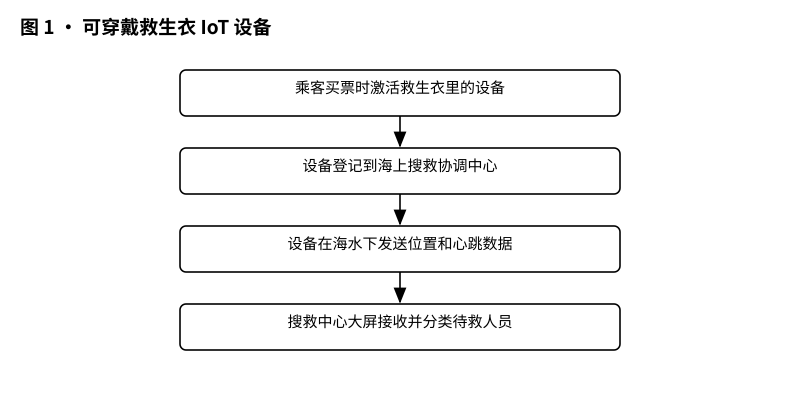
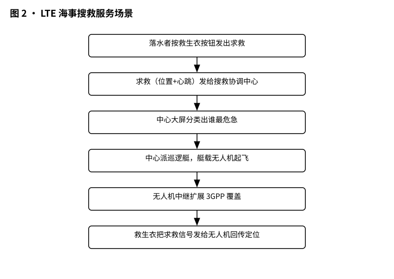
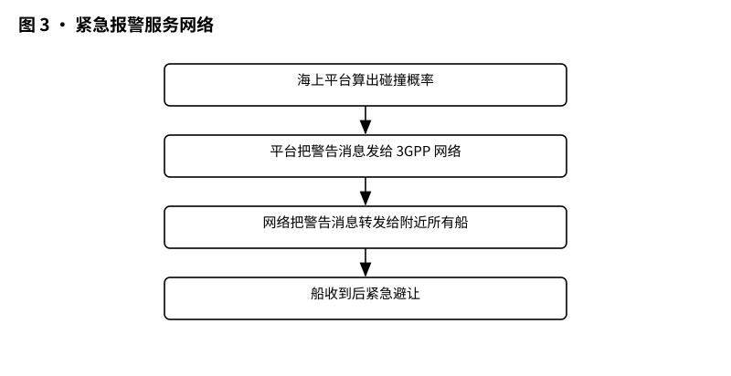
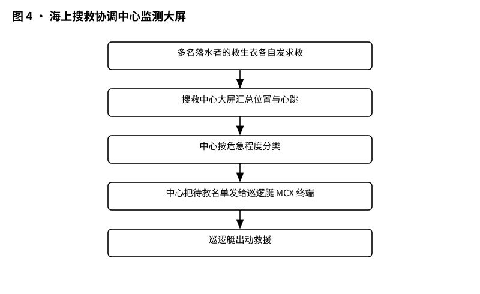

# 3GPP TR 22.819 解读：5G 能不能接管海上通信——海事通信可行性研究

> 版本：v1.0 ｜ 更新：2026-10-28 ｜ 基线：TR 22.819 v16.2.0（Rel-16，2018-12）｜ 原文：3GPP 官方 FTP 存档原文（.doc）

**TR 22.819 这份冻结版研究报告，回答"5G 能不能接管海上通信"。**

上面这句就是本篇的题眼。TR 22.819 不是一部法律，而是一份"先看看行不行"的可行性研究报告（FS MARCOM）：它把海上通信的用例和需求摆上桌，结论是——3GPP 系统（也就是你手机背后那套移动通信技术体系，4G/5G 都算）有希望成为海上通信的主力，但要先补齐覆盖、搜救、船载物联网这几块短板。接下来 7 节，我们逐条拆解。

## 1 它要解决什么问题

一句话：海上存在一个巨大的"信息鸿沟"。岸上的人刷视频、开视频会议，信号满格；海上的人——无论是远洋货轮的船员、近海作业的渔民，还是游艇上的游客——要么没信号，要么信号差到只能打卫星电话，按秒计费，字都不敢多说。TR 22.819 的引言点名：海事是 5G 重点垂直行业之一，3GPP 从 2016 年起就开始琢磨这件事 [§Introduction]。

传统海事通信也不是完全没有，VHF/MF/HF 电台、海事卫星都在用。但原文直说：这些老技术的容量和速率，撑不起 IMO（国际海事组织）正在推进的 e-Navigation（电子导航战略）和 MASS（海上自主水面船舶）[§Introduction]。打个比方：传统海事通信像老式电报加对讲机，而新时代的船要的是"移动互联网"。

报告给自己定了三个目标：海上安全、保护海洋环境、提升航运效率——尤其要减少人为失误造成的海难，重点照顾小渔船和游艇这类"没太多预算上高级通信设备"的船 [§1]。换句话说，这份报告想回答：能不能让海上的人和岸上的人，用同一套手机网络体系，聊得一样顺畅？

这里再交代一个背景：IMO 把海上通信服务整理成一份"海事服务组合"（IMO MSP）。TR 22.819 的第 7 章就是把这些官方服务一项一项对应到 3GPP 网络上——VTS 信息服务对应 MSP 1，导航协助服务对应 MSP 2，船舶岸上报对应 MSP 8 [§7.8][§7.9][§7.1]。也就是说，它不是凭空造需求，而是先对齐 IMO 的业务清单，再看 3GPP 能不能接得住。

## 2 它在 MCX 家族中的位置

先认亲戚。MCX（Mission Critical Services，任务关键通信）家族里，有负责公共安全的（警察、消防、急救用的对讲机体系），而海事通信是 3GPP 自 2016 年起重点考虑的另一个垂直行业 [§Introduction]。TR 22.819 就是海事这条线的可行性研究报告。注意它的身份：TR（Technical Report）不是 TS（Technical Specification）——一个是"研究报告"，一个是"规范条文"，后者才有约束力，设备必须照做。TR 只管研究，不管立法。

它在家族里的位置，原文第 4 章（Overview）画得很清楚：第 5 章管"船客的移动宽带"（刷视频）、第 6 章管"船载物联网"（集装箱、救生衣）、第 7 章管"海事安全与官方服务"（搜救、引航、警告）、第 8 章管"上天入地的外挂"（卫星接入、VDES 互通）、第 9 章管"旧技术怎么搬到海上"，第 10 章汇总需求，第 11 章收尾 [§4]。

它还不孤立：卫星接入借道 5GSAT 研究（TR 22.822 和 TR 38.811）[§8.1.1]，船内室内定位借道 5G_HYPOS 研究 [§5.3.1]，船上局域网借道 5GLAN 成果 [§5.4.1]，公共预警直接复用 TS 22.268 [§7.6.6]，任务关键通话复用现成的 MCX 服务规范 [§10.2.1-5]。一句话：TR 22.819 像家族里的"海事侦察兵"，探完路回来写报告：哪些需求现有技术就能满足，哪些得新开课题。

## 3 核心概念大白话

先把几个词翻译成人话。

3GPP 系统：就是你手机背后的全球移动通信标准体系。TR 22.819 干的活，就是研究怎么把这套为陆地设计的网络搬到海上。

UE（用户设备）：手机、手表、救生衣里的芯片，原文统称 UE。

relay UE（中继设备）与"间接网络连接"：船是钢做的，信号进不了船舱。怎么办？在船顶架一台信号好的设备当"中转站"，先接上远处的基站，再在船里发信号——原文管这叫间接网络连接 [§5.1.2]。船顶那台设备就是 relay UE。

IOPS 模式：船开到完全没公网信号的地方，船上自己建一个"局域网"，让乘客在船里刷视频、打游戏，这就是 IOPS 模式 [§5.2]。船一回到有公网覆盖的海域，网络重新选择，切回公网 [§5.2.3]。

eMTC/NB-IoT：物联网技术，让低功耗小设备（比如集装箱上的跟踪器）连上网 [§9.2.1]。

MCX 服务：任务关键通信，对讲机体系的"正版续作"，特点是接通快、抗造、支持组呼 [§10.2.1-5]。

PWS（公共预警系统）：地震、海啸警报的官方广播通道，手机收到会强制提醒 [§7.6]。

SOLAS 船 / 非 SOLAS 船：SOLAS 是《海上人命安全公约》的缩写。原文定义：跑国际航线的客船、500 总吨以上的货船属于 SOLAS 船，其余（小渔船、游艇）是非 SOLAS 船 [§3.1]。后面会看到，不少需求特意照顾非 SOLAS 船。

IMO 号：船的身份证号，7 位数字，全球唯一 [§10.2.2-14]。

先看一张"保命"的图。原文 Figure 6.1.1-1 画的是救生衣式的可穿戴 IoT 设备：

*图 1 · 可穿戴救生衣 IoT 设备（原文 Figure 6.1.1-1）：买票激活 → 登记到搜救中心 → 海水下发位置与心跳。*

流程：乘客买票时激活救生衣里的设备 → 设备登记到海上搜救协调中心 → 设备在海水下也能发送位置和心跳数据 → 搜救中心大屏接收 → 中心按危急程度分类待救人员 [§6.1.2][§6.1.3]。这张图配合的是 6.1 用例：人落水后，救生衣自动或手动发出求救。注意原文的要求有点狠：UE 要支持"在海水下"发送数据 [§6.1.2]。

再补一个生活化的流程——船开到公海怎么继续玩。§5.2 的用例：邮轮离开高雄港，驶出 3GPP 覆盖 → 船上局域网（IOPS 模式）启动，乘客照常刷视频 → 邮轮接近高雄港、重新进入覆盖 → 船内局域网关闭 → 乘客的手机重新选择网络，切回公网 [§5.2.3]。对应需求：支持直接连接与间接连接之间的业务连续性 [PR-10.2.2-3]，UE 应能按归属运营商策略在岸上网络可用时执行网络重选 [PR-10.2.2-4]。整个切换要无感，手机自己搞定。

## 4 关键流程

整份报告最精华的是流程，挑四个讲。

搜救主流程（§7.2）：游艇上 Jiho 突然在钢舱里晕倒 → 朋友用手机经船顶中继 UE 发出海上紧急请求给搜救协调中心 → 中心把附有位置的海上通知消息群发给附近所有海警巡逻艇 → 一艘巡逻艇就近回复"我来" → 人被转移到巡逻艇上，艇上远程医疗设备连上岸上医院 → 医生经 MCVideo/MCData（任务关键视频/数据）看实时画面下医嘱 [§7.2.3]。

原文还配了图。Figure 6.1.3-1 是 LTE 海事服务场景：

*图 2 · LTE 海事搜救服务场景（原文 Fig. 6.1.3-1）：落水者求救 → 中心分类 → 派艇、无人机中继扩展覆盖。*

流程：落水者按救生衣按钮 → 求救请求（位置+心跳）发给搜救协调中心 → 中心大屏分类出"谁最危急" → 中心派巡逻艇 → 艇载无人机起飞 → 无人机飞到落水者上方 → 无人机中继扩展 3GPP 覆盖 → 救生衣把求救信号发给无人机 → 无人机回传定位 [§6.1.3]。对应需求：3GPP 系统应支持移动 UE（比如无人机）以中继模式为覆盖外的用户转发 [PR-6.1.6-4]。

紧急避碰报警（§7.7）：岸上的海上平台根据各船的 SOG（对地速度）和 COG（对地航向）算碰撞概率 →

*图 3 · 紧急报警服务网络（原文 Figure 7.7.3-2）：平台算碰撞概率 → 3GPP 网络转发警告 → 附近船只避让。*

流程：海上平台算出碰撞概率 → 平台把警告消息发给 3GPP 网络 → 网络把警告消息转发给附近所有船 → 船收到后紧急避让 [§7.7.3]。对应的需求只有一条但很硬：3GPP 网络应把海事当局发来的警告消息转给邻近船只 [PR-7.7.6-1]。

船间位置推送（§6.3）：船上出了事故，等海警不如邻居船先到。原文设计：船用组播或广播把位置推给附近所有船，各船之间直接互相通话 [§6.3.1]。船与船之间的距离指标：非 SOLAS 船至少要 15 km [PR-10.2.2-10]。原文还给了现实依据：韩国海警要求大船与快艇之间的通话距离大于 7.5 km [PR-10.2.2-10 NOTE3]。

集装箱 IoT 运输（§6.2）：集装箱上的跟踪传感器上船后，由网络选一个"代表 UE"当班长，替全班办移动管理手续，其他设备"免打扰"；航程中移动管理关停，货物位置和预计到港时间定期发回航运公司 [§6.2.3][PR-6.2.6-1]。打个比方：几百个集装箱传感器不用各自去刷"出勤"，派一个班长代表大家打卡就行。

还有一条船内流水线：§6.4 设想每间船舱都装一个小基站。需求要求：把每间船舱的位置与对应小基站的位置绑定，设备在哪个舱、哪个基站就管它 [PR-10.2.2-11]；IoT 设备上报的信息经小基站组播/广播时，只发给有人的船舱 [PR-10.2.2-12]。大白话：这艘船每间舱都有 WiFi 小基站，谁在哪间舱、谁需要收到广播，系统门清。

## 5 关键时刻的能力

"关键时刻"对应原文第 7 章（当局与海上用户之间的海事安全服务），这里提炼四样本事。

第一，超远覆盖。原文要求海上极端远距离覆盖最远可达 100 km [PR-5.1.6-1]。陆地上一个基站覆盖几公里到几十公里，海上要 100 km——基站得架高、功率得拉满。这就是"海上覆盖"这块短板的硬指标。

第二，搜救中心的"上帝视角"。Figure 6.1.1-2 画的就是搜救协调中心的监测大屏：

*图 4 · 海上搜救协调中心监测大屏（原文 Figure 6.1.1-2）：多名落水者求救汇总 → 按危急程度分类 → 派艇救援。*

流程：多名落水者的救生衣 → 各自发求救（位置+心跳）→ 搜救中心大屏汇总 → 中心按危急程度分类 → 中心把"待救名单+生命体征"发给巡逻艇上的 MCX 终端 → 巡逻艇出动救援 [§6.1.3][PR-6.1.6-3]。注意原文脚注：求救也可能来自 SARSAT 卫星或 AIS 等其他渠道，中心要辨别真假报警——但这是 3GPP 范围外的事 [§6.1.5 NOTE]。

中间插一段预警的分类知识，也是大白话版：海上航行警告分四类——NAVAREA 警告、分区警告、沿海警告、本地警告。前两种靠 NAVTEX 或 SafetyNET 传统渠道广播，后两种可以改用 3GPP 系统来播 [§7.3.1]。沿海警告覆盖航道浮标以外海域，本地警告覆盖港内近岸水域 [§7.3.1]。§7.3 的流程是：船进港前向当局申请海事安全信息 → 当局发预警 → 船把预警显示在自己的电子海图（ENC）上 → 当局按固定时间周期性广播预警 → 预警源数据按国家要求留档 [§7.3.3]。

第三，低时延高码率的引航与拖船。引航（§7.4）和拖船（§7.5）用例里，无人机载着 3D-LiDAR 传感器实时传回船周三维画面，要求"船在现实中动多少，屏幕上就显示多少，看不出延迟" [PR-7.4.6-5][PR-7.5.6-6]。大船吨位大，几秒内姿态就变，所以数据速率和时延都得达标。

第四，不识字也能懂的预警。§7.6 的场景：渔船上三个外籍船员，半夜捕鱼时收到日本近海地震的 PWS 警报。船主的韩文手机没注意到，外籍船员的手机收到"图示"版本（pictogram，语言无关的符号内容），一看图标就懂 [§7.6.3]。这部分需求直接复用 TS 22.268 [§7.6.6]。

第五，卫星接入（§8.1）。大洋中央没有地面基站，卫星是海事通信的传统手段。原文的思路是借力：5G 系统本就该能用卫星接入，要求 5G 支持陆地基站与卫星接入之间的业务连续性 [§8.1.1]。TR 22.819 不另起炉灶，直接把需求挂到 5GSAT 研究的成果上 [§8.1.1]。第 9 章还给出更宽的思路：移动宽带、实时音视频、电视广播、短信彩信、语音视频通话这些陆地老服务，只要海上有了覆盖，都该原样可用 [§9.1.1][PR-9.1.2-1]；覆盖手段可以是卫星回传，也可以是无人机、飞艇组成的"移动网络" [§9.1.1]。

## 6 边界（它不管什么）

这份报告很重要的一点，是知道自己不管什么。

一、它是研究报告，不是规范。全文写的都是 potential requirements（潜在需求）。第 11 章的建议是：应该启动规范化工作，把第 10 章汇总的需求写进正式 TS [§11.2]。也就是说，设备厂商现在不用照着它做，要看后续的 TS。

二、IMO MSP（海事服务组合）的详细用例没展开。报告第 7.8 到 7.13 节列了 VTS 信息服务、导航协助、交通组织、港口服务、远程医疗协助、海事协助这些 IMO 官方服务，但只引用了 IMO 原文描述，没有展开用例——因为 IMO/IHO 数据建模小组（HGDM）的指南 2018 年 9 月才完成，来不及写进本报告 [§7.8.1]。海上单一窗口是 §7.1 船岸上报（IMO MSP 8）的一部分，不是被删的内容——§7.1.1 原文就写着单一窗口是减轻船员报关负担的重要手段 [§7.1.1]。

三、VDES 互通用例没展开。VHF 数据交换系统（VDES）的卫星部分要等 2019 年世界无线电通信大会（WRC-19）拍板，所以报告只登记，不展开 [§8.2.1]。

四、报警真伪不归它管。多渠道报警（卫星、AIS）的合并和鉴别，原文明确说在 3GPP 范围之外 [§6.1.5 NOTE]。

五、KPI 是"暂定值"。船间 15 km 距离这种指标，原文脚注写明还会在规范工作中再分析和修订 [PR-10.2.2-10 NOTE1]。

六、报告不定义业务本身。它管的是"3GPP 系统怎么支持"，业务流程、港口管理这些是 IMO 的事。

## 7 怎么往下读

时间紧的话，按这个顺序翻原文：

- 第 4 章（Overview）：5 分钟拿到全篇地图 [§4]。
- 第 5、6 章：对"船客上网"和"船载物联网"感兴趣直接读，每个用例六段式：描述、前提、流程、后果、影响、需求 [§5][§6]。
- 第 7 章：对搜救、引航、拖船、预警这些"保命"服务感兴趣，直接读 [§7]。
- 第 10 章：全书的"需求汇总表"，分三栏：现有技术就能满足的（10.2.1）、通用海事需求（10.2.2）、当局专用需求（10.2.3）[§10.2]。
- 第 11 章：结论与建议，3 分钟读完 [§11]。
- Annex A：v16.2.0 新增的附录，列了船-岸、船-船现有和未来通信技术的现状 [Annex A]。

想深挖的，顺藤摸瓜：卫星接入看 TR 22.822 和 TR 38.811 [§8.1.1]；公共预警看 TS 22.268 [§7.6.6]；通用服务需求看 TS 22.261 [§10.2.1-6]；船上局域网看 5GLAN 成果 [§5.4.1]。

## 版本说明

原文：3GPP TR 22.819 V16.2.0（2018 年 12 月）。封面标题为 "Feasibility Study on Maritime Communication Services over 3GPP system"（封面措辞为 Feasibility Study，简称 FS MARCOM）；工作项（WID）标题为 "Study on Maritime Communication Services over 3GPP system"。转写文本的第一页是目录（提取时封面文字未进入 txt），封面措辞经原 .doc 文件确认，与上述一致，无需修正。版本历史显示：16.0.0 于 2018 年 9 月经 SA#81 一次性批准；16.1.0（2018-12）增补船内室内定位需求；16.2.0（2018-12）加入 Annex A"船-岸与船-船通信技术现状" [版本历史表]。TR 为冻结/最终研究报告，不属于规范。

## 来源与参考

- 3GPP TR 22.819 V16.2.0 (2018-12)，下载自 3GPP 官方 FTP：https://www.3gpp.org/ftp/Specs/archive/22_series/22.819/22819-g20.zip
- whatthespec.net 未能获取（404）。

## 附录：关键条款速查

| 条款号 | 主题 | 一句话要点 |
| --- | --- | --- |
| PR-5.1.6-1 | 海上超远覆盖 | 3GPP 系统应支持海上极端远距覆盖（最远 100 km） |
| PR-6.1.6-2 | 海上紧急请求 | UE 应能自动发送含位置与心跳的海上紧急请求给搜救协调中心，并支持手动发送 |
| PR-6.1.6-4 | 移动中继 | 3GPP 系统应支持移动 UE（如无人机）以中继模式为覆盖外 UE 转发 |
| PR-6.2.6-1 | 代表 UE | 支持把集装箱等静止 IoT 群映射到一个代表 UE，由其统一办移动管理，航程中关停其余设备的移动管理 |
| PR-7.2.6-1 | 搜救请求 | 经间接连接发海上紧急请求时，必须携带海上位置信息 |
| PR-10.2.2-10 | 船间距离 | 非 SOLAS 船船间推送位置的通信距离至少 15 km（暂定 KPI） |
| PR-10.2.2-14 | 船证绑定 | 支持把 UE 身份与船身份（如 7 位 IMO 号）关联 |
| PR-7.4.6-1 | 引航认证 | 3GPP 系统应支持对申请引航服务的 UE 认证与授权 |
| PR-7.7.6-1 | 紧急报警转发 | 3GPP 网络应把海事当局的警告消息转给邻近船只 |
| PR-10.2.3-8 | 远程医疗 | 巡逻艇上的远程 MCX 终端可经中继 UE 访问 MCVideo/MCData 对接医生 |
