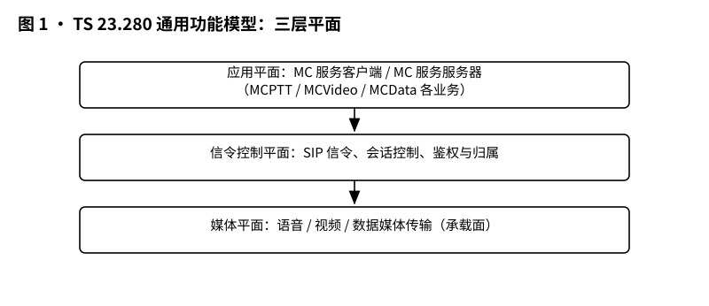
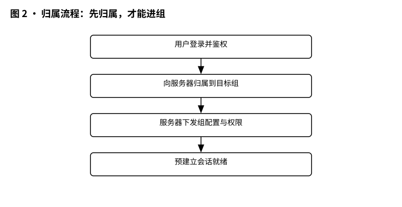
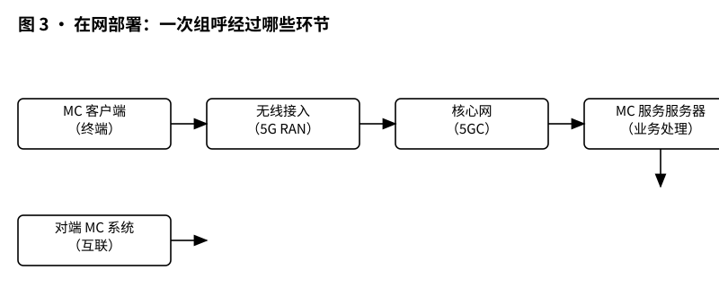
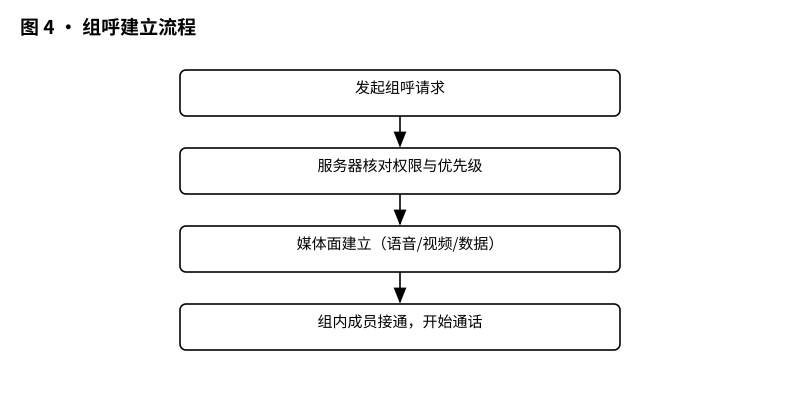

# 3GPP TS 23.280 解读：MCX 通用功能架构——三套业务共用的一套“骨架”

> 版本：v1.0 ｜ 更新：2026-10-28 ｜ 基线：TS 23.280 v20.5.1（Rel-20）｜ 原文：whatthespec.net 抓取的关键条款

**一句话总结：TS 23.280 是 MCX（关键任务通信）家族的“总装说明书”，它定义了 MCPTT（语音）、MCVideo（视频）和 MCData（数据）这三项业务如何共享同一套核心服务器、接口和管理逻辑，避免重复造轮子。** [§1]

---

### 1. 它要解决什么问题

想象一下，你是一家大型应急通信系统的架构师。你需要为警察、消防员和铁路调度员提供三种不同的通信服务：
1.  **MCPTT**（Mission Critical Push-To-Talk）：类似对讲机的语音通信，要求一键发起，毫秒级响应。
2.  **MCVideo**：实时视频传输，用于现场监控。
3.  **MCData**：结构化数据传输，如发送GPS位置、车辆状态或简单消息。

如果让每个业务团队各自设计一套服务器架构、一套用户认证方式、一套群组管理机制，会发生什么？
*   **重复造轮子**：三个团队都要写一遍“用户登录”、“群组管理”、“配置下发”的代码。
*   **运维噩梦**：运维人员需要维护三套独立的服务器集群，接口不统一，调试困难。
*   **体验割裂**：用户在一个设备上切换语音和视频时，可能会发现账号体系不通，群组列表不一致。

TS 23.280 的出现就是为了终结这种混乱。它规定了一套**通用功能架构（Common Functional Architecture）**。这意味着，虽然语音、视频、数据在“怎么传媒体”上不同，但在“谁有资格传”、“传给谁”、“怎么管理群组”这些底层逻辑上，必须共用同一套“骨架”。 [§1] [§4]

这套架构不仅服务于公共安全（如警察、消防），也适用于商业领域（如公用事业公司、铁路系统）。 [§1]

### 2. 它在 MCX 家族中的位置

要理解 TS 23.280，先看它在 3GPP 标准体系中的层级：

*   **Stage 1 (需求层)**：TS 22.280 等文档定义了“我们要什么功能”（比如：要支持紧急呼叫、要区分优先级）。这是“做什么”。
*   **Stage 2 (架构层 - 本文档)**：**TS 23.280** 定义了“由哪些盒子组成，盒子之间怎么连”。这是“怎么做”的高层设计。它不关心具体的比特流怎么编码，只关心逻辑实体之间的交互。
*   **Stage 3 (协议层)**：TS 24 系列文档（如 TS 24.379 for MCPTT）定义了具体的信令消息格式（SIP/HTTP 报文的字段）。这是“怎么说”。

**TS 23.280 与具体业务标准的分工：**
*   **TS 23.280**：定义**通用服务核心（Common Services Core, CSC）**。包括身份管理、群组管理、配置管理、录音管理等所有业务共用的功能。 [§7.3.1.1]
*   **TS 23.379 (MCPTT)**：定义语音业务特有的功能，如语音媒体路由、组呼仲裁逻辑。
*   **TS 23.281 (MCVideo)**：定义视频业务特有的功能，如视频编码策略、视频服务器逻辑。
*   **TS 23.282 (MCData)**：定义数据业务特有的功能，如数据包优先级、数据转发逻辑。

简单来说，TS 23.280 是“地基”和“水电煤”，而 23.379/23.281/23.282 是建在地基上的“具体房间”。 [§4]

### 3. 核心概念大白话

为了读懂后面的架构图，我们需要先搞懂几个关键术语。TS 23.280 将系统分为两个平面：**应用平面（Application Plane）** 和 **信令控制平面（Signalling Control Plane）**。 [§7.3.1.2]

#### 3.1 功能实体（Functional Entities）
别被这个词吓到，它们其实就是逻辑上的“角色”或“盒子”。

**A. 通用服务核心（CSC）中的实体：**
这些是“公共部门”，所有业务共用。
*   **Identity Management Server (IdMS，身份管理服务器)**：
    *   **大白话**：这是“门卫”兼“身份证管理局”。它负责验证你是谁（认证），并确认你有权访问哪些服务。它不直接参与通话，但它决定你能不能进门。 [§7.4.2.2.6]
*   **Group Management Server (GMS，群组管理服务器)**：
    *   **大白话**：这是“社区居委会”。它管理群组（Group）。比如，“第1消防中队”是一个群组。GMS 知道谁在这个群里，群组的策略是什么（比如谁有优先级）。所有 MC 业务（语音、视频、数据）都依赖 GMS 来识别“组”。 [§7.4.2.2.4]
*   **Configuration Management Server (CMS，配置管理服务器)**：
    *   **大白话**：这是“总部行政办”。它负责下发配置信息。比如，告诉终端：“你的录音功能是开还是关？”、“你的显示别名是什么？”。它还管理录音回放的相关配置。 [§7.4.2.2.2]

**B. MC 服务特定实体：**
这些是“专业部门”，每个业务有自己的。
*   **MC Service Server (MC 服务服务器)**：
    *   **大白话**：这是“业务前台”。对于 MCPTT，它是语音服务器；对于 MCVideo，它是视频服务器。它负责处理具体的业务请求，比如“发起组呼”、“建立视频流”。它是 GCS AS（Group Communication System Application Server）的一种实例化。 [§7.3.1.2]
*   **MC Service Client (MC 服务客户端)**：
    *   **大白话**：这就是你手里的手机或手持终端里的 App。它包含处理语音、视频或数据的逻辑。 [§7.3.1.2]

**C. 辅助实体（可选）：**
*   **Recording Server (录音/录像服务器)**：负责存储通话或视频记录。 [§7.3.1.2 NOTE 2]
*   **ACM (Administrative Configuration Management，行政配置管理)**：用于运营商或管理员远程配置用户终端，不是必须的，只有部署了该功能才需要。 [§7.3.1.2 NOTE 1]

#### 3.2 参考点（Reference Points）
参考点就是“接口”。在 TS 23.280 中，接口被命名为 **CSC-x**（Common Services Core - x）。

*   **CSC-1**：连接 **身份管理客户端** 和 **身份管理服务器 (IdMS)**。用于认证。 [§7.5.2.2]
*   **CSC-2**：连接 **群组管理客户端** 和 **群组管理服务器 (GMS)**。用于同步群组列表和策略。 [§7.5.2.3]
*   **CSC-3**：连接 **MC 服务服务器** 和 **群组管理服务器 (GMS)**。服务器需要知道群组信息来处理呼叫，所以通过 CSC-3 去 GMS 查资料。 [§7.5.2.4]
*   **CSC-4**：连接 **配置管理客户端** 和 **配置管理服务器 (CMS)**。用于下发配置。 [§7.5.2.5]

**关键点**：这些接口底层通常跑的是 SIP（信令）和 HTTP（配置/数据）协议。 [§7.5.2.3]

#### 3.3 身份标识
*   **MC Service ID**：标识具体的 MC 服务实例（比如“北京消防MCPTT系统”）。
*   **MC Service Group ID**：标识具体的群组（比如“第1中队”）。
*   **Functional Alias**：功能别名。比如，一个消防员可能叫“张三”，但在紧急呼叫中，他的身份是“队长”或“指挥员”。Functional Alias 允许在通信中显示角色而非真名。 [§10.10.1.1A.1]

### 4. 一次组呼在架构里怎么走

让我们用一个具体的场景来串联这些概念：**消防员“张三”在隧道里发起一个针对“第1中队”的紧急语音组呼。**

*图 1 · 通用功能模型：应用平面、信令控制平面、媒体平面三层结构。*

**步骤分解：**

1.  **归属与预建立（Affiliation & Pre-establishment）**
    *   张三开机后，他的手机（MC Service Client）首先通过 **CSC-1** 与 **IdMS** 交互，完成身份认证。 [§7.5.2.2]
    *   接着，手机通过 **CSC-2** 与 **GMS** 交互，下载“第1中队”的群组配置和策略。手机现在“知道”自己属于哪个群，群里有哪些人。 [§7.5.2.3]
    *   *注：在推按通话（PTT）之前，MC 系统通常会进行“预建立”，即在服务器端预留资源，确保按下按钮时能瞬间接通。*

*图 2 · 归属流程：登录鉴权 → 归属到组 → 下发组配置与权限 → 预建立会话就绪。*

2.  **发起组呼（Initiation）**
    *   张三按下按钮。手机（MC Service Client）向 **MC Service Server**（语音服务器）发送组呼请求。
    *   这个请求包含：目标群组 ID（“第1中队”）、发起者 ID（张三）、以及可能的优先级标记。 [§10.8.2.1]

3.  **服务器仲裁与群组查询（Server Logic）**
    *   **MC Service Server** 收到请求后，它需要确认：“第1中队”现在有多少人在线？谁有更高优先级？
    *   服务器通过 **CSC-3** 接口查询 **GMS**，获取群组的最新状态和媒体策略。 [§7.5.2.4]
    *   如果张三的优先级最高，或者当前没有更高优先级的通话，服务器批准呼叫。

4.  **媒体面建立（Media Setup）**
    *   服务器向群组内其他成员的手机发送呼叫邀请（通过信令控制平面）。
    *   其他手机响应，媒体面建立，语音开始在终端之间传输。TS 23.280 主要关注信令和控制逻辑，媒体面具体怎么传由各业务标准规定。 [§4]

*图 3 · 在网部署：终端 → 无线接入 → 核心网 → MC 服务服务器 → 对端 MC 系统。*

*图 4 · 组呼建立流程：发起 → 服务器核对权限与优先级 → 媒体面建立 → 组内成员接通。*

**为什么这套架构重要？**
因为如果张三想切换到视频模式，他不需要重新认证，也不需要重新下载群组列表。他的手机已经通过 CSC-1 和 CSC-2 完成了通用部分的初始化。他只需要向 **MCVideo Server** 发起视频请求，而 MCVideo Server 同样可以通过 CSC-3 查询同一个 **GMS** 来获取“第1中队”的信息。这就是“共用骨架”的好处。 [§1] [§4]

### 5. 关键时刻的能力

TS 23.280 定义了一些在紧急情况下至关重要的通用流程。

#### 5.1 紧急告警（Emergency Alert）
当发生火灾或袭击时，需要向整个区域或特定群组发出警报。
*   **流程**：MC Service Client 发送 **Emergency Alert Request** 给 MC Service Server。 [§10.10.1.1A.1]
*   **信息要素**：
    *   `MC service ID`：谁发的告警。
    *   `Functional alias`：告警者的角色（如“指挥官”）。
    *   `MC service group ID`：目标群组。
    *   `Location`：告警源的位置（如果可用）。 [§10.10.1.1A.1]
*   **取消告警**：如果误报或危险解除，可以发送 **Emergency Alert Cancel Request**，包含要取消的告警 ID 和范围。 [§10.10.1.1A.3]
*   **关键点**：这个流程是三套业务共用的。无论是语音警铃、视频闪烁还是数据弹窗，底层都走这套 CSC 逻辑。 [§10.10.1.1]

#### 5.2 群组归属与取消归属（Affiliation/De-affiliation）
*   **情景**：一名警察从“巡逻组”转到“追捕组”。
*   **流程**：
    1.  客户端发送 **Affiliation Request**，包含新群组 ID 列表。 [§10.8.2.1]
    2.  如果涉及跨系统（比如从 A 运营商系统转到 B 系统），MC Service Server 之间会通过 **CSC** 接口交互，确认对方系统中该群组的合法性。 [§10.8.2.2]
    3.  服务器返回 **Affiliation Response**，指示每个群组 ID 的加入状态。 [§10.8.2.3]
    4.  如果是离开群组，发送 **De-affiliation Request**，可以指定是仅针对当前客户端，还是针对所有关联设备。 [§10.8.2.6]

#### 5.3 录音与回放（Recording & Replay）
*   **配置**：CMS（配置管理服务器）存储哪些通话需要被录音的策略。 [§7.4.2.2.2]
*   **实体**：
    *   **Recording Server**：存储媒体数据。
    *   **Replay Client**：用于管理员或授权用户回放录音/录像的客户端。 [§7.3.1.2 NOTE 2]
*   **流程**：虽然具体的媒体存储协议不在 TS 23.280 详细定义，但它规定了管理录音配置的接口（如 CSC-4 用于更新录音配置）。 [§7.5.2.5]

#### 5.4 离网与漫游（Off-network & Roaming）
*   TS 23.280 主要关注 **On-network**（在网）场景，即通过 3GPP 网络（E-UTRAN/EPC）接入。 [§1]
*   但也提到了 **MC Gateway UE**，允许非 3GPP 设备（如 Wi-Fi 终端或特定专网设备）通过网关接入 MC 系统。 [§4]
*   对于非 3GPP 接入，标准不额外指定新功能，意味着核心逻辑保持一致，只是接入方式不同。 [§1]

### 6. 通用架构 vs 各业务架构的区别

这是理解 TS 23.280 最关键的部分。很多读者会混淆“谁管什么”。

| 功能领域 | TS 23.280 (通用) | TS 23.379 (MCPTT) | TS 23.281 (MCVideo) | TS 23.282 (MCData) |
| :--- | :--- | :--- | :--- | :--- |
| **身份认证** | **定义 IdMS 和 CSC-1 接口** | 使用 IdMS 进行语音用户认证 | 使用 IdMS 进行视频用户认证 | 使用 IdMS 进行数据用户认证 |
| **群组管理** | **定义 GMS 和 CSC-2/3 接口**，存储群组列表和基础策略 | 使用 GMS 获取群组媒体策略（如音量、编解码） | 使用 GMS 获取群组视频策略（如分辨率、帧率） | 使用 GMS 获取群组数据策略（如 QoS 等级） |
| **配置管理** | **定义 CMS 和 CSC-4 接口**，下发通用配置（如别名、录音开关） | 下发语音特定配置（如 PTT 按键行为） | 下发视频特定配置（如摄像头参数） | 下发数据特定配置（如数据包大小） |
| **呼叫控制** | 定义通用的紧急告警、归属流程 | **定义语音组呼/私呼的详细信令流、仲裁算法、媒体路由** | **定义视频会话建立、切换、媒体流控制** | **定义数据会话建立、数据包转发逻辑** |
| **媒体处理** | 不涉及具体媒体编解码 | 定义语音编解码器选择、回声消除等 | 定义视频编解码器选择、H.264/HEVC 等 | 定义数据格式（XML/JSON 等） |

**核心区别总结：**
*   **TS 23.280** 是“公共基础设施”。它确保所有 MC 业务在“人”和“组”的管理上是统一的。例如，你在 MCPTT 里看到的“第1中队”成员列表，和在 MCVideo 里看到的，应该来自同一个 GMS，保持一致。 [§7.3.1.1]
*   **TS 23.379/281/282** 是“专业应用”。它们解决的是“怎么把声音/画面/数据高效、可靠地传过去”的问题。 [§4]

如果 TS 23.280 没做好，你的语音和视频系统就会变成两个孤立的岛，用户需要分别登录、分别管理群组，这在紧急情况下是致命的。

### 7. 它不管什么（边界）

明确 TS 23.280 **不** 负责的事项，有助于避免混淆：

1.  **不管 Stage 1 需求细节**：
    *   它不规定“延迟必须小于 100ms”或“必须支持 AES-256 加密”。这些在 TS 22.280 等需求文档中定义。TS 23.280 只是提供实现这些需求的架构框架。 [§1]
2.  **不管 Stage 3 具体协议消息**：
    *   它不定义 SIP INVITE 报文里具体哪个字段填什么值。它只说“CSC-2 接口使用 SIP-1 和 SIP-2 参考点”。具体的 SIP URI 格式、HTTP Header 定义在 TS 24 系列文档中。 [§7.5.2.3]
3.  **不管物理实现选型**：
    *   它不规定服务器必须用 Linux 还是 Windows，数据库必须用 Oracle 还是 MySQL。它只定义逻辑实体和功能。 [§7.4.1]
4.  **不管非 3GPP 接入的细节**：
    *   虽然提到了 MC Gateway UE，但没有为非 3GPP 接入定义额外的功能特性。非 3GPP 接入的具体实现由厂商或特定行业标准决定，只要符合 TS 23.280 定义的接口逻辑即可。 [§1]
5.  **不管具体的媒体编解码算法**：
    *   它不关心是用 EVS 还是 AMR 编码语音，是用 H.264 还是 H.265 编码视频。这些是业务特定标准（23.379/23.281）关注的。 [§4]

### 8. 怎么往下读

如果你是一个新入行的通信工程师或架构师，建议按以下路径阅读 TS 23.280 及其相关文档：

1.  **精读本文档（TS 23.280）**：
    *   重点看 **Chapter 7 (Architecture)** 和 **Chapter 10 (Procedures)**。
    *   画出 **Figure 7.3.1.2-1**，并尝试标注出 CSC-1 到 CSC-4 的流向。
    *   理解 **IdMS, GMS, CMS** 这三个核心服务器的职责边界。
    *   仔细阅读 **10.8 (Affiliation)** 和 **10.10 (Emergency Alert)** 的信息流表，理解关键字段（如 MC service ID, Group ID, Location）的含义。

2.  **结合业务标准阅读**：
    *   如果你主要关注语音，读完 23.280 后，立即去读 **TS 23.379**。注意看它如何引用 23.280 中的 GMS 和 CMS。
    *   如果你关注视频，去读 **TS 23.281**。
    *   你会发现，业务标准中关于“群组”和“身份”的部分，都会指向 23.280 的定义。

3.  **深入协议层（可选，高阶）**：
    *   当需要开发或调试时，再去看 **TS 24.379** (MCPTT Signalling) 等文档，查看具体的 SIP/HTTP 消息示例。

4.  **版本说明**：
    *   本文解读基于 **3GPP TS 23.280 v20.5.1, Release 20**。
    *   注意：MCX 标准仍在演进中，阅读旧版本（如 Rel-15/16）时，需留意部分接口和行为可能有所不同，具体差异见各标准附录的变更历史。

### 来源与版本

*   **标准文档**：3GPP TS 23.280 V20.5.1（2026-10）
*   **标题**：Mission critical communication services (MCX); Common functional architecture
*   **相关文档**：
    *   TS 22.280: Mission Critical Services Common Requirements (MCCoRe)
    *   TS 23.379: Mission critical push-to-talk (MCPTT); Architecture
    *   TS 23.281: Mission critical video (MCVideo); Architecture
    *   TS 23.282: Mission critical data (MCData); Architecture
    *   TS 33.180: Security of the Mission Critical (MC) service（CSC-1 接口在此定义）

*(注：文中引用的条款号 [§x.x] 对应 TS 23.280 v20.5.1 的章节结构。)*
