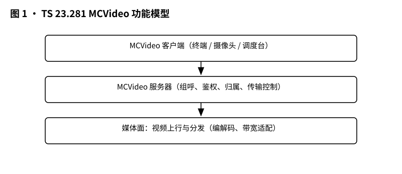
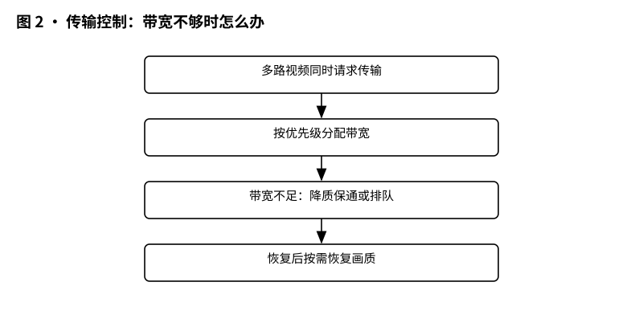
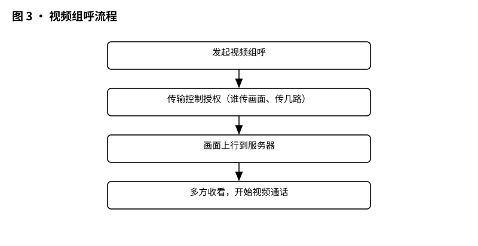

# 3GPP TS 23.281 解读：MCVideo 功能架构——视频画面在网里是怎么流转的

> 版本：v1.0 ｜ 更新：2026-10-28 ｜ 基线：TS 23.281 v20.5.1（Rel-20）｜ 原文：whatthespec.net 抓取的关键条款

**TS 23.281 定义了**关键任务视频（MCVideo）服务的功能模型、流程和信息流**，讲述了视频画面如何在用户终端、服务器和网络之间高效、可靠地传输 [§1]。**

## 1. 它要解决什么问题

想象一下，如果警察叔叔在抓捕行动中只能靠对讲机说话，那是远远不够的。他们需要看到现场的画面：嫌疑人的位置、周围的环境、是否有爆炸物风险。这就是**关键任务视频（MCVideo）**存在的意义 [§1]。

但是，视频比语音“重”得多，给网络架构带来了巨大的挑战：

1.  **带宽消耗大**：语音只需要十几 kbps，而视频动辄数百 kbps 甚至几 Mbps。如果几十个人同时发视频，网络瞬间就会瘫痪。
2.  **传输控制复杂**：谁先说话？谁先看画面？在多人群组中，不能所有人都同时发高清视频，必须有一套“交通管制”机制 [§1]。
3.  **多样化的场景**：有时候是“我推给你看”（主动推送），有时候是“你发给我看”（被动拉取），有时候是“大家一起看”（群组广播） [§1]。

TS 23.281 就是为了解决这些问题，规定了一套统一的架构，确保视频在公共安全（如警察、消防）和商业应用（如铁路、电力公司）中都能稳定运行 [§1]。

## 2. 它在 MCX 家族中的位置

在 3GPP 的关键任务通信（Mission Critical, MCX）家族中，标准通常分为三层：

*   **Stage 1（需求层）**：由 **TS 22.280** 和 **TS 22.281** 定义。它们规定了“用户需要什么”，比如：紧急视频 2 秒内要起传、端到端时延不超过 1 秒（TS 22.281 R-5.4.2-001~005，已核实）[§1]。
*   **Stage 2（架构层）**：即本文 **TS 23.281**。它规定了“网络怎么搭、数据怎么流”，定义了功能实体（如服务器、客户端）和它们之间的逻辑接口 [§1]。
*   **Stage 3（协议层）**：由 **TS 24.281** 等定义。它规定了“具体的数据包长什么样”，比如 SIP 消息的具体字段、HTTP 请求的头信息等。

TS 23.281 建立在 **TS 23.280**（关键任务服务的通用功能架构）之上，并主要适用于基于 LTE（E-UTRAN）接入的场景 [§1]。你可以把它看作是从“需求蓝图”到“施工图纸”之间的关键过渡。

## 3. 核心概念大白话

为了理解视频怎么流转，我们先认识几个关键角色。在 TS 23.281 中，这些是**功能实体**，不一定对应物理设备，但逻辑上必须存在 [§6.2]。

### 3.1 MCVideo 客户端 (MCVideo Client)
这就是你手里的手机或执法记录仪上的 App。
*   **角色**：用户的代理人。
*   **职责**：负责发起呼叫、接收视频、发送视频，以及远程控制设备（比如调整摄像头角度） [§6.2.2.3.1]。
*   **位置**：位于用户设备（UE）中，无论是在网（On-network）还是离网（Off-network）模式下都存在 [§6.2.2.3.1]。

### 3.2 MCVideo 服务器 (MCVideo Server)
这是网络的“大脑”和“调度中心”。
*   **角色**：集中式支持实体。
*   **职责**：
    *   **群组管理**：同一群组的所有用户必须使用同一个 MCVideo 服务器 [§6.2.2.3.2]。
    *   **传输控制**：决定谁可以发视频，谁只能看 [§6.2.2.3.2]。
    *   **设备信息管理**：管理参与视频通信的设备信息，用于授权远程控制 [§6.2.2.3.2]。
    *   **功能别名控制**：管理用户的“功能别名”（Functional Alias），允许用户以特定角色（如“队长”、“观察员”）出现 [§6.2.2.3.2]。
*   **本质**：它是 **GCS AS**（组通信服务应用服务器）的一个具体实例，用于控制组通信中的多播和单播操作 [§6.2.2.3.2]。

### 3.3 媒体分发功能 (Media Distribution Function, MDF)
这是视频的“物流仓库”和“快递站”。
*   **角色**：媒体分发者。
*   **职责**：
    *   **接收上行视频**：从发送者那里接收视频流 [§6.2.2.3.3]。
    *   **存储**：将视频保存为文件（MCVideo Content Files） [§6.2.2.3.3]。
    *   **分发下行视频**：
        *   对使用**单播**（Unicast，点对点）的用户，通过 IP 单播发送 [§6.2.2.3.3]。
        *   对使用**多播**（Multicast，点对多）的用户，通过 IP 多播发送 [§6.2.2.3.3]。
*   **独立性**：MDF 可以使用与 MCVideo 服务器不同的 IP 地址，这意味着视频流和控制信令可以走不同的路径，优化网络负载 [§6.2.2.3.3]。

### 3.4 视频拉取 (Video Pull) vs 视频推送 (Video Push)
这是两种不同的交互模式：
*   **拉取 (Pull)**：接收方主动发起请求，“我要看你的视频”。例如，调度台想看某一线下警员摄像头的画面 [§7.3]。
*   **推送 (Push)**：发送方主动发起请求，“我要把视频发给你/这个组”。例如，一线警员发现情况，主动把画面推给指挥中心 [§7.4]。
*   **远程推送 (Remote Video Push)**：A 命令 B 把视频推给 C。这是一种三方交互，A 是发起者，B 是源，C 是目的 [§7.4.2.1]。

## 4. 一次视频组呼在架构里怎么走

让我们通过一个典型的**在网视频组呼（On-network Group Call）**场景，看看数据是怎么流动的。

*图 1 · MCVideo 功能模型：MCVideo 客户端、MCVideo 服务器、传输控制、媒体面。*

### 4.1 发起阶段：我要开视频会
1.  **用户动作**：用户 A 在手机上点击“发起群组视频呼叫”。
2.  **信令流程**：MCVideo 客户端向 MCVideo 服务器发送**组呼请求（Group Call Request）** [§7.1.2.2.1]。
    *   这个请求包含：
        *   **MCVideo ID**：发起者的身份标识 [§7.1.2.2.1]。
        *   **MCVideo Group ID**：要呼叫哪个组 [§7.1.2.2.1]。
        *   **SDP Offer**：发起者能支持的视频参数（如分辨率、编码格式） [§7.1.2.2.1]。
        *   **Implicit Transmit Media Request**：如果发起者想同时发送视频，这里会隐含一个请求 [§7.1.2.2.1]。

### 4.2 服务器处理与分发
3.  **服务器决策**：MCVideo 服务器收到请求后，检查权限、群组状态，并决定媒体参数 [§7.1.2.2.2]。
4.  **邀请其他用户**：服务器向组内其他成员（用户 B、C、D...）发送**组呼请求（Group Call Request）** [§7.1.2.2.2]。
    *   注意：这里的 SDP Offer 是服务器选定的参数，而不是发起者的原始参数，因为服务器可能会根据网络情况调整 [§7.1.2.2.2]。
5.  **用户响应**：
    *   用户 B 接受呼叫，发送**组呼响应（Group Call Response）**给服务器 [§7.1.2.2.3/4]。
    *   响应中包含 **SDP Answer**，确认自己支持的参数 [§7.1.2.2.3]。

### 4.3 传输控制：谁先说话？
这是视频与语音最大的不同。语音组呼（MCPTT）中，争夺的是“发言权”（Floor）。视频中，争夺的是**“上行媒体传输权”** [§7.7]。

6.  **请求传输权**：如果用户 A 想发送视频，他不能直接发，必须先向**传输控制服务器**（通常由 MCVideo 服务器实现）发送**发送媒体请求（Transmit Media Request）** [§7.7.1.2.2]。
7.  **授权或拒绝**：
    *   **授权 (Granted)**：服务器回复**发送媒体已授权（Transmit Media Granted）**。此时，用户 A 才能开始向上行链路发送视频包 [§7.7.1.2.3]。
    *   **拒绝 (Rejected)**：如果带宽不够或优先级低，服务器回复**发送媒体被拒绝（Transmit Media Rejected）**，并给出原因 [§7.7.1.2.4]。
    *   **排队状态**：用户还可以查询自己在队列中的位置（Media Transmission Queue Status） [§7.7.1.2.1]。

*图 2 · 传输控制：多路视频抢带宽时按优先级分配，不够就降质或排队。*

### 4.4 媒体面流转：画面怎么到别人手机里？

*图 3 · 视频组呼流程：发起 → 传输控制授权 → 画面上行 → 多方收看。*

8.  **上行传输**：
    *   用户 A 获得授权后，通过 **MCVideo-7** 参考点，将视频流发送到 **媒体分发功能（MDF）** [§6.2.2.3.3]。
    *   这个参考点承载上行视频媒体，具体协议栈在 Stage 3 定义。

9.  **下行分发**：
    *   **单播用户**：如果用户 B 使用单播接收，MDF 会通过 **MCVideo-7** 参考点，单独将视频流复制并发送给 B [§6.2.2.3.3]。
    *   **多播用户**：如果用户 C、D、E 都在同一个多播组中，MDF 通过 **MCVideo-8** 参考点，使用 IP 多播一次性发送视频流，网络只传一份数据，节省带宽 [§6.2.2.3.3]。

10. **结束呼叫**：
    *   当用户 A 结束视频，或服务器发起释放时，**组呼释放请求（Group Call Release Request）**会被发送给所有参与方 [§7.1.2.2.5]。
    *   传输控制相关的资源也会被释放 [§7.7]。

## 5. 关键时刻的能力

除了基本的组呼，TS 23.281 还定义了一些在紧急和商业场景中至关重要的功能。

### 5.1 紧急视频与优先级
在紧急情况下（如火灾、袭击），视频呼叫可以携带**请求优先级（Requested Priority）** [§7.1.2.2.1]。
*   传输控制服务器会根据优先级决定谁先获得上行带宽。低优先级的视频流可能会被阻止发送，或者被降质处理 [§7.7]。
*   支持**广播组呼（Broadcast Group Call）**，允许单向大规模分发，例如指挥中心向所有警员推送现场航拍画面 [§7.1.2.2.1]。

### 5.2 视频拉取 (Video Pull)

*图 4 · 视频拉取 vs 视频推送：调度台主动要画面 vs 前端主动传画面。*

*   **场景**：调度台想实时查看某个固定监控点或特定警员的画面，而不是等警员主动发。
*   **流程**：
    1.  接收方（调度台）发送**私有呼叫请求**，类型为 Video Pull [§7.3.2.2]。
    2.  如果是从**服务器**拉取（如回放存储视频），请求中会包含**文件 URL（File URL）** [§7.3.2.2.1]。
    3.  如果是从**另一个客户端**拉取（一对一监控），则是一个受限的私有呼叫，只有被叫方（视频源）可以发送视频，主叫方只能看 [§7.3.2.3.1]。
    4.  视频传输完成后，发送**拉取完成请求（Pull Complete Request）**结束会话 [§7.3.2.2.3]。

### 5.3 视频推送 (Video Push)
*   **场景**：一线警员发现嫌疑人，主动将摄像头画面推给指挥中心。
*   **远程推送 (Remote Video Push)**：这是一个高级功能。调度员可以命令警员 A 将画面推送给警员 B，或者推送给整个小组 [§7.4.2.1]。
    *   请求中包含**源 MCVideo ID**（谁发）和**目的 MCVideo ID/Group ID**（发给谁） [§7.4.2.2.1]。
    *   这实现了“三方控制”：A 发起，B 发送，C 接收。

### 5.4 离网模式 (Off-Network)
*   TS 23.281 也规定了**离网模式**下的行为 [§1]。
*   在离网模式下，没有核心网服务器。MCVideo 客户端之间通过 ProSe（基于邻近的服务）直接通信，群组通信走 ProSe 组播地址 [§7.18]。
*   功能受限：没有集中式的服务器与传输控制，拉取/推送等流程由终端侧按 ProSe 规则完成 [§7.18]。

### 5.5 视频适配与带宽管理
*   当带宽不足时，传输控制机制会介入。
*   服务器可以拒绝低优先级请求，或者（在实现层面）指示客户端降低视频码率/分辨率 [§7.7]。
*   MDF 负责确保媒体流的正确分发，它可以根据接收端的网络状况，通过不同的 IP 地址和端口策略来优化传输 [§6.2.2.3.3]。

## 6. MCVideo 架构 vs MCPTT 架构的区别

很多读者熟悉 MCPTT（关键任务对讲），可能会问：视频架构和语音架构有什么区别？

| 特性 | MCPTT (语音) | MCVideo (视频) |
| :--- | :--- | :--- |
| **核心资源** | **地板 (Floor)**：谁拿话筒谁说话（MCPTT 术语，见 TS 23.379 §10.9） | **上行媒体传输权**：谁有带宽权谁发画面 [§7.7] |
| **媒体特性** | 单一媒体流（音频） | 多路可选，高带宽消耗 [§1] |
| **分发方式** | 主要是多播（组呼） | 多播 + 单播混合，支持拉/推/流 [§6.2.2.3.3] |
| **交互模式** | 主要是一人发多收（对讲） | 支持一对一、一对多、多对一、多对多，支持拉取和推送 [§7.3, §7.4] |
| **控制复杂度** | 相对较低，主要管理发言权 | 高，需管理带宽、优先级、设备控制、文件存储 [§6.2.2.3.2, §7.7] |
| **媒体面实体** | 通常由 GCS AS 或专用媒体服务器处理 | 明确定义了 **MDF (媒体分发功能)**，可与信令服务器分离 [§6.2.2.3.3] |

**关键区别点**：
*   **MCVideo 服务器**不仅是信令中心，还紧密关联**设备信息管理**和**功能别名控制**，因为视频往往涉及摄像头、云台等硬件控制 [§6.2.2.3.2]。
*   **MDF 的独立性**：在 MCVideo 中，明确将媒体分发功能（MDF）作为一个独立实体描述，强调其可以使用不同的 IP 地址，这与语音中媒体服务器往往与信令服务器绑定或紧密耦合的传统架构有所不同 [§6.2.2.3.3]。

## 7. 它不管什么（边界）

为了避免误解，明确 TS 23.281 的**非职责**范围：

1.  **不管 Stage 1 需求细节**：它不规定“视频清晰度必须达到 1080P”这类具体指标。这些在 TS 22.280/281 中定义 [§1]。
2.  **不管 Stage 3 协议细节**：它不定义 SIP 消息的具体 URI 格式、HTTP 头字段的具体名称、RTP 负载格式。这些在 TS 24.281 等协议规范中定义。
3.  **不管编解码实现**：它不规定使用 H.264 还是 H.265，也不规定具体的编码参数算法。它只定义信令中如何协商这些参数（通过 SDP） [§7.1.2.2.1]。
4.  **不管物理层接入**：它不定义 LTE 空口如何传输视频包，也不定义 Wi-Fi 直连的具体物理机制。它假设底层 IP 传输是可用的 [§1]。
5.  **不管纯音频功能**：虽然视频呼叫可能伴随音频，但 TS 23.281 专注于视频媒体。纯音频组呼由 MCPTT 规范（TS 23.379/24.379）处理。

## 8. 怎么往下读

如果你想深入理解 MCVideo，建议按照以下路径阅读：

1.  **本篇 (TS 23.281)**：理解架构、功能实体、信息流。这是“骨架”。
2.  **TS 23.280 (关键任务服务通用架构)**：理解 MCVideo 如何嵌入到更大的 MCX 体系中，特别是与 GCS AS 的关系 [§6.2.2.3.2]。
3.  **TS 24.281 (MCVideo 协议)**：查看具体的信令消息格式，如 SIP INVITE、HTTP POST 的具体字段。这是“血肉”。
4.  **TS 22.281 (MCVideo 需求)**：查看业务需求，理解为什么架构要这样设计。这是“灵魂”。

### 版本说明与来源

*   **文档版本**：3GPP TS 23.281 v20.5.1
*   **发布版本**：Release 20
*   **主要参考**：
    *   TS 22.280: Mission Critical Services Common Requirements (MCCoRe)（通用需求）
    *   TS 22.281: Service requirements for mission critical video (MCVideo) service (视频特定需求)
    *   TS 23.280: Functional architecture for mission critical services (通用架构)
    *   TS 23.468: Group Communication System Enablers for LTE (GCSE_LTE)（MCVideo Server 是 GCS AS 的实例）
    *   TS 23.401: General Packet Radio Service (GPRS) enhancements for Evolved Universal Terrestrial Radio Access Network (E-UTRAN) access (EPC 架构)
*   **来源**：本文基于 3GPP TS 23.281 v20.5.1 官方文本摘要及 whatthespec.net 抓取的关键条款解读。

*(注：文中提到的条款号如 [§7.1] 均指向 TS 23.281 v20.5.1 的对应章节。具体协议实现细节请以 Stage 3 规范为准。)*
