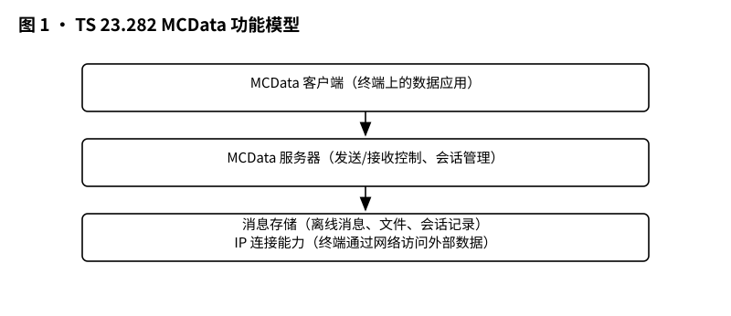
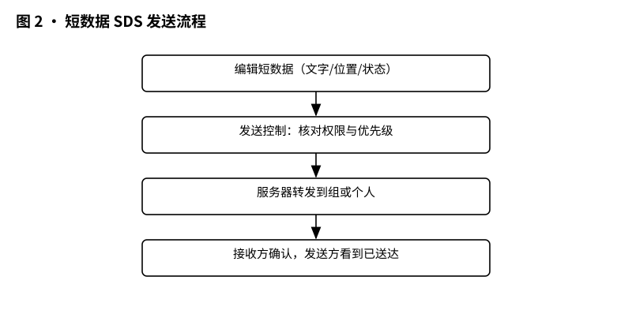
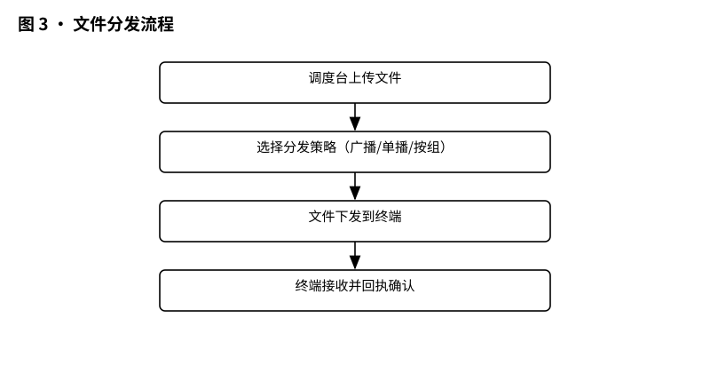
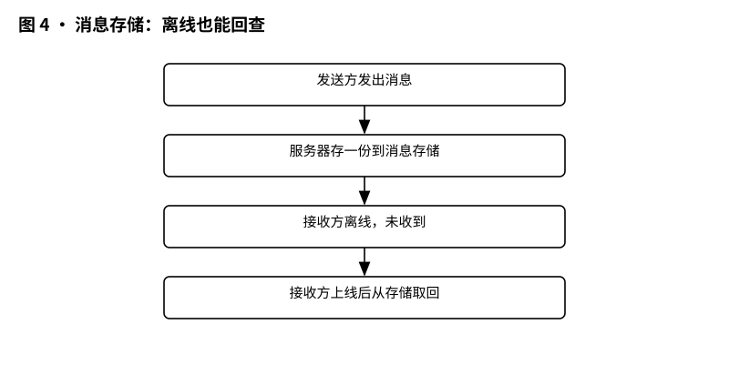

# 3GPP TS 23.282 解读：MCData 功能架构——数据通道在网里是怎么搭起来的

> 版本：v1.0 ｜ 更新：2026-10-28 ｜ 基线：TS 23.282 v20.3.1（Rel-20；知识库原基线为 Rel-19 v19.9.0，2026-10-28 同步）｜ 原文：whatthespec.net 抓取的关键条款

**TS 23.282 是一份“MCData（关键任务数据）功能架构与信息流说明书”，它告诉网络：关键任务的短消息、文件、数据流和 IP 连接，在 LTE 里从发送到接收，每一步该由谁管、怎么管 [§1]。**

---

## 1. 它要解决什么问题

MCData 不是一个单一业务，而是一组业务套餐，底层共用一套功能架构 [§1]。这个套餐里有四个子服务 [§1]：

- **短数据服务（SDS）**：适合发送短小精悍的信息，例如现场人员的状态上报、指令下达；
- **文件分发（FD）**：下发指令文档、现场照片、操作录像等文件资料，且包含强制下载与非强制下载两种模式；
- **数据流（DS）**：传输视频流、音频流等连续数据；
- **IP 连接**：为终端提供接入网络的通道。

打个比方，MCData 就是给关键任务部门配的“数据直通车”。SDS 是直通车上的“文字聊天窗口”，FD 是“文件专区”，DS 是“直播视频流”，而 IP 连接则是“车轮子”——没有车轮子，前面的业务都跑不起来。

套餐之上，还有四项贯穿始终的“能力” [§1]：

- **会话管理**（conversation management）：类似微信群聊的管理，决定谁能说话、在哪个群聊里说话；
- **发送与接收控制**（transmission and reception control）：控制发出的数据往哪走，以及收到的数据如何处理；
- **通信释放**（communication release）：结束会话，类似于挂断电话、解散群聊；
- **增强状态**（enhanced status）：实时感知对方或终端的状态。

一句话总结它们的关系：四个子服务提供“运送什么”，四项能力管“怎么送、谁来看、什么时候结束”。

但光有这些名词，不叫系统。数据要从发送方一路跑到接收方，网络必须回答四个问题：**谁来定路线（发送控制）？谁来确认送达（接收控制）？会话归谁管？消息要不要存档、存到哪？** 这正是 TS 23.282 要回答的。它画出了功能模型——哪些功能实体在客户端、哪些在服务器端——并且把关键业务的信息流逐条写清楚 [§1]。

## 2. 它在 MCX 家族中的位置

在 3GPP 的标准体系里，MCData 并不是孤立的。它在整个标准家族中的位置非常清晰：

**TS 23.282 是一张“施工蓝图”（Stage 2 设计规范）。** 
它站在其他标准的肩膀之上，上承 TS 22.282 的业务需求（“要什么”），复用 TS 23.280 定义的关键任务通用架构（“共用零件”），下接 TS 24.282 的具体协议消息（“怎么接线”）。同时，它还借用了 IMS 架构 [§4]、ProSe 邻近服务架构 [§4]、GCSE_LTE 群组通信架构（支持 MB2 接口的广播多播业务） [§4]、MBMS 用户业务架构 [§4]、安全规范 TS 33.180 [§4]，以及 PS-PS 接入切换流程 [§4]。

**接入方式上**，MCData 终端主要通过 E-UTRAN（LTE 无线接入）接入 EPS 核心网架构 [§4]；也可以从非 3GPP 网络接入部分应用功能，但规范没有为非 3GPP 接入定义任何新增功能 [§1]。换句话说，想要享受完整的 MCData 服务，LTE 是主干道，非 3GPP 网络只是一条小岔路。

**业务场景上**，既可用于公共安全（如警察、消防的应急指挥），也可用于商业领域，比如公用事业公司、铁路部门的日常调度 [§1]。MCData 系统还支持与 LMR（传统窄带专网）系统互通 [§4]。

## 3. 核心概念大白话

要读懂后面那张“功能模型图”，先认识四个核心角色。

**MCData 客户端。** 用户手中的终端（UE）里，有一块专门负责代理所有应用交易的软件模块。它像个“数据总代理”，内置了 SDS、FD、DS 和 IP 连接四大能力，支撑着会话管理、机器人控制、增强状态、数据库查询、安全上网等业务 [§6.4.3.1.1]。

**MCData 服务器。** 这是网络侧的核心，负责对整套业务进行集中化支持 [§6.4.3.1.2]。两个硬规矩：同一组的所有用户客户端，必须使用同一台 MCData 服务器；一个用户同时加入多个组时，可以和多台服务器打交道 [§6.4.3.1.2]。服务器身兼两职——对某场通信，它是“发令员”，负责控制整个会话流程；同时它也可以作为“运动员”亲自参与通信 [§6.4.3.1.2]。但注意：每场一对一或群组通信中，**只能有一台服务器当“发令员”**，参与者可以有多个 [§6.4.3.1.2]。

**发送控制与接收控制。** 它们是用户层面的专属网络功能，是现网业务中的核心所在。发送控制像是“交通调度员”，终端要发消息，必须先向网络“报备”，由发送控制接管并决定这辆车该怎么走；接收控制则像是“门卫”，管理着哪些群组消息可以进终端的大门，哪些外部 IP 数据包可以放行 [§1][§5.1][§5.2]。

**MCData 消息存储。** 这是一块为用户永久保存通信记录的安全“官方档案室”。每个授权用户有一个专属存储区，凭 MCData ID 认人，互不越界。即使用户不在线，他的消息也会被妥善保管。调度员等其他角色如果获得授权，也可以查看该用户的档案 [§5.10]。

此外，MCData 服务器还扮演着一个重要的物理角色：**它控制信号和媒体的走法** [§6.4.1]。网络可以选择让数据流直接端到端传输（像普通 IP 电话的 P2P 直连），也可以让服务器充当中转站，决定自己是否要坐在数据流的路径上 [§6.4.1]。

*图 1 · MCData 功能模型：MCData 客户端、MCData 服务器、发送/接收控制、消息存储。*

## 4. 一次短数据发送在架构里怎么走

有了上面的角色，我们来走一遍最基础的短数据发送流程。

MCData 客户端在选择发送方式时，会依次考虑这些因素 [§7.4.1]：数据大小是否超过信令通道的上限；是单发还是连续发；收件人是某个用户还是某个群组（也可以是叫不出真名、只有一个“功能别名”的角色，比如“值班员”）；终端是在网还是离网；最后还要考虑安全要求。

发送方客户端组装出一条“独立数据请求”，发给 MCData 服务器。这条请求里装的东西很讲究 [§7.4.2.1.1]：

- **必填的四项**：发送方 MCData ID（我是谁）、会话标识（在哪个“房间”）、交易标识（本次是哪一笔）、载荷目的地类型（这数据是给应用软件吃，还是给人看）；
- **可选的一堆**：接收方的身份（MCData ID 或功能别名）、回复标识、紧急指示、处置类型（要求对方回“已送达”还是“已读”，或者两者都要）、位置信息、应用标识等；
- **载荷本体**：也就是你要发的实际文字内容。

这里有个关键细节：**接收方身份至少出现一种**。如果 MCData ID 和功能别名都带了，就以 MCData ID 为准来路由——别名只是展示用的备注 [§7.4.2.1.1 NOTE 1]。

服务器收到后，根据目的地做出判断。如果是点对点发送，它直接交给对端用户的客户端；如果是群组发送，它就充当“中转枢纽”，把消息扇出给组内所有人 [§6.4.3.1.2]。

*图 2 · 短数据 SDS 发送流程：编辑 → 发送控制 → 服务器转发 → 接收确认。*

需要说明的是，这些信息流只在**单个 MCData 系统内部**有效；跨系统的通信，要另外由系统间流程规定 [§7.4.2]。

## 5. 关键时刻的能力

### 5.1 文件分发：广播的效率

文件分发支持一对一和群组两种模式，并涵盖强制下载与非强制下载 [§7.5.1]。

文件上传时，客户端告诉服务器“我是谁”（MCData ID），然后二选一：要么直接把文件内容传上去，要么只给一个“内容引用”（URL，指向自己消息存储里已有的文件） [§7.5.2.1.1]。注意：内容和引用**只能带一个，不能两个都带** [§7.5.2.1.1 NOTE]。服务器确认接收成功之后，会返回一个成功确认，并附带一个存储位置 URL [§7.5.2.1.2]。

分发到对端时，客户端告诉接收方要去哪个 URL 下载 [§7.5.2.1.3]。服务器执行下发任务。对于群组文件下发，服务器有个“大招”——利用 MBMS 广播机制。广播和单播是两条腿走路，服务器负责统一控制。如果是群组广播，就通过 MB2 接口下发 MBMS 通知，让所有人都从同一个通道接收数据，极大节省核心网带宽 [§4][§6.4.3.1.2]。同时，发送方也可以选择是否要求接收方回传“下载完成”报告 [§7.5.2.1.5]。

*图 3 · 文件分发流程：上传 → 选择分发策略 → 下发到终端 → 回执确认。*

### 5.2 紧急告警

不管是发短数据还是发文件，信息流里都预留了“紧急指示”这个可选字段 [§7.4.2.1.1][§7.5.2.1.1][§7.5.2.1.3]。一旦勾选，网络就知道这是紧急通信。规范没有写明紧急通信触发与通知的具体优先级规则（这部分留给了实现或更高层的系统设计），但字段本身必须在那里，这是系统承载紧急数据能力的基础 [§7.4.2.1.1]。

### 5.3 离网数据

所谓离网，就是终端不在 LTE 覆盖范围内（比如隧道、地下室、边远山区）。规范明确画出了离网场景下的应用平面功能模型 [§6.4.2]，离网通信走 ProSe（基于邻近的服务）能力，流程见 §7.16。一句话：离网能走，但没有在网的服务器集中管控，能力范围受限。

### 5.4 消息存储与回查

关键时刻，离网的人回来后，必须能查到之前的消息，这就是消息存储的用武之地。

在规范里，消息存储的操作是透明的。当会话进行时，只要用户开启了存储开关，服务器就会把双方交换的消息和文件**自动抄送到档案室** [§5.10]。如果用户在档案室还没有账号，服务器会先帮他建号，再存入数据 [§5.10]。

存进去的每个对象都打包了两样东西 [§5.10]：一是消息/文件本体；二是元数据，元数据里面既有从原消息里提取的 MCData ID、会话标识，也有内容类型、各种“已见/已收/已读/已下载”的状态标签。

一个很有实用价值的小细节：如果消息里带的只是一个文件下载 URL，存储时有两种摆法 [§5.10]——要么原样保存这条消息；要么把 URL 改造一下，指向从内容服务器取回来、单独存进用户档案室的文件副本。改造后的 URL 在安全和授权到位的前提下，还能被内容服务器等其他网络单元访问，方便二次调取。

最后，**同步时机有硬规矩**：用户登录终端、完成认证授权并拿到服务 profile 之后，在任何 MCData 业务开始之前，终端上的消息存储客户端必须先跟档案室同步一遍（自动或手动），保证本地和云端的存档是同一版本 [§5.10]。

*图 4 · 消息存储：发送方存一份，接收方离线也能在上线后回查。*

## 6. MCData 架构 vs 通用架构的区别

你可能会问，既然有 TS 23.280 的通用关键任务架构，为什么还要有 TS 23.282？

区别在于：**TS 23.280 管的是“共用的骨架”，而 TS 23.282 管的是“数据专属的血肉”。**

在通用架构（TS 23.280）中，定义的是 MCPTT（关键任务一键通话）等业务的公共功能模型，涵盖了 PTT 业务专用的语音通信控制。而 MCData 是数据业务，虽然它借用了通用架构中极为相似的“客户端-服务器”逻辑，但核心差异在于 23.282 提出了数据业务特有的机制：

**关键差异表：数据业务 vs 一键通业务**

| 维度 | MCPTT 架构特征 | MCData 架构特征 |
|---|---|---|
| 核心数据载体 | 短音频（语音片段）为主 | SDS 短数据、FD 文件、DS 视频流、IP 数据包 [§1] |
| 架构复用关系 | TS 23.280 定义的公共功能架构 [§1] | 复用 TS 23.280 的公共功能架构 [§1] |
| 功能实体 | MCPTT 客户端、MCPTT 服务器 | MCData 客户端、MCData 服务器、内容服务器 [§6.4.3.1] |
| 特定机制 | 拥有典型的按下即说、说话者识别、群组呼叫状态等机制 | 不存在 MCPTT 语音典型的说话者标识等机制；具备专门的消息存储、发送/接收控制机制 [§1] |
| 在模型中的角色 | MCPTT-x 参考点（如 MCPTT-1~MCPTT-8，见 TS 23.379 §7.5） | 能力参考点（MCData-cap-1 到 MCData-cap-n） [§6.4.1] |

可以看到，在 TS 23.282 的通用功能模型（图 6.4.1-1）中，客户端和服务器之间的连接是一组抽象的“能力参考点”（MCData-cap） [§6.4.1]。四大能力各自独立运作。此外，为了支撑消息存储，23.282 模型中引入了 MCData 消息存储、消息存储客户端和通知服务器这三个新组件，而它们的安全机制和参考点全部划归 3GPP SA3 安全组负责，不在本规范的讨论范围 [§6.4.1 NOTE 1]。

## 7. 它不管什么

读一份规范，也要清楚它“不做什么”。TS 23.282 有四道清晰的边界：

**不管 Stage 1 的需求细节。** 这篇文档是施工图，不是需求书。“用户到底想要什么功能细节”写在 TS 22.282 和 TS 22.280 里，这里只管把功能实现出来 [§1]。

**不管 Stage 3 的具体协议消息。** 它画出了“信息流”（信息流表格里列出了必选、可选字段），但具体这些字段如何映射到 SIP/HTTP 等协议消息里，要去找 TS 24.282 等协议规范 [§1]。

**不管实现选型。** 规范里写“功能实体”，只是逻辑上的模块划分，不代表现实中一定要部署成一台物理机器。一个物理服务器里可以跑多个功能实体，怎么部署由设备商和运营商决定 [§6.4.3.0]。

**不管某些流程。** 比如数据流（DS）的具体流程，当前规范就明确标注了“不在本规范覆盖范围内” [§1 NOTE]。

## 8. 怎么往下读

按这个顺序读，效率最高：

1. **先读本篇（TS 23.282）**：建立 MCData 的功能全景图，记住四个子服务、四类能力、四个核心角色。
2. **再读 TS 23.280**：看懂关键任务共用功能架构，理解 MCData 与 MCPTT 在骨架上的渊源。
3. **最后读 TS 24.282**：落到协议层面，弄清楚一条 SDS 请求从终端到核心网底层，具体是由哪些信令消息携带的。

读的时候记住一个大原则：这份规范的核心思想是**“逻辑功能可以拆分，流程按场景分类，细节留给后续协议”**。

### 版本说明与来源

- **规范版本**：TS 23.282 v20.3.1（Rel-20，2026-10）。
- **知识库原基线**：Rel-19 v19.9.0，2026-10-28 同步为 Rel-20 v20.3.1。
- **参考来源**：
  - 3GPP TS 23.282，Mission Critical Data (MCData) functional architecture（whatthespec.net 抓取条款：§1 Scope、§4 Introduction、§5.10 MCData message store、§6.4 Generic functional model、§7.4 Short data service、§7.5 File distribution）。
  - 文中引用的标准号均来自规范原文引用：TS 23.280、TS 22.282、TS 22.280、TS 23.401、TS 23.228、TS 23.303、TS 23.468、TS 26.346、TS 26.348、TS 33.180、TS 23.237、TS 23.283。
