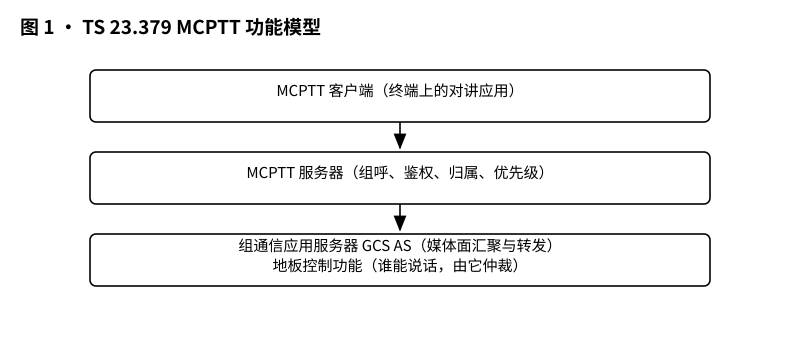
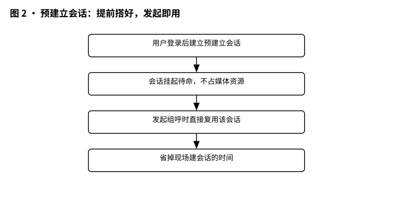
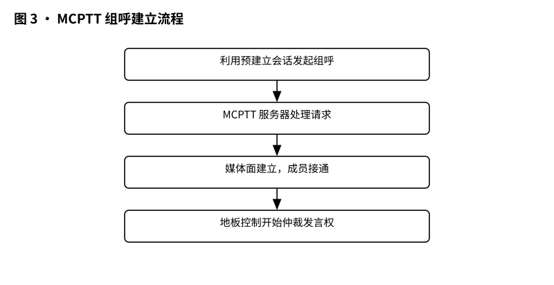
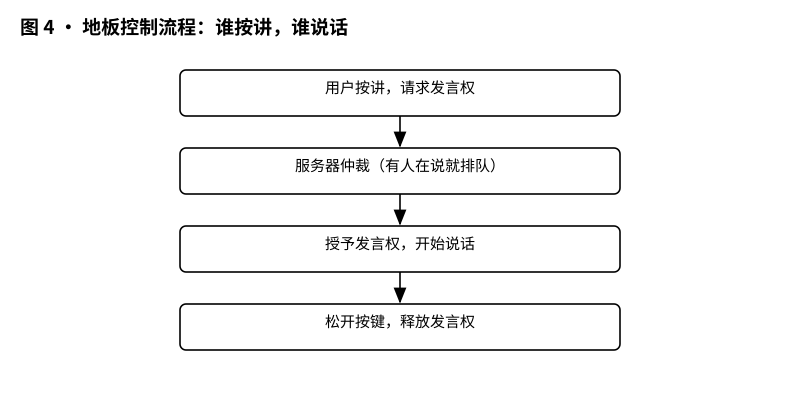

# 3GPP TS 23.379 解读：MCPTT 功能架构——对讲机在网里是怎么搭起来的

> 版本：v1.0 ｜ 更新：2026-10-28 ｜ 基线：TS 23.379 v20.4.0（Rel-20）｜ 原文：whatthespec.net 抓取的关键条款

**TS 23.379 是 MCPTT（任务关键一键通）的“功能架构说明书”，把“谁负责干什么、消息怎么流动”画成图纸，不讲具体消息怎么编码 [§1]。本文解读版本 TS 23.379 v20.4.0（Rel-20）。**

## 1. 它要解决什么问题

MCPTT 是对讲机的现代化版本：按下按键就说话，松开就听，一群人一起开会，有人管“谁现在能说”。但传统对讲机靠模拟专用频率，而 MCPTT 要跑在 LTE 上，必须变成运营商网络里能被管理、能被优先保障的数字业务 [§1]。

需求端（要不要做、做到什么程度）由 TS 22.179 和 TS 22.280 定义 [§1]，而 TS 23.379 负责把这些需求“落成楼”：定义支持 MCPTT 业务所需的功能架构、程序和信息流 [§1]。具体要回答三个问题：

1. 系统里有哪些“功能盒子”（不是指物理服务器，只是功能模块），比如服务器、客户端、地板控制功能 [§7.4.1]；
2. 谁管发言权（地板控制）：组呼里大家不能抢话，必须有人仲裁谁可以说话 [§10.9]；
3. 媒体走哪条路：单播还是组播、何时建会话、何时传话 [§7.4.2.3.2]。

MCPTT 的定位是“任务关键”：比如警察、消防场景中，MCPTT 呼叫需要比普通电信业务更高的优先级，包括紧急和紧迫威胁的优先处理 [§1]。所以架构里处处要给“插队”和“强插”留位置（后文会讲到）。

适用范围方面，本规范主要面向基于 E-UTRAN 接入、采用 TS 23.401 定义的 EPC 架构的 MCPTT 语音业务 [§1]；调度和管理等应用功能也可以走非 3GPP 接入，但对非 3GPP 接入不定义额外功能 [§1]。规范也考虑了不同 MCPTT 系统之间的互通 [§1]。

## 2. 它在 MCX 家族中的位置

把 MCX 想象成盖楼：TS 22.179/TS 22.280 是“户型需求书”（要什么功能），TS 23.379 是“总平面图”（功能块怎么摆、消息怎么流），TS 24.379 则是“施工规范”（消息字段怎么编码）——本篇解读的是中间这层。

TS 23.379 并不是从零画图纸，而是“站在别人的肩膀上”拼装出 MCPTT 架构 [§4]：

- 共用的任务关键服务通用功能架构：TS 23.280（MCPTT 服务器、离网录音客户端等共用实体都在那里定义）[§1][§4][§7.4.2.2]；
- IMS 架构：TS 23.228 [§4]；
- Proximity-based Services（ProSe，基于邻近的服务）架构：TS 23.303 [§4]；
- LTE 组通信使能系统 GCSE_LTE：TS 23.468 [§4]；
- PS-PS 接入转移程序：TS 23.237 [§4]。

其中最关键的一条关系：MCPTT 服务器功能实体是 TS 23.468 中 GCS AS（组通信应用服务器）的一个具体实例 [§7.4.2.3.2]。换句话说，MCPTT 没有另起炉灶，而是复用了 LTE 上做组通信的标准零件。同时，MCPTT 系统还提供与 LMR（传统陆地集群无线电）系统互通的功能 [§4]，让老式对讲系统能和新系统搭上话。

## 3. 核心概念大白话

先上整栋楼的功能图（图里画的是各功能实体之间的归属关系和职责划分）：

*图 1 · MCPTT 功能模型：MCPTT 客户端、MCPTT 服务器、组通信应用服务器 GCS AS 与地板控制功能。*

**常用功能实体**（MCPTT 客户端、MCPTT 服务器、地板控制、GCS AS 等）：功能实体描述的是“干什么”，不隐含物理实体——同一块功能可能落在一台物理机器上，也可能分散在多台机器上 [§7.4.1]。

**应用面**：MCPTT 服务应用面内的实体提供应用控制、媒体控制和分发功能 [§7.4.2.1]。可以把它理解成“对讲业务的操作系统”，跑在网络侧。

**常用服务核心**：MCPTT 应用面内包含一个“常用服务核心”，其实体在 TS 23.280 的共用架构里定义 [§7.4.2.2]。它就像大楼的公共管廊，MCPTT 和 MC 视频、MC 数据业务共用。离网录音客户端同样在 TS 23.280 里定义 [§7.4.2.2a]，功能细节见该规范。

**MCPTT 客户端**：MCPTT 应用业务的用户代理，处理所有 MCPTT 应用交易，并负责报告自己当前所在的位置 [§7.4.2.3.1]。它就是装在终端里的“对讲机 App”。

**MCPTT 服务器**：为 MCPTT 业务提供集中式支持 [§7.4.2.3.2]。几个关键规则：

- 同一个组的所有用户，其客户端必须使用同一个 MCPTT 服务器来服务该组；一个用户同时参加多个组时，客户端可以和多个服务器打交道 [§7.4.2.3.2]；
- 对某次呼叫，每个 MCPTT UE 用单播还是组播传输，由服务器来决定，并负责把分配结果通知终端 [§7.4.2.3.2]；
- 扮演 GCS AS 角色后，服务器要负责：申请组播资源、把组播资源与呼叫的关联通知 MCPTT UE、为每个 UE 决定传输方式并通知分配结果、向媒体分发功能告知本次呼叫需要支持哪些媒体流 [§7.4.2.3.2]。

服务器还要支持两个角色：“控制方”和“参与方” [§7.4.2.3.2]。每通私呼或组呼，有且只有一个服务器当控制方；参与方可以有一个或多个，同一个服务器可以同时既控制又参与 [§7.4.2.3.2]。控制方的职责很多，包括：呼叫控制（例如对参与组呼执行策略）、和组管理服务器对接用户组成员与策略、执行功能别名优先级处理、管理组呼/私呼中的地板控制实体、管理呼叫中的媒体处理实体（会议、转码），以及和录音服务器对接录音流程管理 [§7.4.2.3.2]。功能别名控制角色还负责从功能别名管理服务器获取策略，并执行功能别名的激活与去激活 [§7.4.2.3.2]。

功能别名是什么？比如处警台呼叫时可以用“××分局指挥中心”而不是某个具体话务员的号码，这就是功能别名。

**地板控制**：这是 MCPTT 的灵魂。“地板”（floor）就是“说话权”。组呼里任何人都不能随意插话，必须先向地板控制服务器申请，获批后才能说话，说完释放 [§10.9.1.1]。私呼里地板控制同样适用 [§10.9.1.1]。

**预建立会话**：先在服务器和客户端之间提前建好一条会话管道，真正开会时直接用，省掉临时建会话的时间。细节见第 4 节。

**媒体面路由**：组呼里服务器决定每个 UE 用单播还是组播拿媒体，这就是“媒体怎么分发”的路由决策 [§7.4.2.3.2]。

## 4. 一次 MCPTT 组呼在架构里怎么走

### 4.1 第一步：进组（归属）

用户先在某个组里“挂上号”。控制方服务器要与组管理服务器交互，获取本服务器所服务成员的组成员关系和策略信息 [§7.4.2.3.2]。组成员和调度策略不在 23.379 里定义，这步只是“接口对好”。

### 4.2 第二步：预建立会话

MCPTT 服务器和客户端可以使用 TS 23.280 定义的一个或多个预建立会话，用于组呼、私呼、MCPTT 紧急组呼、MCPTT 紧急危险（imminent peril）组呼、MCPTT 紧急私呼、MCPTT 紧急告警等流程 [§10.5.1]。

建会话时，客户端发“Create pre-established session request”，带两个必选元素：发起方 MCPTT ID（我是谁）和 SDP offer（媒体信息，如端口、编解码器、协议标识）[§10.5.2.1]；服务器回“Create pre-established session response”，带 SDP answer（服务器这边的媒体信息）和 Session ID（标识这条预建立会话）[§10.5.2.1]。之后双方还可以用 Modify 流程修改会话，同样带 Session ID 和新的 SDP offer/answer [§10.5.2.2]。

生活类比：这就像开会前先把音视频管线铺好，等人到齐了直接开讲，不用等“喂喂，听得到吗”半天。

*图 2 · 预建立会话：登录后提前建好会话，发起组呼时直接复用，省掉建会话时间。*

### 4.3 第三步：发起组呼

这里有两种模式，像点菜时选“预定包间”还是“到店开桌”：

- **预定组呼（pre-arranged group call）**：发言方 UE 用 SIP 程序发起呼叫 [§10.5.1]；组呼入呼（服务器叫成员来接）则用媒体面控制程序建立服务器与客户端之间的呼叫 [§10.5.1]。有点绕，但意思就是：被叫侧走媒体面控制，速度快。
- **聊天组呼（chat group call）**：成员可以发送组加入请求（group join request）用 SIP 程序加入 [§10.5.1]。注意：无论是否用预建立会话，聊天组呼的开始和通知都使用地板控制消息 [§10.5.1 NOTE]——也就是说聊天组呼的“开场白”就是地板消息。

*图 3 · 组呼建立流程：预建立会话 → 发起组呼 → 服务器处理 → 媒体面建立。*

### 4.4 第四步：地板控制（抢话权）

服务器侧要管理地板控制实体，负责仲裁每次发言 [§7.4.2.3.2]。

具体流程：

1. **请求（Floor request）**：想说话的人把请求发给地板控制服务器。必选元素：MCPTT ID（申请人身份）、Floor priority（优先级）；可选元素：功能别名、来源标识（仅在媒体复用时出现）、位置信息 [§10.9.1.2.2]。请求以单播发给服务器 [§10.9.1.2.2]。
2. **仲裁/排队**：服务器根据会话状态（话权是否已给别人）、用户签约、优先级等决定授予还是拒绝 [§10.9.1.2.1]。
3. **授予（Floor granted）**：通知获批的人可以传媒体了。必选元素：MCPTT ID（被授予方身份）、Duration（允许说话时长）；可选：功能别名、来源标识、是否需要确认 [§10.9.1.2.3]。以单播发给被 granted 的人 [§10.9.1.2.3]。
4. **说话**：拿到 granted 后，沿预先建好的上行承载发语音 [§10.9.1.2.1]。
5. **拒绝（Floor rejected）**：不想给就单播拒绝给申请人 [§10.9.1.2.4]。
6. **释放/空闲**：说完了，用 floor release（上行）或 floor idle（下行，可广播）释放话权 [§10.9.1.2.1]。

*图 4 · 地板控制流程：按讲请求 → 仲裁/排队 → 授予发言权 → 说话 → 松开释放。*

还有个小机关：部分地板控制消息可以“顺风车”捎带呼叫控制信息，提高效率 [§10.9.1.2.1]：

- 呼叫建立请求可捎在 floor request（上行）或 floor taken（下行，可广播）里；
- 呼叫释放请求可捎在 floor release（上行）或 floor idle（下行，可广播）里。

也就是说，释放话权的同时可能顺便把呼叫也拆了，消息一鱼两吃。

### 4.5 第五步：媒体传输

拿到地板的人说话，媒体沿预建立的管道传。组呼里服务器会告诉每个 UE 用单播还是组播收媒体 [§7.4.2.3.2]，这就是媒体面路由的落点。组呼由控制方服务器集中管理媒体处理实体（会议、转码）[§7.4.2.3.2]。

## 5. 关键时刻的能力

**紧急组呼**：有专用的信息流。客户端发起 MCPTT 紧急组呼请求，发给服务器，服务器再转给群主机 MCPTT 服务器，并转发给客户端 [§10.6.2.2.1]。必选元素：主叫 MCPTT ID、MCPTT 组 ID、紧急指示（标明这是紧急组呼）；可选元素：功能别名、告警指示（是否要同时发紧急告警）、隐式申请地板（发起方顺手要话权）、请求的优先级、位置 [§10.6.2.2.1]。响应流程返回结果（成功或失败）[§10.6.2.2.1a]。

还有配套的取消流程：正在进行的紧急组状态取消（MCPTT in-progress emergency group state cancel），在 Rel-13、Rel-14 版本中这条信息流叫“MCPTT emergency group call cancel request/response”，Rel-14 起改名 [§10.6.2.2.2 NOTE]。这体现了标准的演进：名字变了，位置没变。

**地板抢占（override）**：地板 revoked 消息可以作为 override 的一部分，把已授予的话权硬收回 [§10.9.1.2.1]。生活类比：消防现场，指挥员需要立刻插话时，按下红色按钮直接抢走话筒，不需要排队。

**地板排队透明**：地板队列状态请求（floor queue status request）可以让申请人知道自己在队里排第几 [§10.9.1.2.1]。

**离网（off-network）**：规范同时支持在网和离网两种模式的组呼与私呼 [§1][§10.6.1]。离网就是终端之间不走网络服务器、直接邻近通信；在网则依赖服务器集中管理。MCPTT 客户端里包含离网录音客户端，功能在 TS 23.280 里定义 [§7.4.2.2a]。

**与 LMR 系统互通**：MCPTT 系统提供与 LMR 系统互通的功能，互通细节见 TS 23.283 [§4]。

**环境监听与互通的边界**：MCPTT 本篇规定的是功能实体与信息流，紧急告警、紧急私呼等流程也在预建立会话的适用范围内 [§10.5.1]；环境监听本身是本篇定义的一道程序（§10.14），其消息级细节在协议层 TS 24.379 中规定。跨系统呼叫在规范范围内 [§1]，但具体互通实现不在本篇展开。

## 6. MCPTT 架构 vs 通用架构的区别

可以把两者理解为“公共管廊”和“专用房间”：

- **TS 23.280 管共用的**：常用服务核心、MC 业务共用的信令与媒体机制、预建立会话的通用定义（MCPTT 的预建立会话就是引用它）[§7.4.2.2][§10.5.1]。MCPTT 服务器、离网录音客户端在 TS 23.379 里不重复定义，直接指向 23.280 [§7.4.2.2][§7.4.2.2a]。
- **TS 23.379 管 MCPTT 专属的**：MCPTT 客户端/服务器这对“user agent 与集中支持”的组合 [§7.4.2.3.1][§7.4.2.3.2]、组呼与私呼的具体信息流（紧急组呼、取消流程）[§10.6]、地板控制的信息流细节（请求/授予/拒绝/释放）[§10.9]、预建立会话在 MCPTT 场景里的使用方法 [§10.5]。

**23.280 画“通用骨架”，23.379 在骨架上贴“MCPTT 皮肤”——皮肤包括组呼怎么发起、紧急怎么插队、话权怎么仲裁，这些都是 MCPTT 特有的肌肉记忆。**

## 7. 它不管什么

- **不管需求细节**：要不要做一键通、优先级分几级，是 TS 22.179 / TS 22.280 的事 [§1]；
- **不管协议层消息编码**：SIP 消息字段怎么写、地板消息格式怎么填，是 TS 24.379 的事。本文出现的 floor request/granted/rejected 都是“信息流”（功能层概念），不是消息本身；
- **不管实现选型**：规范说的是功能实体，不隐含物理实体 [§7.4.1]。服务器是几台机器、地板控制实体放哪儿，实现者自己决定；
- **不管非 3GPP 接入的额外功能**：调度和管理功能可走非 3GPP 接入，但本规范不为其定义额外功能 [§1]；
- **不管跨系统互通的具体实现**：规范考虑了不同 MCPTT 系统间呼叫的场景 [§1]，但 LMR 互通细节指向 TS 23.283 [§4]。

## 8. 怎么往下读

推荐顺序：先读本篇建立“功能块地图”，再读 TS 23.280 理解共用架构（特别是常用服务核心与预建立会话），最后读 TS 24.379 看协议层的消息细节。想先了解“要什么”，可以先扫 TS 22.179。

### 版本说明与来源

- 版本：TS 23.379 v20.4.0（Rel-20）；
- 来源：whatthespec.net 抓取的条款摘要（Scope、Introduction、§7.4、§10.5、§10.6、§10.9）。

文中条款号如 [§7.4.2.3.2] 均指该版本文档的对应小节。
