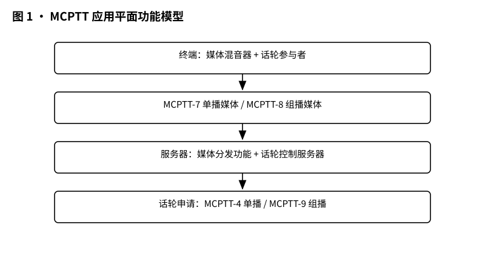
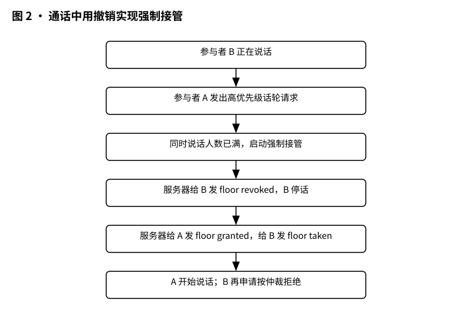
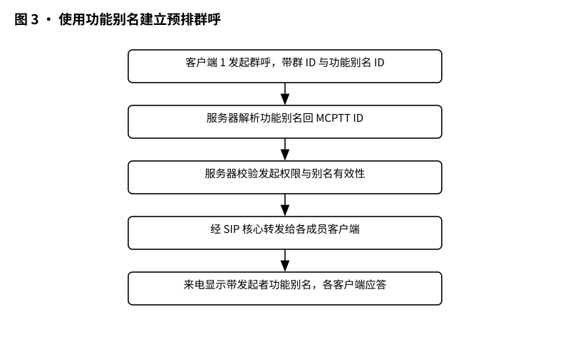
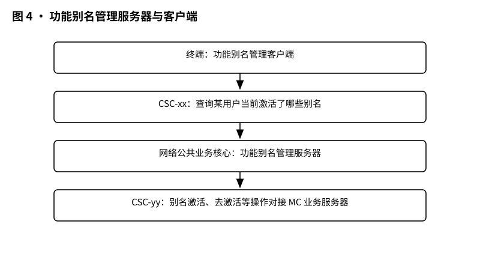

# 3GPP TR 23.790 解读：铁路通信换代前的架构勘察——FRMCS 应用架构 Stage 2

> 版本：v1.0 ｜ 更新：2026-10-28 ｜ 基线：TR 23.790 v15.0.0（Rel-15，2018-01）｜ 原文：3GPP 官方 FTP 存档原文（.doc）

**铁路通信换代前的架构勘察报告，把"多方通话"和"岗位别名"两大新需求翻译成 3GPP 功能图。**

这份 TR 23.790 v15.0.0 是 3GPP 为 FRMCS 应用架构开出的“体检报告”：对照 Stage 1 需求逐项排查现行 MC 架构，报告哪里有缺口、给出候选修补方案，再打包移交给规范阶段。

## 1 它要解决什么问题

想象一条铁路的通信系统：调度员要随时喊到司机，司机之间编组作业时也要互相通联，出了事应急呼叫必须插队。这套系统叫 GSM-R，干了几十年，到了该考虑继任者的时候。这份报告（3GPP TR 23.790）的引言里写得明白：铁路社区正在考虑 GSM-R 的继任者 FRMCS，首批试验预计在 2020 年左右开始 [§Introduction]。国际铁路联盟 UIC 已经把需求写进了 URS 用户需求规范，并分享给了 3GPP [§Introduction]。

那么 3GPP 这边要回答的问题是：铁路的新需求，现有的任务关键通信架构能不能装得下？装不下的话，差在哪里、怎么改？这就是本报告的核心任务——做一次"差距分析"（gap analysis），找出 FRMCS 需求与 Stage 2 任务关键服务规范之间的缺口；对现有架构无法满足的缺口，记录功能架构增强、新流程和新信息流，作为后续规范工作的候选方案 [§1]。打个比方：老房子要翻新，先请人上门测量，看看哪里的墙要加厚、哪里要新开一扇窗，这份报告就是那张"测量草图"，而不是施工队本身。

为什么要这么折腾？因为铁路通信的场景太特殊了。调度所里，调度员要随时喊到沿线各站的值班员；编组场上，好几台调车机同时作业，司机之间要边干边对进度；隧道里出了突发状况，应急呼叫必须一路绿灯。这些场景堆在一起，对讲机那套"一个人说完别人再说"的老规矩就不够用了，光靠改频点、加频道也解决不了——得在架构层动手术。

测量下来，最扎眼的缺口有两个：一是"多方通话"（multi-talker control），二是"功能别名"（functional alias）[§4]。后文所有方案都是围着这两块展开的。前者解决"几个人能不能同时在一个群里说话、谁可以说、说到什么程度"，后者解决"呼叫方喊的是岗位名，系统怎么把这句话送到对的人耳朵里"。这两件事看似一新一旧，其实都是铁路作业的立身之本。

## 2 它在 MCX 家族中的位置

3GPP 里有一个"任务关键通信"（Mission Critical，简称 MC）家族：MCPTT 是关键任务一键通（按下即说话的对讲式语音），MCData 是关键任务数据，MCVideo 是关键任务视频，再加上一份公共功能架构 TS 23.280 [§1]。这个家族不是拍脑袋想出来的，而是从公共安全、消防、铁路这些行业一路攒出来的：警察在现场要的是"按键即通"的语音和数据，铁路要的是"岗位寻址"的语音，双方共用同一套架构骨架，各取所需。

本报告研究铁路应用架构时，就是站在这四份规范的肩膀上找差距的 [§1]。注意本报告只研究应用架构（application architecture），也就是这些业务功能在系统里由哪些模块负责、模块之间怎么打信号；无线空口、核心网传输层怎么跑数据包，是别的组的研究范围。

顺着铁路这条线往上看：Stage 1 的需求研究是 3GPP TR 22.889（Study on Future Railway Mobile Communication System; Stage 1），在原文参考文献列表里是第 [9] 条 [§2]。Stage 1 是干什么的？通俗说就是"用户要什么"：UIC 把铁路用户的需求一条条写成 URS，3GPP 把它整理成规范性需求，回答"系统该具备什么能力"。Stage 2 轮到工程师登场：回答"这些能力在系统里怎么实现"。Stage 3 才是协议工程师写接口信令。本报告正好卡在 Stage 2 的位置上。

这里要较个真：Stage 1 的需求研究是 TR 22.889，全文没有出现过 22.289，下文一律写 22.889。

再说演进路线。本报告引言交代：铁路社区考虑用 FRMCS 接替 GSM-R，首批试验预计 2020 年左右 [§Introduction]。GSM-R 到 FRMCS 的迁移，像火车换轨：旧轨还要跑几年车，新轨要一段一段接上去，两趟车之间还得能照面。迁移与互连的问题另有两份研究报告在管：TR 23.781（迁移与互连研究）和 TR 23.782（LTE 与非 LTE 系统的互连研究）[§1]。本报告只管其中一块：应用层架构怎么搭，多方通话和功能别名怎么落到 3GPP 的功能实体上。

最后要分清 TR 和 TS 的区别。TR 是技术研究报告，是"研究结论"；TS 是技术规范，是"法律条文"，设备照着它实现。TR 的前言明确说：本报告未经 3GPP 组织伙伴的批准流程，不用于实施，只为 3GPP 未来的开发工作提供参考。所以这份报告里的方案叫"候选方案"——能不能写进正式 TS，要由后续规范工作决定 [§1、§7]。读这份报告的正确姿势，是把它当作一张"已经冻结的研究地图"：它告诉你哪里有坑、哪里准备架桥，但不承诺桥什么时候修好、图纸会不会改。

## 3 核心概念大白话

**多方通话（multi-talker control）**。现在的 MCPTT 群呼是"单人讲话"模式：一个群里通常只有一个人按着说话，其他人听，像会客室传话筒，一人发言全屋肃静 [§4.2.1]。唯一的例外是 TS 23.379 §10.9.1.3.2.2 里的强制接管场景。但铁路作业不一样：几列火车的司机联控、编组场的调车作业，需要几个人同时说话。多方通话就是允许一个群呼里多人同时发声，同时网络还能管住"最多几个人同时说" [§4.2.1]。需求源头是 TS 22.179 的 §6.2.3.7 [§4.2.1]。打个比方：单人模式是一支话筒，多方模式是圆桌会议，但桌上有个主持人，谁开腔、几个人能同时开腔，都要听安排。

**话轮控制（floor control）**。这是 MCPTT 管理发言权的老机制，像会议室里的话筒管理：想说话要申请（floor request），管理员批准（floor granted），别人被告知话筒给谁了（floor taken）；级别高的人来了可以直接把话筒拿走（floor revoked），申请被拒就叫 floor rejected [§5.2.1、§5.2.2]。TS 23.379 §7.3.1 指明话轮控制是现行唯一适用的算法，申请、批准这些功能由网络侧的话轮控制服务器和终端侧的话轮参与者分担 [§4.4.2.1]。多方通话只是把"话筒可以同时发给几个人"，这套申请-批准-告知的戏还是要按新剧本重演一遍。

**功能别名（functional alias）**。这是铁路的看家本领：对讲机里喊的是"XX 站值班员""03 号司机"这种岗位名，而不是张三李四的姓名。功能别名就是一个 MC 用户可以被呼叫的"别名"，一个别名可以同时分给多个用户，一个用户也可以同时激活多个别名 [§4.4.3.1]。为什么铁路离不开它？因为铁路的人是流动的：张三今天值班、李四明天接班，调度员不该关心今天坐这个台子的是张三还是李四，他只该喊"XX 站值班员"，系统负责把这句话送到当班的人手里。GSM-R 时代的"功能寻址"靠的是 Follow Me 机制（TS 23.094），原文在 §4.4.3.2 里专门打了个注记提醒读者这一点 [§4.4.3.2]。需求源头是 TS 22.280 的 §5.9a [§4.3.1]。

**混音（audio mixing）**。几个人同时说话，听的人要不要挨个听一路？混音就是把几路声音合成一路送给听众。可以放在网络里（服务器混音），也可以放在手机里（终端混音）[§4.4.2.2]。注意一个坑：网络混音和端到端加密是打架的——网络要拆开声音才能混合，但端到端加密要求网络碰不了内容；原文的注记给出折中：端到端加密不能用网络混音时，客户端与网络之间的加密（e2ae）仍然可行 [§5.2.4.2]。另一个小麻烦：终端用组播接收时，要想办法别把自己的声音又听回去造成回声，原文说这超出了本报告范围 [§4.4.2.3 NOTE 2]。

**参考点**。MCPTT-4 是话轮控制的单播信令通道，MCPTT-7 传单播媒体，MCPTT-8 传组播媒体，MCPTT-9 传组播话轮信令 [§4.4.2.1]。这些编号是架构师们给"功能模块之间连线"起的门牌号。

**录音**。要把丑话说在前头：这份报告通篇没有提"录音"两个字。铁路录音需求可能存在于别处，但在本文原文依据内，我们不展开。

## 4 关键流程

先看全景：多方通话要落地，得先看清第一块拼图——MCPTT 的应用平面功能模型。

*图 1 · MCPTT 应用平面功能模型（原文图 4.4.2.1-1）：媒体走 MCPTT-7/8，话轮申请走 MCPTT-4/9。*

这张图画的是 MCPTT 客户端和服务器之间的分工：说话人的声音从终端的媒体混音器出发，单播媒体走 MCPTT-7 送到服务器的媒体分发功能，组播媒体走 MCPTT-8 送回来；想说话时，终端的话轮参与者经 MCPTT-4（单播）或 MCPTT-9（组播，可选）向服务器里的话轮控制服务器申请发言权 [§4.4.2.1]。一句话：媒体走 MCPTT-7/8，话筒申请走 MCPTT-4/9。

有了这张底图，再看第一个关键流程：通话进行中，高优先级用户来抢话筒。

*图 2 · 通话中用撤销实现强制接管（原文图 5.2.2.1-1）：高优先级请求 → 满员 → 撤销在说话者 → 授予请求者。*

顺序是：参与者 B 正在说话 → 参与者 A 发出 floor request，带着比 B 高的优先级 → 话轮控制服务器一算，允许同时说话的人数已经满了，于是启动强制接管 → 服务器给 B 发 floor revoked，B 停止说话 → 服务器给 A 发 floor granted，同时给 B 发 floor taken，告诉 B 话筒给谁了 → A 开始说话 → 之后 B 再申请，服务器按仲裁结果拒绝，发 floor rejected [§5.2.2.1]。整场戏的主角是服务器里的仲裁功能：按优先级、参与者类型、呼叫类型来裁谁可以说。原文还留了个注记：这套话轮控制流程，跟混音放在网络还是终端无关，两层各改各的就行 [§5.2.2.1 NOTE]。相比不抢话筒的 MT1 流程（A 申请 → 服务器授予 → 给 B、C 发 floor taken → A 开口，B 继续说、C 继续听 [§5.2.1.1]），MT2 多了"先撤后授"这一出，也更接近调度现场"紧急呼叫插队"的真实画面。

接下来是功能别名进群呼的第一关：预排群呼（pre-arranged group call）建立。

*图 3 · 使用功能别名建立预排群呼（原文图 5.3.1.1.1-1）：带别名 ID 发起 → 解析回 MCPTT ID → 校验 → 转发。*

流程是：客户端 1 的用户发起群呼，带上群 ID 和自己的功能别名 ID → 客户端 1 向承载该群的 MCPTT 服务器发群呼请求 → 服务器做两件核对：把功能别名解析回 MCPTT ID，再检查该用户有没有权限发起这个群呼、别名是否有效且已激活 → 确认无误后经 SIP 核心把群呼请求转发给各成员的客户端，来电显示里可以带发起者的功能别名 → 各客户端应答 [§5.3.1.1.1]。关键点：通话期间功能别名不变，直到通话结束或用户离组。至于"即兴聊天群"，流程类似，差别是加入群呼时服务器还会自动补一个隐式入组动作 [§5.3.1.1.2]。

功能别名要管得好，光改呼叫流程不够，还得有专门管家。这就是第四张图。

*图 4 · 功能别名管理服务器与客户端（原文图 5.3.4.1-1）：CSC-xx 查别名、CSC-yy 对接业务服务器。*

这张图里出现了两个新角色：终端里的功能别名管理客户端，和网络公共业务核心（Common Services Core）里的功能别名管理服务器 [§5.3.4.1]。连线有两条：UE 与管理服务器之间走 CSC-xx，可以查询"某个用户当前激活了哪些别名"；管理服务器与 MC 业务服务器之间走 CSC-yy，用于别名激活、去激活等操作 [§5.3.4.1]。有了这个管家，FA5 的激活、去激活、接管、订阅状态通知等操作才有处安放 [§5.3.5]。

最后补两个"轻流程"：一是改"最多同时说话人数"，方案 MT3 直接借用 TS 23.280 §10.1.5.1-1 的存储群组配置流程——授权用户改配置 → 发给群管理服务器存储 → 服务器校验后回应成功或失败 [§5.2.3]；二是别名接管，FA5 里客户端 1 发接管请求 → 管理服务器核对授权后更新状态（加上 1、删掉 2）→ 给客户端 2 发去激活通知，原来的使用者就此让位 [§5.3.5.1.3]。

## 5 关键时刻的能力

把这些流程串起来，铁路在关键时刻能获得什么能力？先把话轮控制放在日常场景里看一遍：调度所呼叫司机，司机应答；两台调车机联控，司机甲申请发言、服务器批准，司机乙收到“话筒已给甲”的通知，甲说完乙接上。这就是 MT1 描述的日常版多方通话 [§5.2.1.1]。等到抢险时刻，优先级更高的呼叫来了，强制接管机制（MT2）登场，把话筒从低优先级用户手里直接拿走 [§5.2.2]。日常与应急，两副面孔，一套机制。

**多人同时说话，且能插队**。调度场景里多方同时讲话是常态，但人数要有上限且随时可调：管理员在群配置里设上限 [§5.2.5]，授权用户在通话中改上限 [§5.2.3]，满了的时候按优先级仲裁，紧急呼叫（如 MCPTT Emergency）这类高优先级呼叫可以顶掉别人 [§Annex B，R-6.2.3.7.4.1-004]。优先级层级至少四级，TS 24.481 §7.2.4.2 已有支撑 [§5.2.5.1]。

**喊岗位名，找人不抓瞎**。列车员交接班、临时换人，只要把功能别名激活到人，呼叫方照岗位名呼出，被呼方照常应答 [§5.3.1.1.1]。一个岗位多人同时在班，别名可以共享激活并互相通知；别名可以设“允许接管”属性，交班时授权用户一个接管动作就完成交接 [§5.3.2.1.4、§5.3.5.1.3]。别名列表还可以按上下文来生成，原文在 FA2 流程注记里举了用户位置、运行图时刻两个例子 [§5.3.2.1.1 NOTE]。

**安全上的讲究**。结论章点出：部分关键问题和方案涉及安全考虑，比如功能别名配合 MIKEY-SAKKE 密钥机制使用 [§7]；方案 MT4 还牵连 SA3（负责媒体面安全的组）[§6.2]。

**位置与应急还在"备忘录"里**。Annex A 是给 Rel-15 之后工作准备的差距分析储备：多定位源的管理与聚合（A.4）、语音链路中断指示 AVC（A.2）、应急通信增强（A.7）、与 GSM-R 的互连（A.6）、丢失被盗设备的封锁（A.8）等 [§Annex A]。原文特别声明：这个附录"保持原样"，后续不再改动 [§A.1]。这些能力此刻只有差距分析，没有解决方案。比如 A.3 提到的角色与通信类型区分（司机、调度员、应急指挥各有各的话路优先级），原文只列了"缺少处理不同角色与呼叫类型的流程"这类缺口，没有给出方案 [§A.3.2]。

## 6 边界（它不管什么）

**它不是规范**。TR 的结论是"研究结论"，前言白纸黑字：本报告未经批准流程、不用于实施 [§Foreword]。报告自己也说，这些方案是"候选方案"，供规范工作参考 [§1、§7]。

**它不保证哪些进了正式 TS**。结论章的表述很克制：MT1–MT5 和 FA1–FA3 是多方通话与功能别名的候选方案；FA1–FA3 的架构方面需要在规范阶段继续研究；FA4 可能需要额外的架构增强，同样要在规范阶段继续研究 [§7]。换句话说，除了"所有找出的差距都至少有一个方案覆盖"这句结论 [§7]，哪些方案最终变成 TS 里的" shall（必须）"，本文无法替它们打包票。

**它不管互连**。MCPTT 服务器之间经 MCPTT-3 的互连，原文注记"不在本版本范围内" [§4.4.2.3 NOTE 1]。

**它留了不少"待办"**。原文里有若干 FFS（留待未来研究）的编辑注记：现有语音编码器能否支撑网络混音、是否需要 CSC 参考点连接管理服务器与配置管理服务器等 [§5.2.4.2、§5.3.4.1]。这些坑，报告只负责标出来。

**它没提的东西，我们也不编**。录音；位置管理在正文里只是 Annex A 的差距分析，没有给出解决方案 [§A.4]；与 GSM-R 的互连也只有差距清单 [§A.6]。

## 7 怎么往下读

**按兴趣选线**。关心"多人怎么同时说话"的，走 MT 线：§5.2.1（MT1 申请与批准）→ §5.2.2（MT2 强制接管）→ §5.2.3（MT3 改上限）→ §5.2.4（MT4 架构增强）→ §5.2.5（MT5 参数）；关心"岗位名怎么管"的，走 FA 线：§5.3.1（FA1 呼叫处理）→ §5.3.2（FA2 配置交换）→ §5.3.3（FA3 参数）→ §5.3.4（FA4 新架构）→ §5.3.5（FA5 管理操作）[§5.1]。

**看影响面**。§6 的两节评估（6.2 多方通话、6.3 功能别名）给每个方案标注了对其他组的影响：多数方案要动 CT1（第 3 阶段协议组），MT4 牵涉 SA3 和 SA4 [§6.2、§6.3]。想知道某个方案落地时要惊动谁，查这两张表最快。

**对需求编号**。Annex B 把 Stage 1 的规范性需求（如 R-5.9a-001 到 R-5.9a-013、R-6.2.3.7.2-001 到 R-6.2.3.7.4.1-008）逐条映射到解决方案小节 [§Annex B]，适合当索引查。

**继续追三条线**。需求源头读 TR 22.889（Stage 1）[§2，文献 9]；迁移互连读 TR 23.781、TR 23.782 [§1]；某个方案是否最终写进了正式 TS，要到 Release 15 及之后的 TS 里找答案。

## 版本说明

本文依据的原文第一页（封面）信息，已从原始 .doc 文件中确认：标题为 "Study on application architecture for the Future Railway Mobile Communication System (FRMCS); Stage 2 (Release 15)"，版本 "3GPP TR 23.790 V15.0.0 (2018-01)"。版本变更记录（Annex C）显示：2018-01 经 SA#78 提交批准后，由 MCC 做出版编辑更新，版本号定为 15.0.0 [§Annex C]。需要留意的是，原文参考文献 [9] 是 3GPP TR 22.889（FRMCS Stage 1 研究），全文未出现"22.289"，本文以原文 22.889 为准。

## 来源与参考

- 3GPP TR 23.790 V15.0.0 (2018-01)，下载自 3GPP 官方 FTP：https://www.3gpp.org/ftp/Specs/archive/23_series/23.790/23790-f00.zip
- whatthespec.net 未能获取（404）。
- 文中引用的其他标准文件（TS 22.280、TS 22.179、TS 23.379、TS 23.280、TS 23.281、TS 23.282、TS 23.094、TS 24.481、TR 22.889、TR 23.781、TR 23.782、TR 21.905 等）均转引自原文参考文献列表 [§2]。

## 附录：关键条款速查

| 条款 | 标题 | 一句话要点 |
| --- | --- | --- |
| §1 | Scope | 找出 FRMCS 需求与 Stage 2 MC 规范的差距，给出架构增强与新流程作为规范候选 |
| §4.2.1 | Multi-talker feature control | 现行 MCPTT 群呼一般只允许一人说话，铁路需要多人同时发声 |
| §4.2.2 | Potential gaps | 四大缺口：上限配置、多讲话者话轮机制、混音位置（网络/终端）、强制接管 |
| §4.3.1 | Functional alias(es) | 功能别名需求来自 TS 22.280 §5.9a，现行 TS 23.280 的别名机制管不了 |
| §5.2.2 | Solution MT2 | 通话中按优先级强制接管：floor revoked 收回旧话筒，floor granted 发给新主人 |
| §5.3.1.1.1 | Solution FA1（预排群呼） | 群呼请求带功能别名 ID，服务器解析别名、校验权限后再转发给群成员 |
| §5.3.4.1 | Solution FA4 | 新设功能别名管理服务器与客户端，引入 CSC-xx、CSC-yy 新参考点 |
| §6.2 | 总体评估（多方通话） | MT 系列方案多要影响 CT1，MT4 还牵涉 SA3（媒体面安全）与 SA4（语音编码） |
| §7 | Conclusions | 所有差距均有至少一个方案覆盖；各方案是候选，进正式 TS 前还需规范阶段研究 |
