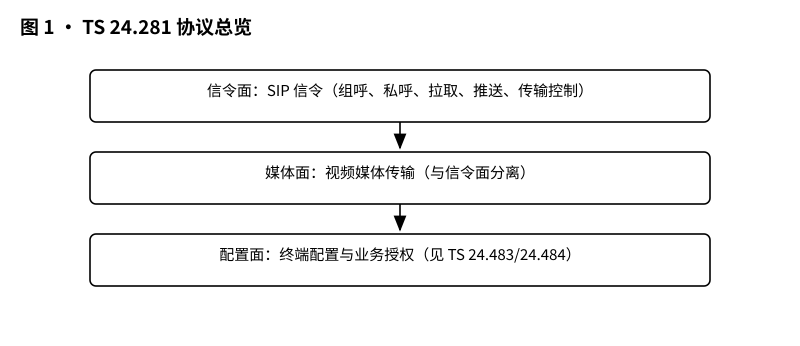
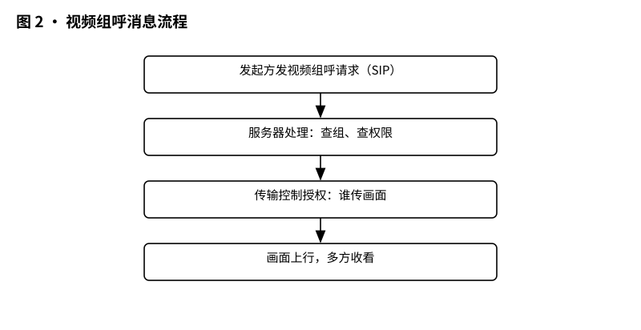
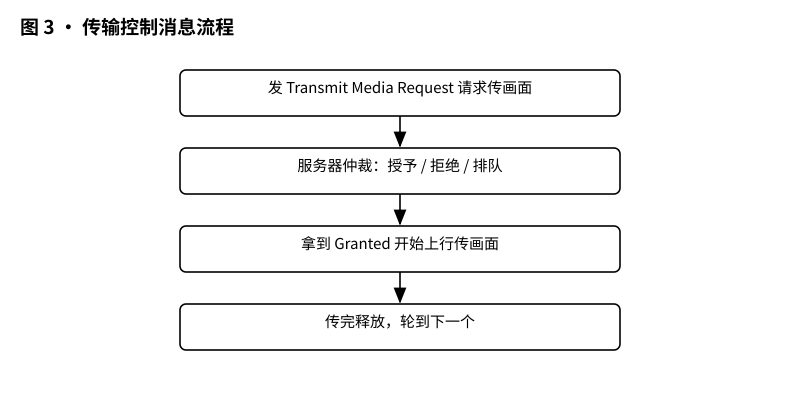
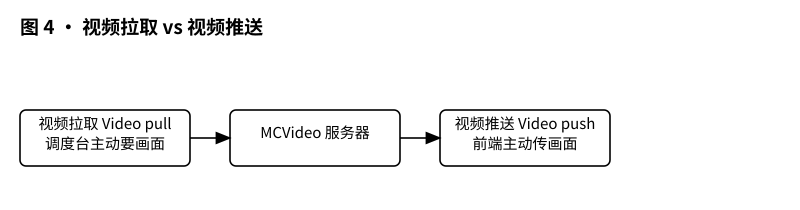

# 3GPP TS 24.281 解读：MCVideo 协议——视频画面在信令层面是怎么约定的

> 版本：v1.0 ｜ 更新：2026-10-28 ｜ 基线：TS 24.281 v20.1.0（Rel-20，2026-09）｜ 原文：whatthespec.net 抓取的关键条款

**TS 24.281 就是 MCVideo（任务关键视频）的信令协议规范，它规定了视频组呼、私呼、视频拉取、视频推送等每一步“发什么消息、消息里写什么”[§1]。可以把 MCVideo 想成“对讲机 + 视频监控 + 应急广播”的融合体：不只说话，还要实时传画面；不只一对一，还要一群同时看。**

## 1 它要解决什么问题

语音对讲好办：接通、说话、结束。视频麻烦得多：

- 画面是多路、多方向的：前台拍、后台看；一个现场要多台设备同时上传；调度台可能还要切不同画面[§4.1]。
- 信令不只是“接通”：什么时候允许上传、谁先传、传哪一路、传输中如何控制，都要在信令层面写清楚，否则一群人同时喊“我先说”，网络就乱了[§4.1][§6.2.0.1]。
- 传输要可控：视频上传不是“想发就发”，需要先请求、再授权，授权后才能传，传完要释放[§13.2.2.4]。
- 场景更复杂：网络覆盖好时走在线（on-network），没网时走离线直连（off-network）；还要支持紧急视频呼叫、紧急警报、视频拉取和推送[§4.1][§9.1]。

所以 TS 24.281 要解决的核心问题就是：把 MCVideo 在信令层面怎么走、每条消息怎么写，标准化下来，让不同厂家的 UE 和服务器能互相配合[§1][§4.1]。

*图 1 · 协议总览：信令面（SIP）+ 媒体面 + 传输控制，各走什么通道。*

## 2 它在 MCX 家族中的位置

MCVideo 属于 Mission Critical Services（MCX）家族。3GPP 对这类业务分阶段写规范：

- Stage 1：TS 22.281 写“要什么”，从用户角度提需求。
- Stage 2：TS 23.281 写“系统怎么架构”，谁负责什么、有哪些网元、哪些接口。
- Stage 3：TS 24.281 就是本篇，写“协议怎么跑”，每条消息怎么发、发什么、按什么顺序[§4.1][§6]。

TS 24.281 明确说：它提供 call control protocol，去支持 TS 23.281 里规定的 MCVideo 架构流程；在线呼叫时，还会复用 IMS 的现有 SIP 流程（TS 24.229）[§4.1]。换句话说：架构图告诉你“有服务器、有 UE、有接口”，本篇告诉你“接口上具体怎么说”。

## 3 核心概念大白话

先把关键词翻成大白话，后面读起来就顺了：

- SIP / SIP-MESSAGE：信令里的“短信”和“信封”。发起呼叫、请求授权、发位置、改群选择，很多都用 SIP MESSAGE 这种消息来跑[§6.2.0.1]。
- SIP INVITE：更正式的“邀请”，用来起一次会，比如组呼、私呼、视频推送呼叫[§9.2.1.2.1.1][§13.2.2.1]。
- 注册与业务授权：UE 先登录到 MCVideo 业务，证明“我是合法用户、能用哪些功能”。TS 24.281 在第 7 节规定 registration 和 service authorisation[§4.1]。
- 归属（affiliation）：用户跟某个组、某个服务的“归属关系”。你想加入一个群，先要有归属或被允许加入；第 8 节规定 affiliation 流程[§4.1]。
- 传输控制：视频不是随便传。TS 24.281 引用 TS 24.581 的 transmission-control procedures，来管理“谁现在能传”[§4.1]。这就像老师点名：你先举手，老师批准，你再说话。
- 视频拉取（Video Pull）：调度台/后台向前端要画面。前端本来没传，收到拉取后才按需上传[§12.2.1]。
- 视频推送（Video Push）：前端主动把画面推给调度台、另一台 UE 或 MCVideo server[§13.2.2]。
- 环境查看：规范里讨论的是“位置报告配置/请求”这类 SIP MESSAGE：一方可以请求配置位置上报，另一方可以按要求上报位置[§6.2.0.1]。
- 能力信息共享：通过媒体特征标签、ICSI 引用、Accept-Contact 等，告诉对方“我能处理 MCVideo”“我支持哪些业务”，保证双方会话参数对齐[§9.2.1.2.1.1]。

*图 2 · 视频组呼消息流程：发起 → 服务器处理 → 传输控制授权 → 画面上行。*

## 4 一次视频组呼在消息层面怎么走

下面按大白话顺序，把“发起一次在线预安排组呼”的消息过程说清楚。

### 4.1 先注册、业务授权、归属

开始之前，UE 要先完成：

- 注册到 IM CN 子系统，并做业务授权：确认这个 UE 能用 MCVideo。TS 24.281 在第 7 节规定这些流程[§4.1]。
- 用户和组/服务建立归属关系：比如加入某个预安排组。第 8 节规定 affiliation[§4.1]。
- UE 通过 E-UTRAN 或 NG-RAN 接入，接入信令按 TS 24.301 或 TS 24.501 跑；MCVideo 自己的信令协议在本篇规定[§4.1]。

这些做完，UE 才有资格发起或加入视频会话。

### 4.2 发起预安排组呼：SIP INVITE 怎么写

以“按需发起的预安排组呼”为例：用户在客户端里要求建立预安排组会话后，MCVideo client 先检查组文档里有没有 `<preconfigured-group-use-only>` 且值为 “true”。如果是，客户端应提示用户“该组不允许呼叫”，并跳过后续流程[§9.2.1.2.1.1]。

如果允许，客户端就生成初始 SIP INVITE，按 TS 24.229 的 UE 发起会话流程来，但要做以下 MCVideo 专属补充[§9.2.1.2.1.1]：

- Contact 头里带 `g.3gpp.mcvideo` 媒体特征标签，并带 ICSI 引用 `urn:urn-7:3gpp-service.ims.icsi.mcvideo`[§9.2.1.2.1.1]。
- Accept-Contact 头里要求（require/explicit）对方必须接受 `g.3gpp.mcvideo`，以及 ICSI 引用[§9.2.1.2.1.1]。
- P-Preferred-Service 头里带 ICSI 值 `urn:urn-7:3gpp-service.ims.icsi.mcvideo`，表示“我偏好这个业务”[§9.2.1.2.1.1]。
- Request-URI 要指向“服务该用户的参与 MCVideo 功能”的公共业务标识；客户端应配置有这个标识[§9.2.1.2.1.1]。
- Supported 头建议带 `timer` option tag；Session-Expires 按 RFC 4028 带，建议省略 refresher，若带则设为 `uac`[§9.2.1.2.1.1]。
- 若用户发起的是紧急组呼、紧急状态已置位、即时危险组呼、广播组呼等，客户端分别按对应章节的流程执行[§9.2.1.2.1.1]。

> 大白话：SIP INVITE 就是“我请求开会”，但消息里必须同时说清“我能做 MCVideo、我偏好 MCVideo、请你按这个业务来”，服务器才认。

### 4.3 服务器处理与传输控制授权

组呼不是只把 INVITE 发出去就完，还需要网络侧参与 MCVideo 功能处理。TS 24.281 的组呼章节规定在线预安排组呼、聊天群（受限）组呼等流程[§9.1][§9.2.1]。

更重要的是传输控制：视频媒体要上行时，UE 不是直接“开闸放水”，而是走 TS 24.581 定义的 transmission-control procedures[§4.1]。大白话流程是：

1. 请求传输：前端需要传画面时，先发传输控制请求。
2. 授予/拒绝/排队：控制方（如参与 MCVideo 功能）决定现在能不能传；拒绝或排队时会告诉原因或状态。
3. 传输：拿到授权后，视频媒体才能上行。
4. 释放：传完或不再需要时，释放传输资源。

*图 3 · 传输控制消息流程：请求 → 授予/拒绝/排队 → 传输 → 释放。*

### 4.4 画面上行与多方收看

授权后，媒体面开始传视频。TS 24.281 管信令，媒体编解码和媒体处理由 TS 26.281 规定[§4.1]。在线组呼里，规范允许使用单播承载（unicast bearers）[§4.1]；UE 还可以支持加入已建立的组会话、离开后再重新加入同一会话、使用功能别名标识用户等[§4.1]。

所以一次在线组呼的完整画面是：

- UE 先注册、授权、归属；
- 发起方发 SIP INVITE，消息里写好 MCVideo 能力与偏好；
- 网络侧处理并走传输控制授权；
- 授权后媒体上行；
- 多方加入后同时收看。

## 5 关键时刻的能力：紧急视频、拉取推送、环境查看、广播、业务连续性、临时组呼

TS 24.281 不只是普通视频通话协议，它还覆盖很多“关键时刻”能力。

### 5.1 紧急视频、紧急警报、即时危险

规范支持 MCVideo emergency calls、MCVideo imminent-peril calls、MCVideo emergency alerts[§4.1]。注意一个细节：MCVideo 紧急呼叫不使用 emergency bearers；而是把普通承载的 EPS bearer priority 调高[§4.1]。

另外，在线/离线呼叫都支持紧急相关流程[§4.1]；离线场景在 EPS 里会用到 ProSe 直接发现和点对点 ProSe 直接通信（TS 24.334）[§4.1]。

### 5.2 视频拉取：调度台要画面

视频拉取就是“我没在看你，但我现在想看”。触发后，MCVideo client 可以从另一个 MCVideo client 或 MCVideo server 拉取视频[§12.2.1]。它和普通呼叫的区别是：先建立拉取关系，再按需取流。

### 5.3 视频推送：前端主动传画面

视频推送分几种[§13.2.2]：

- 一对一推送到另一台 MCVideo client：发起流程按私呼流程，但 SIP 消息里要带 `application/vnd.3gpp.mcvideo-info+xml` 体，并把 `<session-type>` 设为 “one-to-one video push”；媒体面交互按 TS 24.581 第 6.2 节[§13.2.2.1]。
- 推送到 MCVideo server：同样带 `mcvideo-info` 体，`<session-type>` 设为 “one-to-server video push”；并且不插入 resource-lists 体；使用 automatic commencement mode[§13.2.2.4]。
- 服务器侧收到带对应 `<session-type>` 的 SIP INVITE 后，按私呼对应流程处理[§13.2.3.1]。
- 释放：用户要求结束推送时，按私呼释放流程执行[§13.2.2.3][§13.2.2.5]。

*图 4 · 视频拉取 vs 视频推送：调度台主动要画面 vs 前端主动传画面。*

### 5.4 环境查看：位置报告配置与请求

MCVideo client 需要区分两类 SIP MESSAGE 请求[§6.2.0.1]：

- 位置报告配置：Content-Type 为 `application/vnd.3gpp.mcvideo-location-info+xml`，XML 根为 Location，含 Configuration 元素。
- 位置报告请求：同样 Content-Type，XML 根为 Location，含 Request 元素。

大白话：A 可以先配置 B “要不要报位置、怎么报”；之后 A 可以发请求，让 B 按要求上报。这对应急场景很有用。

### 5.5 MBMS / 5G MBS 广播

规范还规定使用 MBMS 传输和 MBS 传输的程序，分别在 clause 16 和 clause 16A[§4.1]。大白话：如果一群用户要同时看同一路视频，网络可以用广播传输方式把视频一次发给多人，减少重复传输。

### 5.6 业务连续性与接入转移

MCVideo 流程还引用 TS 24.237 的 PS-PS access transfer procedures[§4.1]。意思是：用户在移动、切换接入时，视频会话要尽量连续，别因为换个基站就断。

### 5.7 临时组呼与临时组紧急警报

离线场景里，规范定义 MVONP（MCVideo Off-Network Protocol）和 MVONP 应用流程[§4.1]。另外在线临时组紧急警报（adhoc group emergency alert）也有专门流程：客户端收到用户请求后，先判断是否授权；若未授权，应提示不允许并跳过；若授权，就生成 SIP MESSAGE 请求[§12.1A.1.1]。消息里要带 ICSI 偏好、Accept-Contact 要求、`application/vnd.3gpp.mcvideo-info+xml` 体，并在 `<mcvideo-Params>` 里带 `<adhoc-alert-ind>` 设为 “true”、客户端 ID、可选的临时组标识、功能别名 URI、用户请求的优先级、附加信息、呼叫参与者条件等[§12.1A.1.1]。还会带上临时组紧急警报的具体位置信息[§12.1A.1.1]。

## 6 Stage 3 协议 vs Stage 2 架构的区别

很多人会混淆“架构”和“协议”。用大白话对比：

- TS 23.281（Stage 2 架构）回答：MCVideo 系统由哪些功能实体组成？在线/离线怎么工作？组呼、私呼、紧急警报在架构上怎么走？[§4.1]
- TS 24.281（Stage 3 协议）回答：实体之间具体发什么 SIP 消息？消息头怎么填？XML 体怎么写？什么情况下跳过流程？如何引用传输控制、群管理、身份管理、安全、接入转移等其他规范？[§4.1][§6.2.0.1][§9.2.1.2.1.1]

所以读法是：先在 TS 23.281 里搞清楚“谁做什么”，再在 TS 24.281 里看“每条消息怎么写”。本篇就是第二层。

## 7 它不管什么

TS 24.281 的边界要清楚：

- 不重新定义 Stage 1 需求：需求在 TS 22.281 等规范里。
- 不规定编解码实现细节：codecs 和 media handling 在 TS 26.281[§4.1]。
- 不替代安全机制：安全程序引用 TS 33.180；身份管理引用 TS 24.482；群管理引用 TS 24.481；传输控制引用 TS 24.581；配置参数引用 TS 24.483/24.484[§4.1]。
- 不覆盖接入层全部细节：E-UTRAN 接入信令看 TS 24.301，NG-RAN 看 TS 24.501[§4.1]。
- 协议文本里的一些实现选项、编辑注记等，仍需结合原文核对。

换句话说：TS 24.281 是“信令层怎么写”的专家，不是“编解码怎么做”的工程师，也不是“安全算法怎么实现”的保安队长。

## 8 怎么往下读

建议顺序：

1. 先读本篇，建立“信令消息层”的整体感：SIP INVITE、SIP MESSAGE、mcvideo-info、传输控制、拉取/推送。
2. 再读 TS 23.281，理解 MCVideo 的架构、在线/离线、组呼/私呼/紧急警报在系统层面怎么组织[§4.1]。
3. 然后读 TS 33.180 安全，理解这些信令和媒体如何被保护[§4.1]。
4. 需要理解传输控制时，读 TS 24.581；需要理解群、身份、配置时，读 TS 24.481、TS 24.482、TS 24.483、TS 24.484[§4.1]。

版本说明与来源：本文对应规范为 TS 24.281 v20.1.0，Rel-20（2026-09）。内容来自该版本 TS 24.281 的公开规范文本整理，条款号以原文为准。
