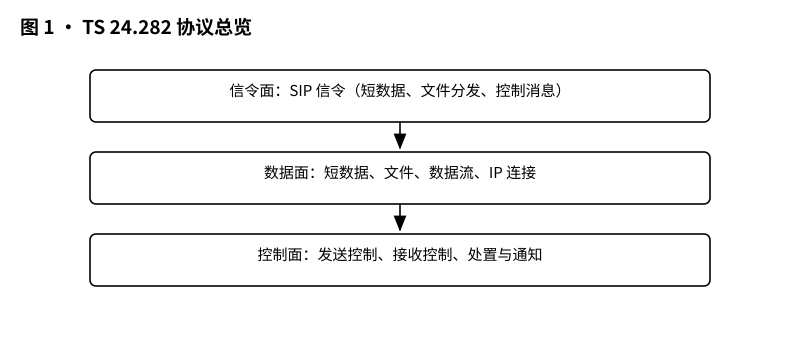
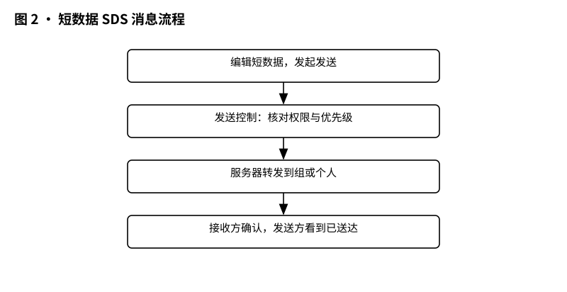
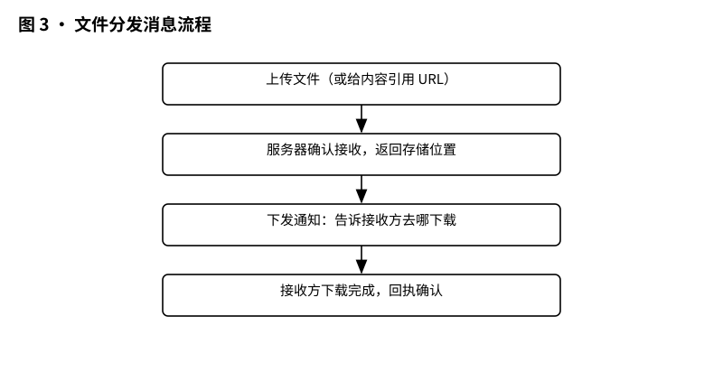
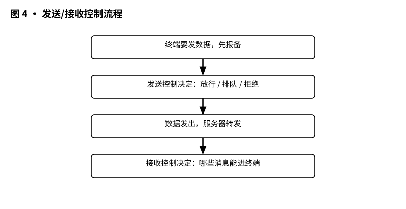

# 3GPP TS 24.282 解读：MCData 协议——短数据、文件、IP 连接在信令层面是怎么约定的

> 版本：v1.0 ｜ 更新：2026-10-28 ｜ 基线：TS 24.282 v20.1.0（Rel-20，2026-09）｜ 原文：whatthespec.net 抓取的关键条款

**TS 24.282 v20.1.0（Rel-20，2026-09）是 MCData 的信令协议，规定短数据、文件分发、发送/接收控制、IP 连接等每一步发什么消息，就像列车时刻表规定每趟车怎么跑。**

## 1. 它要解决什么问题：四大数据能力各有各的信令流程

如果把一次关键通信想象成一个“指挥中心”，那它手里有四件武器：
1. 发一条短数据（像对讲机按键输入）。
2. 发一个文件（像把厚厚一本手册分发给队友）。
3. 谁先发、谁有权限发、能发给谁（像一张“通行证”检查）。
4. 临时建立一条 IP 连接，直接用 IP 互通数据。

TS 24.282 的核心使命，就是把上述四件事背后的信令规则全部讲清楚：
- 短数据怎么在信令面和媒体面分别发送？
- 文件怎么分发？用 HTTP 还是用媒体面？
- 服务器收到消息后，怎么通知发送方“对方已收到”或者“消息已处置”？
- 两台设备如果想临时建立 IP 连接，SIP 消息里该写什么参数？

这四大能力在规范里被定义为：共享数据使用短数据服务（SDS）、共享文件使用文件分发（FD）、交换数据使用 IP 连接服务 [§4.1]。同时，MCData 还支持一对一通信和群组通信，这意味着上述规则必须既能处理“单聊”，也能处理“群发” [§4.1]。

值得注意的是，TS 24.282 规定的不仅是技术动作，还包括“开关权”。比如群组管理员可以在群组文档里把 `<mcdata-allow-short-data-service>` 设为 `false`，直接禁用该群的短数据功能；同理，`<mcdata-allow-file-distribution>` 设为 `false` 则禁用文件分发。一旦被禁用，MCData 客户端就不应再尝试发送，而接收端的控制功能也必须直接拒绝 [§9.1]、[§10.1]。

这套协议不仅服务于公共安全（警察、消防），也适用于普通商业场景，比如公共事业公司和铁路系统 [§1]。

## 2. 它在 MCX 家族中的位置：Stage 3 信令协议，上接架构，下走 SIP

在 3GPP 的通信标准体系里，每个服务通常分三个阶段（Stage 1、2、3）来写。
- Stage 1 回答“做什么”：这是需求，写在 TS 22.282 里。
- Stage 2 回答“谁来做”：这是架构，写在 TS 23.282 里。
- Stage 3 回答“怎么做”：这是详细流程，也就是本文的主角 TS 24.282。

TS 24.282 明确规定，它利用了 TS 23.280 定义的公共功能架构来支持任务关键服务，并且是对 TS 23.282 所规定的 MCData 架构程序进行的“信令控制协议增强” [§1]、[§4.1]。

换句话说：
- TS 23.282 画了一张“系统图纸”，告诉你哪里有服务器、哪里是终端、它们之间怎么分工。
- TS 24.282 则是一本“施工手册”，告诉你手机和服务器之间具体发什么 SIP 消息、消息体里包含哪些字段、收到消息后按什么步骤处理。

对于网络内（On-network）通信，TS 24.282 大量借用了 IMS 的核心 SIP 流程（TS 24.229），包括注册、呼叫控制等 [§4.1]。而对于离线（Off-network）通信，则借用了 EPS 中的 ProSe 直连发现和一对一/一对多直接通信程序（TS 24.334） [§4.1]。

## 3. 核心概念大白话：8 个关键词

在正式拆流程前，先搞懂 8 个核心概念，后面的步骤会清晰很多。

1. SIP 信令：通信的“公共语言”
SIP 就像一套标准化的对讲机频道，手机和服务器之间的所有“商量”都靠它。比如“我想发数据”“你有权发吗”“收到，谢谢”，这些对话全是 SIP 消息。

2. 注册与业务授权：办通行证
MCData 客户端在使用服务前，必须先在 IMS 核心网注册。这相当于去公安局办身份证+通行证，证明你是合法用户、能用哪些业务。这部分流程在 TS 24.282 的条款 7 中定义。

3. 短数据（SDS）：对讲机按键输入
SDS 用于传输小容量数据，比如“已到达 A 区”“请求支援”。规范规定，SDS 可以通过信令控制面发送，也可以通过媒体面发送。发送前要先做发送控制检查。

4. 文件分发（FD）：发手册
FD 专门用来发大一点的文件，比如图纸、照片。在网络内，FD 有两种路子：一种是走 HTTP，另一种是走媒体面。文件怎么发、发多大，都有严格的信令约定。

5. 发送/接收控制：谁先发、谁能收
这是 TS 24.282 条款 11 的重点。就像演唱会入场检票，你要发消息，得先看自己有没有票。检查包括：
- 一对一发送时，检查用户档案里的 `<allow-transmit-data>` 是否为 true [§11.1]。
- 发送目标是否在用户的 One-to-One 通信列表里 [§11.1]。
- 群组发送时，检查群组文档里的 `<allow-transmit-data-in-this-group>` 是否为 true [§11.1]。
- 消息大小是否超过服务配置文档里设定的最大值（如 `<max-data-size-sds-bytes>`） [§11.1]。

6. 处置与通知：收到后回个话
发了消息不能石沉大海。接收方收到后，需要回复“已收到”或“已阅读”，发送方也能收到通知。这能让发送方知道消息到底送没送到。

7. IP 连接：临时拉一条网线
如果两个用户想直接用 IP 交换数据（比如传输实时视频流），需要先建立 IP 连接会话。这通过 SIP INVITE 来协商 IP 地址和端口，定义在条款 20。

8. 消息存储：没收到就存起来
发送方如果暂时离线，服务器可以帮忙存消息，等他上线再取。这就是 MCData 消息存储功能，定义在条款 21。

*图 1 · 协议总览：信令面（SIP）+ 数据面 + 控制面，各走什么通道。*

## 4. 一次短数据发送在消息层面怎么走

让我们模拟一次“单聊短数据”的全过程，看看 TS 24.282 是怎么规定的。

第一步：注册与归属（条款 7 和 8）
- 用户 A 开机，MCData 客户端先向 IMS 网络注册，完成业务授权 [§7]。
- 如果 A 要发到某个群组，还需要进行“归属”操作，让网络知道 A 属于这个群组 [§8]。

第二步：发送控制检查（条款 11）
- A 在手机里输入“已到达”，点击发送。
- MCData 客户端先进行发送控制检查：
- 检查 A 的用户档案里 `<allow-transmit-data>` 是否允许发送一对一数据 [§11.1]。
- 检查 A 要发给的目标 B 是否在 One-to-One 通信列表里 [§11.1]。
- 检查消息大小是否超过 `<max-data-size-sds-bytes>` 的限制 [§11.1]。
- 如果检查失败，直接不发；如果通过，进入下一步。

第三步：选择发送通道（条款 9.2）
- 如果消息体小于或等于服务配置里的 `<max-payload-size-sds-cplane-bytes>`，就走信令控制面发送（条款 9.2.2.2.1） [§9.2.1.1]。
- 如果消息体大于这个值，那就需要走更复杂的流程（条款 9.2.3.2.3）。
- 发送时，客户端会生成一个 SIP 请求，里面包含两种 MIME 体：`application/vnd.3gpp.mcdata-signalling`（信封）和 `application/vnd.3gpp.mcdata-payload`（内容）。

第四步：服务器转发与接收处理（条款 9.2.1.2）
- 接收方 B 的 MCData 客户端收到 SIP 请求后，按以下步骤处理：
- 先解码 signalling MIME 体和 payload MIME 体。
- 如果消息里带了新的 Conversation ID，说明这是一个新会话，客户端会新建一个会话线程。
- 如果带了已有的 Conversation ID，并且包含 InReplyTo 字段，说明这是对之前某条消息的回复，客户端会把它关联到原来的消息上 [§9.2.1.2]。
- 如果消息里没带 Application ID，客户端就知道这段数据是直接给用户看的，而不是给应用后台处理的 [§9.2.1.2]。

*图 2 · 短数据 SDS 消息流程：编辑 → 发送控制 → 服务器转发 → 接收确认。*

## 5. 关键时刻的能力：文件、IP 连接与更多

文件分发（FD）：强制下载与非强制
FD 的信令流程比 SDS 复杂。当用户发送文件时，客户端可以选择用 HTTP（条款 10.2.4）或用媒体面（条款 10.2.5）来传 [§10.2.1.1]。
- 如果是强制下载，接收方收到 FD SIGNALLING PAYLOAD 消息后，必须立即下载文件，并把文件保存到本地 [§10.2.1.2.2]。
- 如果不是强制下载，接收方可以选择稍后下载 [§10.2.1.2.3]。
- 另外，如果 FD SIGNALLING PAYLOAD 里包含了 Application metadata container IE，客户端可以根据本地策略决定是否处理这些元数据 [§10.2.1.2.1]。

*图 3 · 文件分发消息流程：上传 → 分发 → 下载 → 完成确认。*

IP 连接：直接连 IP 互通数据
当两个 MCData 客户端想建立 IP 连接时，需要通过 SIP INVITE 进行协商 [§20.2.1]。
- 发起方生成 SIP INVITE，在 Contact 头里包含 `g.3gpp.mcdata.ipconn` 媒体特性标签和 `urn:urn-7:3gpp-service.ims.icsi.mcdata.ipconn` 的 ICSI 引用 [§20.2.1]。
- 同时在 Accept-Contact 里也包含这个标签，并设置为 require 和 explicit，意思是“我必须要求对方支持这个能力” [§20.2.1]。
- 随后双方通过 SDP offer/answer 交换 IP 地址和端口号，SDP offer 里必须包含一个 `m=application` 媒体段，并带上 fmtp 属性 [§20.2.0a]。

发送/接收控制的精细度
条款 11 不仅管“能不能发”，还管“能发多大”。
- 一对一 SDS：最大不能超过 `<max-data-size-sds-bytes>` [§11.1]。
- 一对一 FD：最大不能超过 `<max-data-size-fd-bytes>` [§11.1]。
- 群组 SDS：最大不能超过群组文档里的 `<mcdata-on-network-max-data-size-for-SDS>` [§11.1]。
- 群组 FD：最大不能超过群组文档里的 `<mcdata-on-network-max-data-size-for-FD>` [§11.1]。

*图 4 · 发送/接收控制流程：谁先发、谁能收，由控制消息说了算。*

其他关键能力
- 消息存储：如果接收方暂时不在线，服务器会代为存储，等接收方上线再取 [§4.1]。
- 功能别名：用户可以不用真实的 MCData ID，而用一个功能别名（Functional Alias）来寻址，比如用“北区队长”代替一串数字 ID [§4.1]。
- 使用 MBMS/MBS 传输：在群组通信中，可以利用广播多播技术来发送数据 [§4.1]。

## 6. Stage 3 协议 vs Stage 2 架构的区别

很多人会把 TS 23.282 和 TS 24.282 搞混，其实它们就像“画图纸”和“盖房子”的关系。

TS 23.282 是架构（Stage 2）：
- 它定义了 MCData 系统里有哪些功能实体（比如 MCData 客户端、参与 MCData 功能、控制 MCData 功能）。
- 它定义了这些实体之间怎么分工，比如“控制功能负责鉴权，参与功能负责转发”。
- 它不管具体的消息长什么样，只说“需要建立一条 IP 连接”。

TS 24.282 是信令（Stage 3）：
- 它定义了每个功能实体在具体操作时，每一步发什么 SIP 消息。
- 它规定了消息体里必须包含哪些 IE（信息元素），比如 Conversation ID、Message ID、InReplyTo 等。
- 它规定了接收方收到消息后，必须按什么顺序处理、什么情况下拒绝。

举个具体的例子：
- 在架构层面，TS 23.282 说：“用户 A 要给用户 B 发短数据，需要经过发送控制检查。”
- 在信令层面，TS 24.282 则详细规定：
- 检查什么？检查 `<allow-transmit-data>` 和 One-to-One 列表 [§11.1]。
- 超限怎么办？如果数据大于 `<max-data-size-sds-bytes>`，直接拒绝 [§11.1]。
- 发送用什么消息？用 SIP 请求，带 `application/vnd.3gpp.mcdata-signalling` MIME 体 [§9.2.1.2]。
- 接收方怎么判断是新消息还是回复？通过 Conversation ID 和 InReplyTo 字段 [§9.2.1.2]。

没有 TS 24.282，设备厂商就不知道该把 SIP 消息写成什么样；没有 TS 23.282，TS 24.282 就不知道该让谁去发这些消息。

## 7. 它不管什么：规范的边界

虽然 TS 24.282 规定得很细，但它也有一些明确的边界：

1. 不管需求内容：它不规定“公共安全业务必须有哪些功能”，那是 Stage 1（TS 22.282）的事。
2. 不管架构设计：它不定义“服务器和数据库怎么连接”，那是 Stage 2（TS 23.282 及 TS 23.280）的事。
3. 不管文件内容本身：它只管“怎么传送文件”，不管文件里面是图片还是文本，也不负责加密文件内容。
4. 不管实现选型：规范不会规定你用哪种编程语言写客户端，也不会规定你买哪个品牌的服务器。
5. 安全机制在其他规范：虽然 TS 24.282 会用到安全程序，但具体的加密、认证算法定义在 TS 33.180 里 [§4.1]。

## 8. 怎么往下读：学习路径与版本说明

如果你想系统搞懂 MCData，建议按以下顺序阅读：
1. 先读本篇：搞懂 TS 24.282 的信令流程和核心概念。
2. 再看架构：去读 TS 23.282，理解各个功能实体是怎么部署的。
3. 再看安全：去读 TS 33.180，搞懂 MCData 的加密和鉴权机制。

版本说明：
- 本文解读的规范版本为：TS 24.282 v20.1.0。
- 所属 3GPP 版本：Rel-20（2026-09）。
- 来源：基于 whatthespec.net 抓取的关键条款（Scope、General、SDS、FD、Transmission Control、IP Connectivity 等）进行 ELI5 解读。

总结：TS 24.282 就像一本“MCData 通信交规”，它把短数据、文件、IP 连接从发起到结束的每一步都写得明明白白，确保不同厂商的设备能在同一套规则下对话。
