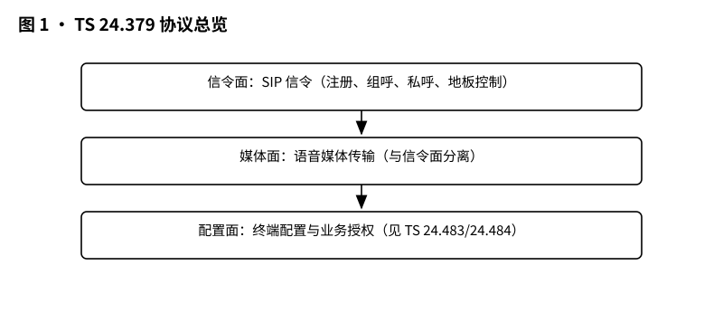
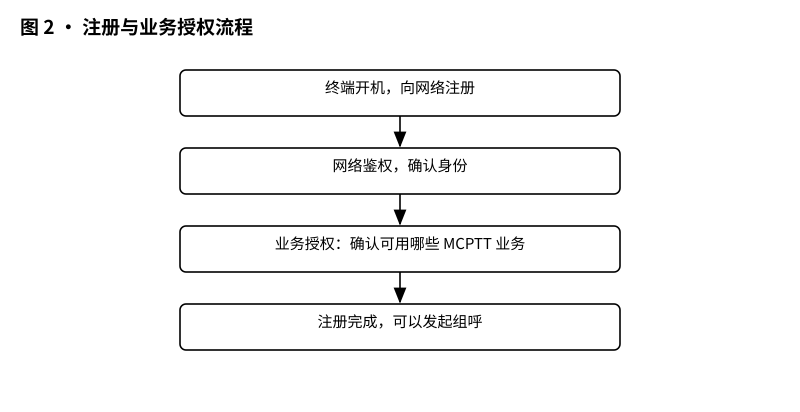
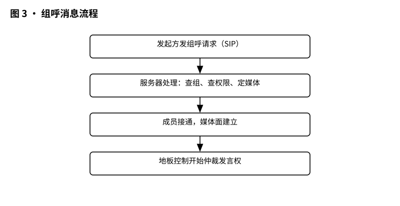
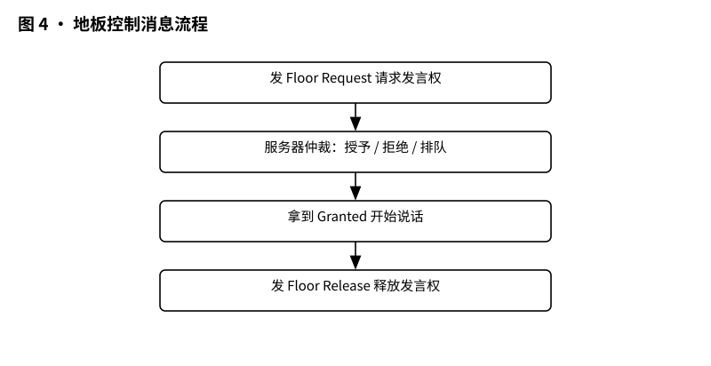

# 3GPP TS 24.379 解读：MCPTT 协议——对讲机的每句话，网里是怎么传的

> 版本：v1.0 ｜ 更新：2026-10-28 ｜ 基线：TS 24.379 v20.1.0（Rel-20，2026-09）｜ 原文：whatthespec.net 抓取的关键条款

**一句话总结：TS 24.379 是 MCPTT（关键任务按讲互连）的“信令字典”，它规定了手机（UE）和服务器之间，为了建立一次紧急通话，必须按什么顺序、发什么格式的消息。** [§1]

## 1. 它要解决什么问题

想象一下，如果你手里拿的是一个普通的微信语音对讲功能，你想跟消防队说“我在火场”，你需要先加好友、再建群、最后按说话键。但在火灾现场，每一秒都关乎生死，这种“社交式”的连接太慢了。

MCPTT（Mission Critical Push To Talk，关键任务按讲互连）就是为警察、消防、铁路调度等场景设计的“专业对讲机”。它要求**优先处理**，比普通电话更紧迫。[§1]

TS 24.379 这份规范，就是为了解决“怎么传”的问题。
*   **Stage 2（架构层）** 画了框图：谁和谁说话，数据流向哪里。
*   **Stage 3（协议层，即本篇）** 写死细节：每条消息长什么样？字段叫什么？顺序不能乱。

如果没有 TS 24.379，你的手机和 MCPTT 服务器就像两个说不同方言的人，虽然都想通电话，但谁也听不懂谁。这份规范就是他们的“普通话字典”。[§1]

## 2. 它在 MCX 家族中的位置

3GPP 的“关键任务通信”（MCX）家族很大，包括 MCPTT（语音）、MCData（数据）、MCVideo（视频）。TS 24.379 专门负责 **MCPTT 的会话控制协议**。[§1]

它的上下游关系如下：
1.  **上游需求**：TS 22.179 定义了“用户想要什么功能”（比如：我要能紧急报警）。
2.  **上游架构**：TS 23.379 定义了“系统怎么搭”（比如：有哪些服务器，接口怎么连）。
3.  **本规范（TS 24.379）**：定义“消息怎么传”（比如：SIP INVITE 里该填什么字段）。
4.  **邻居规范**：
    *   地板控制（谁先说话）：TS 24.380。[§4.1]
    *   群组管理（谁在这个组里）：TS 24.481。[§4.1]
    *   身份管理（你是谁）：TS 24.482。[§4.1]
    *   安全机制（怎么防窃听）：TS 33.180。[§4.1]

*图 1 · 协议总览：信令面（SIP）+ 媒体面 + 配置面，各走什么通道。*

## 3. 核心概念大白话

在深入流程前，先搞懂几个 TS 24.379 里的关键名词。

### 3.1 SIP 信令：电话的“信使”
MCPTT 建立在 IMS（IP 多媒体子系统）之上，使用 **SIP（会话初始协议）** 作为信令语言。[§4.1]
*   类比：SIP 就像快递单。它不运送货物（语音），只负责告诉网络：“我要把这个货物寄给谁”、“我要开始通话了”、“我要挂断了”。
*   TS 24.379 规定了 MCPTT 特有的“快递单格式”，比如要在单子上贴上“MCPTT 专用”的标签。[§7.2.1]

### 3.2 注册与业务授权：先刷工牌，再进大楼
在网内（On-network）使用 MCPTT 前，手机必须向服务器“报到”。
*   **SIP REGISTER**：手机告诉服务器：“我是张三，我的号码是 138xxxx，我支持 MCPTT 功能。” [§7.1]
*   **业务授权**：服务器检查后，下发一个“令牌”（access-token），确认张三有权限使用 MCPTT 服务。[§7.1]
*   **关键点**：如果你的手机同时开了 MCVideo 和 MCPTT，它们可以共用同一个 SIP 注册，但要在注册包里分别带上各自的服务标签。[§7.1]

### 3.3 预建立会话：电话线先通，声音后传
这是 MCPTT 最核心的技巧之一，为了**快**。
*   普通电话：按号码 → 振铃 → 接通 → 建立通道。
*   MCPTT：手机开机后，就悄悄和服务器建立好“预建立会话”（Pre-established session）。就像消防队平时把水管接好，一旦火情发生，直接开水龙头就有水，不用现场接水管。[§4.1]
*   当你要发起组呼时，只需要发送一个简单的“发起”指令，媒体通道瞬间建立，延迟极低。[§4.1]

### 3.4 归属（Affiliation）：我属于哪个组？
MCPTT 是群组通信。手机需要知道“我现在属于哪个组”（比如：特警一组、消防二组）。
*   **归属**就是手机和服务器确认：“我当前加入的是‘特警一组’，请把我纳入这个组的通信范围。” [§4.1]
*   你可以随时切换归属，比如从“特警一组”切换到“特警二组”，服务器会更新你的路由信息。[§4.1]

### 3.5 地板控制协议：谁有资格说话？
对讲机最怕“抢话”或“多人同时说话导致噪音”。
*   **地板（Floor）**：指“发言权”。
*   **仲裁**：服务器像裁判，决定谁拿到“地板”。
*   TS 24.379 引用了 TS 24.380 的地板控制协议。你按下 PTT（Push To Talk）键，其实是向服务器申请“地板”；服务器批准后，你才能说话；其他人听到提示音，知道现在该你说了。[§4.1]

### 3.6 离网协议 MONP：没网时怎么对讲？
如果警察去了深山老林，手机没信号（EPS/5G 网络不可用），MCPTT 还能工作吗？
*   可以，这叫 **Off-network（离网）** 模式。
*   此时不走基站，而是利用 **ProSe**（Proximity Services，近距离服务）直接通过 LTE/5G 空口或蓝牙/Wi-Fi 直接通信。
*   TS 24.379 定义了 **MONP（MCPTT Off-Network Protocol）**，一套专门用于离网场景的消息格式。比如 `GROUP CALL PROBE`（探测有没有人在这个组里通话）和 `GROUP CALL ANNOUNCEMENT`（宣告我在这个组里通话）。[§4.1, §15.1.2]

*图 2 · 注册与业务授权流程：开机注册 → 鉴权 → 业务授权 → 可用。*

## 4. 一次 MCPTT 组呼在消息层面怎么走

让我们模拟一次标准的网内（On-network）组呼过程。假设你是特警队员 A，你要向“特警一组”发起紧急通话。

### 第一步：前置准备（开机后已完成）
*   **注册**：手机已向 IMS 核心网注册，并获得了 MCPTT 服务授权。[§7.1]
*   **归属**：手机已加入“特警一组”。[§4.1]
*   **预建立会话**：手机与 MCPTT 服务器之间已经维护了一个空闲的 SIP 会话（Pre-established session），媒体通道（RTP）可能已预分配或随时可激活。[§4.1]

### 第二步：发起组呼（PTT 按下）
1.  **用户动作**：队员 A 按下 PTT 键。
2.  **生成 INVITE**：MCPTT 客户端生成一个 **SIP INVITE** 请求。[§10.1.1.2.1]
    *   **关键点**：这个 INVITE 不是发给普通 IMS 用户，而是发给 **MCPTT 服务器** 的公共业务身份（Public Service Identity）。[§10.1.1.2.1]
    *   **头部字段**：
        *   `P-Preferred-Service`：值设为 `urn:urn-7:3gpp-service.ims.icsi.mcptt`，明确告诉网络这是 MCPTT 业务。[§10.1.1.2.1]
        *   `Accept-Contact`：包含 `g.3gpp.mcptt` 标签，确保只有支持 MCPTT 的实体才能处理。[§10.1.1.2.1]
        *   `Contact`：包含 `g.3gpp.mcptt` 和 `g.3gpp.icsi-ref` 标签。[§10.1.1.2.1]
3.  **发送**：INVITE 通过 IMS 核心网发送到 MCPTT 服务器。

### 第三步：服务器处理与成员接通
1.  **服务器接收**：MCPTT 服务器收到 INVITE，解析出“谁发起的”、“哪个组”。
2.  **查找成员**：服务器查询群组数据库（关联 TS 24.481），找到“特警一组”的所有在线成员。
3.  **发送邀请**：服务器向其他成员（B、C、D...）发送 **SIP INVITE** 消息。
    *   这些 INVITE 会触发成员的预建立会话激活。
    *   成员手机收到后，自动播放“提示音”（Tone），表示有组呼进入。[§10.1]
4.  **媒体建立**：媒体通道（RTP）在成员之间建立（单播或组播）。[§4.1]

### 第四步：地板控制（谁说话）
*   此时，所有成员都“在线听”，但只有一个人能说。
*   队员 A 按下 PTT，实际上是向 MCPTT 服务器发送地板控制请求（Floor Request）。[§4.1]
*   服务器仲裁后，授予 A “地板”（Floor Granted）。
*   A 的语音通过 RTP 流发送给 B、C、D。
*   B、C、D 听到语音。如果 B 也想说话，他按 PTT，服务器会拒绝或排队（取决于策略），直到 A 松开 PTT（释放地板）。[§4.1]

### 第五步：释放
*   队员 A 松开 PTT，释放地板。
*   当通话结束（例如超时或用户手动挂断），MCPTT 客户端发送 **SIP BYE** 消息释放会话。[§4.1]
*   预建立会话可能保留，以便下次快速发起。

*图 3 · 组呼消息流程：发起 → 服务器处理 → 成员接通 → 地板控制。*

*图 4 · 地板控制消息流程：请求 → 授予/拒绝 → 说话 → 释放。*

## 5. 关键时刻的能力

TS 24.379 不仅仅是普通对讲，它专为“生死的瞬间”设计。

### 5.1 紧急组呼（Emergency Group Call）
*   **特殊标记**：在 SIP INVITE 中，会有特殊的标识表明这是“紧急”呼叫。[§10.1.1.2.1]
*   **处理优先级**：服务器识别到紧急标记后，会优先处理，甚至绕过某些常规检查。
*   **注意**：MCPTT 紧急呼叫**不使用**传统的“紧急承载”（Emergency Bearer，那种即使没 SIM 卡也能用的），而是通过调整 EPS 承载的优先级来实现。[§4.1]

### 5.2 紧急告警（Emergency Alert）
*   这不仅仅是语音，还可以是“警报音”或“文字通知”。
*   TS 24.379 定义了 **Emergency Alert** 流程。例如，指挥中心可以向所有成员发送一个紧急告警，成员手机会强制弹窗或播放最高优先级警报声。[§4.1]

### 5.3 位置上报（Location Report）
*   在紧急情况下，知道“你在哪”比“你说了什么”更重要。
*   TS 24.379 定义了通过 **SIP MESSAGE** 请求来上报位置。
*   **消息类型**：
    *   `application/vnd.3gpp.mcptt-location-info+xml`：用于位置报告配置或请求。[§6.2.0.1]
    *   服务器可以配置 UE 定期上报位置，或在紧急呼叫建立时自动附带位置信息。[§6.2.0.1]

### 5.4 MBMS/5G MBS 广播
*   对于大型组呼（比如整个城市的所有警察），逐个单播（Unicast）效率太低。
*   TS 24.379 支持 **MBMS**（多媒体广播多播服务，4G）或 **MBS**（5G 多播）。
*   服务器只发一份数据流，基站通过组播方式发给所有在范围内的手机，大大节省网络资源。[§4.1, §14]

### 5.5 业务连续性（Service Continuity）
*   如果你在移动中从 4G 切换到 5G，或者从 Wi-Fi 切换到 LTE，通话不能断。
*   TS 24.379 定义了 **MCPTT Service Continuity** 流程，确保在接入网络切换时，SIP 会话和媒体流能平滑迁移。[§4.1, §14A]

### 5.6 预配置重组与临时组呼
*   **预配置组**：平时就建好的组（如“特警一组”）。
*   **临时组**：临时拉个群。TS 24.379 支持通过 **Chat Group** 机制快速创建临时通信组，适用于突发任务。[§10.1.1.2]

## 6. Stage 3 协议 vs Stage 2 架构的区别

很多初学者混淆 TS 23.379 和 TS 24.379。
*   **TS 23.379 (Stage 2)**：是“设计图纸”。它说：“这里需要一个 MCPTT 服务器，它要负责仲裁地板；这里需要一个群组管理服务器，它要负责存群列表。” 它不关心服务器内部怎么存数据，也不关心消息里具体填几个字节。
*   **TS 24.379 (Stage 3)**：是“施工规范”。它说：“MCPTT 服务器收到 INVITE 后，必须按规定的顺序和字段回复，缺一个字段都可能被拒绝。” 它关心的是**字节级**的格式。

**简单比喻**：
*   Stage 2 说：“厨房要有锅、铲子、火。”
*   Stage 3 说：“锅必须是直径 24cm 的不锈钢，铲子手柄长度 30cm，火源温度需达到 800 度。”

TS 24.379 就是那个规定“锅的直径”和“火的温度”的规范。[§1]

## 7. 它不管什么（边界）

为了写好文章，必须明确 TS 24.379 **不做什么**，避免读者误解。

1.  **不管媒体编解码**：
    *   语音用什么编码（AMR, EVS, LPC等）？由 **TS 26.179** 规定。TS 24.379 只负责在 SDP 里说“我支持 EVS”，具体怎么解码听音，不归它管。[§4.1]
2.  **不管安全加密细节**：
    *   怎么加密密钥？怎么防止窃听？由 **TS 33.180** 规定。TS 24.379 只负责在 SIP 头里带上安全相关的标识。[§4.1]
3.  **不管用户界面（UI）**：
    *   手机屏幕上 PTT 按钮长什么样？什么颜色？由手机厂商决定，TS 24.379 只关心按钮按下后发了什么消息。
4.  **不管 Stage 1 需求**：
    *   “用户希望接入多快、延迟多低”是 TS 22.179 的事。TS 24.379 只负责定义消息流程，尽量让延迟低，但不承诺具体毫秒数（那是性能测试的事）。
5.  **不管非语音 MCX 服务**：
    *   MCData（数据文件传输）和 MCVideo（视频）有各自的协议规范（TS 24.282、TS 24.281）。TS 24.379 只专注 **MCPTT 语音**。[§4.1]

## 8. 怎么往下读

如果你刚接触 MCPTT，建议按以下顺序阅读：

1.  **本篇（TS 24.379）**：先理解“消息怎么传”。重点看 Chapter 7（注册）、Chapter 10（组呼）、Chapter 15（离网消息格式）。
2.  **TS 23.379（架构）**：理解“为什么这么传”。看看 MCPTT 服务器、群组服务器、位置服务器是怎么协同工作的。
3.  **TS 33.180（安全）**：理解“怎么保护传的内容”。MCPTT 是机密通信，安全是核心。
4.  **TS 24.380（地板控制）**：深入理解“谁先说话”的具体协议细节。
5.  **TS 24.481（群组管理）**：理解“群组列表怎么下发和更新”。

**版本说明**：
本文基于 **3GPP TS 24.379 v20.1.0**（Release 20，2026-09 版本）解读。[版本事实]
请注意，3GPP 规范更新频繁，Release 20 引入了 5G MBS 支持等新特性，与早期 Release 14/15 在某些细节上可能有差异。阅读时务必核对具体版本。

**来源**：
*   3GPP TS 24.379: "Mission Critical Push To Talk (MCPTT); Stage 3"
*   3GPP TS 23.379: "Mission Critical Push To Talk (MCPTT); Architecture; Stage 2"
*   3GPP TS 24.380: "Mission Critical Push To Talk (MCPTT); Floor Control Protocol; Stage 3"
*   3GPP TS 33.180: "Security of the Mission Critical (MC) service"

---

### 附录：常见消息类型速查（基于 TS 24.379 v20.1.0）

| 消息类型 | 用途 | 方向 | 备注 |
| :--- | :--- | :--- | :--- |
| **SIP REGISTER** | 注册与业务授权 | UE -> Server | 包含 `g.3gpp.mcptt` 标签 [§7.2.1] |
| **SIP INVITE** | 发起/加入组呼或私呼 | UE <-> Server/UE | 包含 ICSI 值 `urn:urn-7:3gpp-service.ims.icsi.mcptt` [§10.1.1.2.1] |
| **SIP MESSAGE** | 位置上报、配置请求 | UE <-> Server | Content-Type: `application/vnd.3gpp.mcptt-location-info+xml` [§6.2.0.1] |
| **GROUP CALL PROBE** | 离网探测是否有组呼 | UE -> Other UEs | MONP 消息，非 SIP [§15.1.2] |
| **GROUP CALL ANNOUNCEMENT** | 离网宣告组呼存在 | UE -> Other UEs | MONP 消息，含 SDP 信息 [§15.1.3] |
| **PRIVATE CALL SETUP REQUEST** | 离网发起私呼 | UE -> Another UE | MONP 消息，含 SDP Offer [§15.1.5] |

*(注：MONP 消息仅用于 Off-network 场景，On-network 主要使用 SIP。)*
