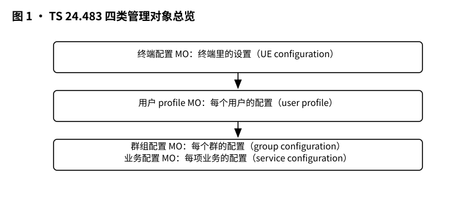
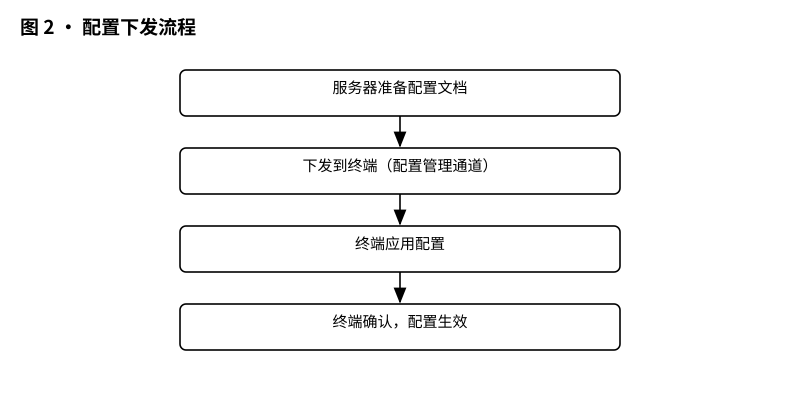
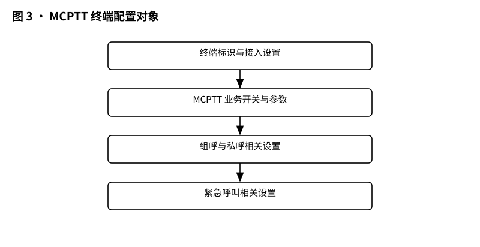
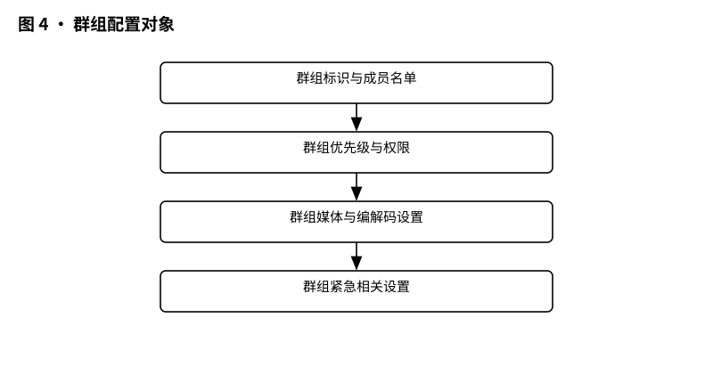

# 3GPP TS 24.483 解读：MC 配置管理对象——终端里的设置，是怎么被远程配出来的

> 版本：v1.0 ｜ 更新：2026-10-28 ｜ 基线：TS 24.483 v20.1.0（Rel-20，2026-09）｜ 原文：whatthespec.net 抓取的关键条款

**TS 24.483 是什么？** 它是 MCX（关键任务通信）配置管理对象的定义标准，规定了终端、用户、群组、业务四类配置数据在设备里具体长什么样，就像给手机里的“关键任务应用”定了一套标准的“设置菜单”格式。[§1]

### 1. 它要解决什么问题

想象一下，警察部门有 5000 台对讲机终端，消防队有 2000 台，铁路调度有 1000 台。

以前，如果要修改“最大并发通话数”或者“群组层级”，运维人员得拿着笔记本电脑，一台一台地去改设置？显然不可能。

再比如，新买了一台终端，开机后必须立刻知道：我是哪个部门的？我能加入哪些群组？我的语音优先权是多少？如果这些设置靠人工输入，效率极低且容易出错。

TS 24.483 解决的就是**“标准化配置数据格式”**的问题。

它定义了一套通用的“数据模板”（管理对象，MO）。无论终端是苹果、三星还是华为，无论运营商是哪家，只要遵循这个标准，服务器就能把配置数据打包成统一格式，一键下发到成千上万台终端上。终端收到后，能准确识别：哦，这是“最大并发通话数”，那是“群组 ID”。

简单来说，它把“设置”变成了可传输、可存储、可批量管理的“数据对象”。[§1]

### 2. 它在 MCX 家族中的位置

在 3GPP 标准体系中，TS 24.483 处于 **Stage 3（协议规范层）**，属于配置管理领域。

我们可以把它看作一座桥梁：

*   **上游（数据定义）**：它承接 TS 22.280（需求）和 TS 23.280（总体架构）中定义的业务逻辑参数。TS 23.280 说了“我们需要配置群组层级”，TS 24.483 就具体规定“群组层级这个数字放在哪个节点，叫什么名字，取值范围是多少”。
*   **下游（流程控制）**：它定义好的数据格式，交给 TS 24.483 的兄弟标准 **TS 24.484** 去使用。TS 24.484 规定了“怎么把这些数据从服务器送到终端”，而 TS 24.483 规定了“送过去的数据长什么样”。
*   **横向（其他业务）**：它还与 TS 24.379（MCPTT 协议）、TS 24.281（MCVideo 协议）、TS 24.282（MCData 协议）等具体业务协议配合。业务协议负责传输语音视频数据，而 TS 24.483 负责告诉终端“在传输之前，先检查这些配置”。

一句话总结：**TS 24.483 是“字典”，TS 24.484 是“快递员”，TS 24.379/24.481 是“打电话的人”。** [§1]

### 3. 核心概念大白话

为了搞懂 TS 24.483，你需要认识几个核心角色（管理对象，MO）：

#### 3.1 管理对象（MO, Management Object）
你可以把 MO 想象成一个**“文件夹”**或**“表单”**。
在 OMA DM（开放移动联盟设备管理）协议中，设备里的数据是树状结构的。MO 就是这棵树上的一个分支。每个 MO 有一个唯一的 ID（URI），比如 `urn:oma:mo:oma-dm-mcptt-ue-configuration:1.0`。这个 ID 就像门牌号，告诉服务器：“我要找的是 MCPTT 终端配置这个文件夹。” [§4.1]

#### 3.2 终端配置 MO（MCPTT UE configuration MO）
这是**“这台设备本身的能力”**。
比如：
*   这台手机最多能同时打几个点对点电话？（MaxCallN10）
*   最多能同时听几个群组通话？（MaxCallN4）
*   最大能同时发送几个群组通话？（MaxTransmissionN5）
这些是硬件或软件能力限制，跟用户是谁没关系。只要换一台性能更强的手机，这些值可能会变，但格式不变。 [§4.2.7, §4.2.9, §4.2.10]

#### 3.3 用户配置 MO（User Profile MO）
这是**“这个人是谁”**。
比如：
*   用户的名字是什么？
*   用户的职位（如：警长、司机）？
*   用户的优先权等级？
这些配置跟“人”绑定。如果张三把他的账号换到李四的手机里，用户配置 MO 应该跟着账号走（通常存在 USIM 卡或云端同步）。 [§1]

#### 3.4 群组配置 MO（MCS group configuration MO）
这是**“这个群是什么”**。
比如：
*   群组 ID 是多少？
*   群组的名字是什么？
*   群组的层级是多少？（例如：全国组 > 省组 > 市组）
*   群组是否支持广播？
一个用户可以加入多个群组，每个群组都有自己的一套配置。 [§6.1]

#### 3.5 业务配置 MO（Service configuration MO）
这是**“这个服务怎么开”**。
比如：
*   MCPTT 服务是否开启？
*   广播群组通话的层级结构有几级？
*   是否允许临时群组？
这决定了终端是否支持某些高级功能，以及这些功能的基本参数。 [§7.1]

#### 3.6 初始配置 MO（Initial Configuration MO）
这是**“新手机刚开机时的默认值”**。
当一台全新的终端第一次连接网络时，它可能没有任何配置。初始配置 MO 提供了一套“出厂默认值”，让终端能先连上网络，然后再去拉取完整的用户和群组配置。 [§1]

*图 1 · 四类管理对象总览：终端配置 / 用户 profile / 群组配置 / 业务配置。*

### 4. 一次配置下发怎么走

TS 24.483 本身不规定“怎么发”，只规定“发什么”。但为了理解，我们结合 OMA DM 协议的大致流程来看：

1.  **服务器准备**：配置管理服务器（CMS）根据用户的权限和终端的能力，生成符合 TS 24.483 格式的配置数据。例如，服务器知道用户 A 是警察，所以给他配置高优先权；知道用户 A 的手机支持 4 路并发，所以把 MaxCallN4 设为 4。
2.  **打包发送**：服务器通过 OMA DM 协议，将这些数据打包成管理对象树的形式（TS 24.483 定义节点结构），通过配置管理通道下发给终端。 [§1]
3.  **终端接收与解析**：终端收到数据后，解析 XML 树。它看到 `urn:oma:mo:oma-dm-mcptt-ue-configuration:1.0`，就知道这是终端配置。然后它逐层查找节点，比如找到 `Common/PrivateCall/MaxCallN10`，读取值 `4`。
4.  **存储与应用**：
    *   终端检查 USIM 卡里是否已经有这个参数。
    *   **关键规则**：如果 USIM 和终端存储（ME）里都有这个参数，**USIM 里的值优先**。这是为了防止恶意软件篡改终端本地存储的配置，确保 SIM 卡作为可信源。 [§4.1, §6.1, §7.1]
    *   终端将新配置应用到 MCPTT/MCData/MCVideo 客户端模块中。
5.  **确认**：终端向服务器发送成功或失败的消息。

*图 2 · 配置下发流程：服务器准备 → 下发 → 终端应用 → 确认。*

### 5. 关键时刻的能力：具体配置项详解

为了让你更有画面感，我们深入看看 TS 24.483 里具体定义了哪些“旋钮”。

#### 5.1 MCPTT 终端配置：能力的边界

在 [`§4 MCPTT UE configuration MO`] 中，核心节点包括：

*   **MaxCallN10 (最大点对点通话数)**：
    *   取值范围：0-255。
    *   大白话：这台手机最多能同时跟几个人单独通话？如果是 1，那就是传统对讲机模式；如果是 4，就可以一边跟队长通话，一边跟消防员通话。 [§4.2.7]
*   **MaxCallN4 (最大并发群组通话数)**：
    *   取值范围：0-255。
    *   大白话：这台手机最多能同时“听”几个群？比如你可以同时听“火灾现场组”和“交通管制组”的声音，这取决于这个值。 [§4.2.9]
*   **MaxTransmissionN5 (最大群组发送数)**：
    *   取值范围：0-255。
    *   大白话：这台手机最多能同时向几个群“说话”？通常这个值较小，因为一个人很难同时向多个群有效地讲话。 [§4.2.10]

这些参数是“硬约束”。如果服务器下发的值超过了终端硬件支持的最大值，终端应该忽略该值或报错，而不是强行执行导致崩溃。

#### 5.2 群组配置：群的身份证

在 [`§6 MCS group configuration MO`] 中，每个群组都有一个独立的配置块。

*   **MCPTTGroupID**：群组的唯一标识符。
*   **Common 节点**：包含在线和离线通用的参数。
*   **MCData/MCVideo 子节点**：
    *   虽然这个 MO 名字叫 "MCPTT group configuration"，但它其实是一个**通用群组容器**。
    *   规范中特别注明：出于历史原因，很多元素名字里带 "MCPTT"，但实际上它们对所有 MCS（包括 MCData 和 MCVideo）都是通用的。
    *   特定于 MCData 的参数放在 `MCData` 子节点下，特定于 MCVideo 的放在 `MCVideo` 子节点下。 [§6.1]
    *   这意味着，同一个群组 ID，既可以用来传语音（MCPTT），也可以用来传数据（MCData，如文件、GPS 位置），还可以传视频（MCVideo）。群组配置 MO 统一管理这些身份。

*图 3 · MCPTT 终端配置对象：里面装了哪些设置项。*

*图 4 · 群组配置对象：一个群的配置由哪些部分组成。*

#### 5.3 业务配置：功能的开关

在 [`§7 MCPTT service configuration MO`] 中，主要控制服务的整体行为。

*   **BroadcastMCPTTGroupCall (广播群组通话)**：
    *   **NumLevelGroupHierarchy (群组层级数)**：取值 0-255。
        *   大白话：广播群组可以分几级？比如 1 级是全国广播，2 级是省级广播，3 级是市级广播。这个值告诉终端，最多可以嵌套多少层广播。 [§7.2.7]
    *   **NumLevelUserHierarchy (用户层级数)**：
        *   大白话：在广播中，用户的优先权可以分几级？比如指挥官 > 组长 > 组员。 [§7.2.8]
    *   **AdhocGroup (临时群组)**：
        *   规范中还定义了临时群组的配置 MO（Figure 7.1.2）。临时群组是用户可以手动创建的、非预定义的群组，常用于现场临时组建小队。 [§7.1]

#### 5.4 初始配置：新机的“第一口奶”

**MCS UE initial configuration MO** 是专门为新终端设计的。
当终端没有任何配置时，它可以使用这个 MO 中的默认值来启动基本的连接功能。这确保了即使服务器还没来得及下发完整配置，终端也能“活着”并尝试连接。 [§1]

### 6. 配置对象 vs 配置流程的区别

很多初学者会混淆 TS 24.483 和 TS 24.484。

*   **TS 24.483 (本文)**：**“长什么样”**。
    *   它定义数据模型（Data Model）。
    *   它规定：有一个节点叫 `MaxCallN10`，它是整数，范围 0-255，它是必需的。
    *   它不涉及：这个数据是通过 HTTP 发的还是 FTP 发的？发送失败了重试几次？
    *   **类比**：这是“菜单模板”。菜名是什么，价格是多少，配料表是什么。

*   **TS 24.484**：**“怎么管”**。
    *   它定义配置管理流程（Configuration Management Procedures）。
    *   它规定：服务器如何触发配置更新？终端如何请求配置？如果配置冲突了怎么解决？如何验证配置的有效性？
    *   **类比**：这是“点餐流程”。顾客怎么点，服务员怎么传，厨房怎么做，上错菜了怎么退。

TS 24.483 基于 OMA DM 1.2 协议框架。OMA DM 负责传输和会话管理，而 TS 24.483 告诉 OMA DM：“请把下面这段 XML 数据放进终端的这个特定位置。” [§4.1, §6.1, §7.1]

### 7. 它不管什么（边界）

明确 TS 24.483 **不**负责的内容，有助于避免误解：

1.  **不管 Stage 1 需求**：它不讨论“为什么”需要 MCX，也不讨论具体的业务场景（如警察怎么抓贼）。那是 TS 22.280 的事。
2.  **不管传输层细节**：它不规定 TCP 端口是多少，TLS 证书怎么生成。那是 OMA DM 协议和底层网络协议的事。
3.  **不管具体的编解码器选择**：它配置“最大通话数”，但不配置“用 AMR 还是 EVS 编码”。那是 TS 26.179（MCPTT 编解码）等规范的事。
4.  **不管用户界面（UI）**：它规定了数据存在哪，但不规定手机屏幕上这几个设置项显示成中文还是英文，字体多大。那是终端厂商的事。
5.  **不管离线存储的具体文件格式**：虽然它提到参数可以存在 USIM 或 ME 中，但 USIM 里的具体字节布局由 TS 31.102 定义，TS 24.483 只定义逻辑上的参数名和值。 [§4.1, §6.1]

### 8. 怎么往下读

如果你想深入理解 MCX 的配置体系，建议按以下顺序阅读：

1.  **本篇 (TS 24.483)**：建立数据模型概念，记住主要的 MO 类型和关键参数（如 MaxCallN10）。
2.  **TS 24.484 (MCX Configuration Management)**：看配置是怎么动态更新的。重点看“配置请求”和“配置响应”的消息交互。
3.  **TS 23.280 (MCX Overall Architecture)**：特别是附录 A，那里通常列出了所有配置参数的汇总，可以作为字典查阅。
4.  **TS 24.379 (MCPTT Access Layer)**：看这些配置参数在建立呼叫时是如何被使用的。例如，当终端发起呼叫时，它会检查 `MaxCallN10`，如果已满，就拒绝新呼叫。

**版本与来源说明：**

*   **标准版本**：TS 24.483 v20.1.0，Rel-20（2026-09）
*   **主要参考**：
    *   OMA DM 1.2 (开放移动联盟设备管理协议)
    *   3GPP TS 31.102 (USIM 应用工具包)
    *   3GPP TS 24.379, 24.380, 24.481, 24.482, 24.484, 24.282, 24.582, 24.281, 24.581 (其他 MCX 相关规范) [§1]

---

### 附录：关键节点速查表

为了方便快速查找，以下是 TS 24.483 中几个核心 MO 的关键节点摘要：

| MO 名称 | 关键节点 (Path) | 含义 | 取值/类型 | 条款 |
| :--- | :--- | :--- | :--- | :--- |
| **MCPTT UE Config** | `/Common/PrivateCall/MaxCallN10` | 最大点对点通话数 | int (0-255) | §4.2.7 |
| **MCPTT UE Config** | `/Common/MCPTTGroupCall/MaxCallN4` | 最大并发群组通话数 | int (0-255) | §4.2.9 |
| **MCPTT UE Config** | `/Common/MCPTTGroupCall/MaxTransmissionN5` | 最大群组发送数 | int (0-255) | §4.2.10 |
| **MCS Group Config** | `/Common/MCPTTGroupID` | 群组 ID | chr/string | §6.2.7 |
| **MCPTT Service Config** | `/Common/BroadcastMCPTTGroupCall/NumLevelGroupHierarchy` | 广播群组层级数 | int (0-255) | §7.2.7 |
| **MCPTT Service Config** | `/Common/BroadcastMCPTTGroupCall/NumLevelUserHierarchy` | 广播用户层级数 | int (0-255) | §7.2.8 |

**注意**：所有 MO 都支持 `Ext` 节点，用于厂商自定义扩展，非标准化部分。 [§4.2.4, §6.2.4, §7.2.4]
