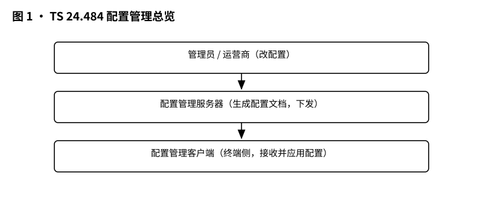
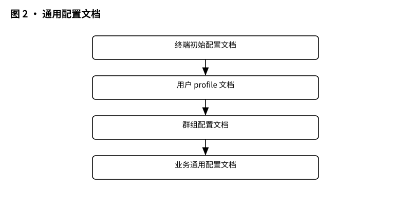
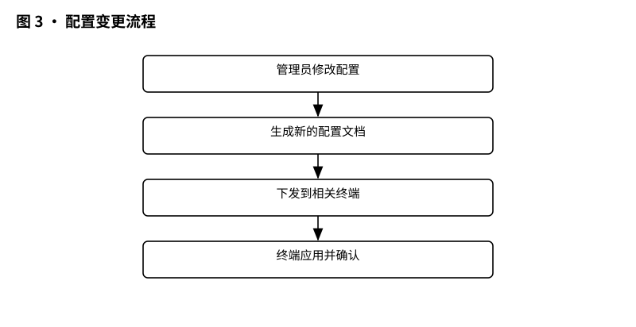
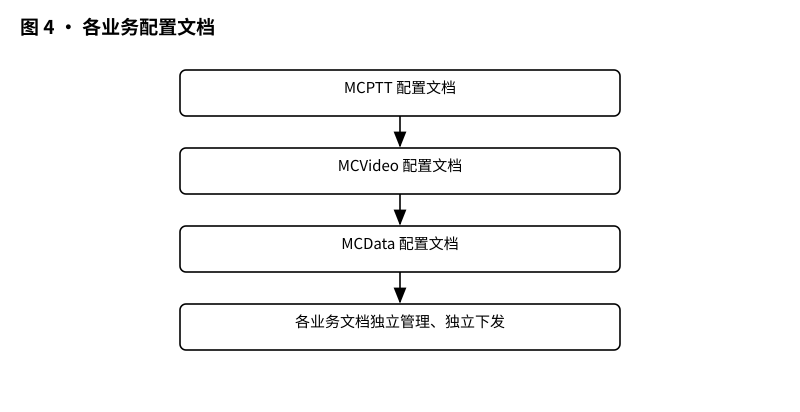

# 3GPP TS 24.484 解读：MC 配置管理——几千台终端的配置，网里是怎么管起来的。

> 版本：v1.0 ｜ 更新：2026-10-28 ｜ 基线：TS 24.484 v20.1.0（Rel-20，2026-09）｜ 原文：whatthespec.net 抓取的关键条款

**首屏一句话**：TS 24.484 是 MCX（Mission Critical，任务关键型）里专门管“配置”的规范，它把配置文档怎么建、怎么改、怎么发、怎么查、怎么删，以及管理员怎么通过终端把配置塞进网里，都写成了可落地的流程 [§1][§6]。**

版本事实先摆上：本文依据 **TS 24.484 v20.1.0，Rel-20（2026-09）** 的公开抓取摘要展开。

---

## 1. 它要解决什么问题

想象一个几千人的行业集群：有对讲（MCPTT）、有视频（MCVideo）、有数据（MCData）。每个终端都要有“能上哪种业务、能进哪个组、能调什么功能”的配置；每个企业里还有一大堆管理员，要能像管公司门禁一样，把配置统一建好、下发下去、随时改、随时查。

TS 24.484 要解决的就是这件“配置全生命周期管理”的事 [§1]：

注意：它不是一份“随便写写”的草案，而是把配置动作拆成标准流程，让不同厂家的终端和服务器能按同一套规则沟通 [§6]。管理员不是拿着蓝牙逐台配，而是把配置做成文档，丢给网里的“配置管家”，由管家批量处理。

*图 1 · 配置管理总览：管理员 → 配置管理服务器 → 终端，配置文档在中间流转。*

---

## 2. 它在 MCX 家族中的位置

TS 24.484 属于 **Stage 3** 的“配置类”规范：它不讲需求怎么做，不讲业务信令怎么发，它专管“配置流程怎么走” [§6]。

它和 TS 24.483 是配套关系：

- **TS 24.483** 回答：配置对象长什么样？有哪些字段？语义是什么？
- **TS 24.484** 回答：配置文档怎么创建、怎么检索、怎么更新、怎么删除、怎么订阅通知 [§6]。

打个比方：24.483 是“户型图”，告诉你客厅、厨房、阳台都有什么；24.484 是“装修流程”，告诉你先砸哪面墙、再铺哪块砖、最后验收签字。

覆盖的业务也齐：MCPTT、MCVideo、MCData [§1]。

---

## 3. 核心概念大白话

### 3.1 配置管理服务器（CMS）

CMS 就是网里的“配置管家”：它收文档、存文档、按身份鉴权、给终端或服务器提供访问入口 [§6.2.4.1]。规范要求 CMS 要按 HTTP 服务器的要求处理请求，并且要用发送方身份来做授权 [§6.2.4.1]。

### 3.2 配置管理客户端（CMC）

CMC 是“手里拿文档的人”：终端里的配置客户端，或网络侧的服务器客户端，都能当 CMC。它负责发起 HTTP 请求，而且要走 TLS 连接 [§6.2.2][§6.2.3]。

### 3.3 配置文档

TS 24.484 把配置写成一份份“文档”，通用文档加三类业务文档，一共十类：

- MCS UE initial configuration document（初始配置）
- MCPTT UE / user profile / service configuration document
- MCVideo UE / user profile / service configuration document
- MCData UE / user profile / service configuration document [§1]

### 3.4 配置管理流程

文档不是死文件，得能动。标准里至少定义了这些流程 [§6.1]：

- 创建、检索、更新、删除；
- 对文档元素或属性进行创建/替换、删除、抓取；
- 抓命名空间绑定；
- 订阅与通知。

*图 2 · 通用配置文档：所有业务共用的配置有哪些。*

---

## 4. 一次配置变更怎么走

拿最常见的“管理员改配置”举例。

1. **管理员动手**：MCS 服务管理员可以用 MCS UE 去配置“MCS UE initial configuration document” [§4.1.1]。
2. **终端当打包员**：CMC 按对应业务的用法，把配置写成一份 XML 文档 [§6.3.2.2]。
3. **发到配置管家**：CMC 用 HTTP PUT 把文档发过去，Request-URI 指向网络里配好的 “CMSXCAPRootURI”，遵循 IETF RFC 4825 的 “Create or Replace a Document” [§6.3.2.2]。
4. **管家鉴权入库**：CMS 按 HTTP 服务器要求处理请求，并按发送方身份授权 [§6.2.4.1]。
5. **终端取配置**：MCS UE 启动时先 bootstrap 到必要的信息，用来定位配置管理服务器，再做初始配置 [§4.2.1]。
6. **订阅后续变更**：需要持续知道“文档变了”的角色，可以走订阅和通知 [§6.1]。

*图 3 · 配置变更流程：改配置 → 生成文档 → 下发 → 应用 → 确认。*

---

## 5. 关键时刻的能力

### 5.1 通用配置文档

“MCS UE initial configuration document” 是一份公共模板文档：

- 它的 schema 定义在条款 7.2.2.3 [§7.2.1]；
- 它既可以指“全单位所有终端都适用”的默认文档，也可以只对特定终端生效；没有特定标识时，默认作用于整个任务关键组织 [§7.2.1]；
- 管理员目录里存一份 “master” 模板，CMS 再按模板生成终端各自的初始配置对象 [§7.2.1]；
- 不含终端标识的 master 文档，文件名是 “DEFAULT-MCPTT-INITIAL-UE.xml” [§7.2.1]；
- 终端通过 XDM 集合访问，XCAP URI 不因“特配还是模板”而变 [§7.2.1.1]。

### 5.2 MCPTT 配置文档

MCPTT 服务管理员可以用 MCPTT UE 配置 [§4.1.2]：

- MCPTT UE configuration document：格式在 §8.2；
- MCPTT user profile configuration document：格式在 §8.3；
- MCPTT service configuration document：格式在 §8.4；
- MCPTT group document：格式在 3GPP TS 24.481 [§4.1.2]。

### 5.3 MCVideo 配置文档

MCVideo 服务管理员可以用 MCVideo UE 配置 [§4.1.3]：

- MCVideo UE configuration document：格式在 §9.2；
- MCVideo user profile configuration document：格式在 §9.3；
- MCVideo service configuration document：格式在 §9.4；
- MCVideo 相关组配置数据：格式在 TS 24.481 [§4.1.3]。

### 5.4 MCData 配置文档

MCData 服务管理员可以用 MCData UE 配置 [§4.1.4]：

- MCData UE configuration document：格式在 §10.2；
- MCData user profile configuration document：格式在 §10.3；
- MCData service configuration document：格式在 §10.4；
- MCData 相关组配置数据：格式在 TS 24.481 [§4.1.4]。

### 5.5 查询、订阅与安全

- 客户端要支持 OMA XDM Core 的 “Document Management” 和订阅 [§6.3.1.1]；
- 服务端要支持对应的文档管理和接入权限 [§6.3.1.2]；
- HTTP 要过 TLS，CMS 还要维护授权 MCS 服务器列表 [§6.2.2][§6.2.4.1]；

*图 4 · 各业务配置文档：MCPTT / MCVideo / MCData 各自的配置文档。*

---

## 6. 配置管理 vs 配置对象 vs 业务协议的区别

一句话区分 [§1][§6]：

- **TS 24.484**：管“配置流程”——怎么建文档、怎么发、怎么改、怎么查；
- **TS 24.483**：管“配置对象”——对象里有哪些字段、什么意思；
- **业务协议（如 MCPTT、MCVideo、MCData 的 Stage 3）**：管业务信令怎么跑。

---

## 7. 它不管什么

- 不管 Stage 1 需求：需求在 TS 22.280 等需求规范里；
- 不管配置对象内部字段语义：字段在 TS 24.483；
- 不管实现选型：实现细节留给厂家。

---

## 8. 怎么往下读

1. 先读本篇，建立“文档 + 流程”的心智模型；
2. 再读 TS 24.483，看配置对象的字段细节；
3. 对照 TS 23.280，理解整体架构上下文 [§6.3.2.1]；
4. 想查原始定义，回到条款：文档格式 §7–§10，流程 §6，初始化 §7.2。

### 来源与版本

- 规范：3GPP TS 24.484
- 版本：v20.1.0，Rel-20（2026-09）
- 摘要来源：whatthespec.net 抓取的条款文本

注：以上条款号均来自上述摘要；摘要未覆盖之处本文不做扩展。
