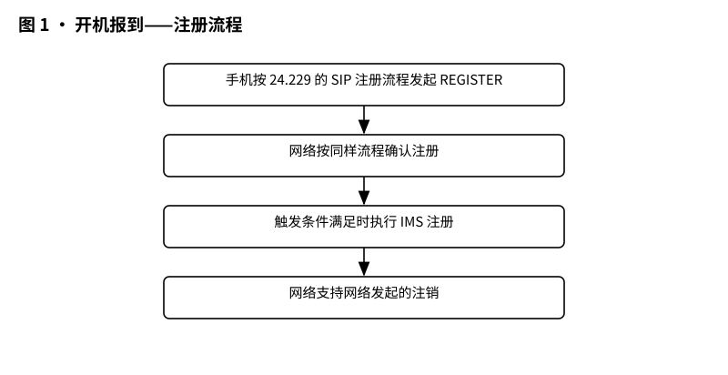
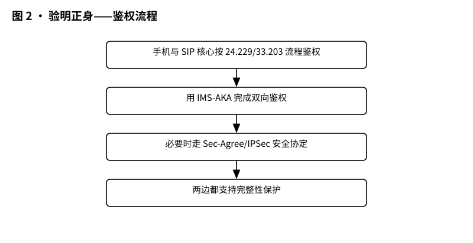
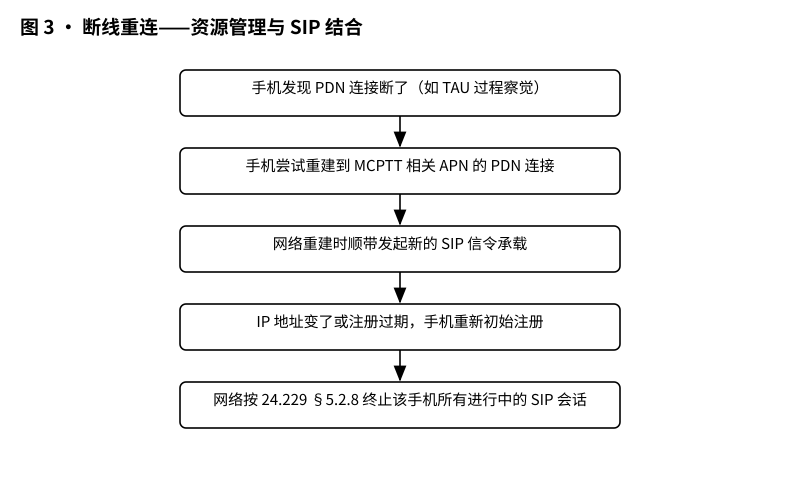
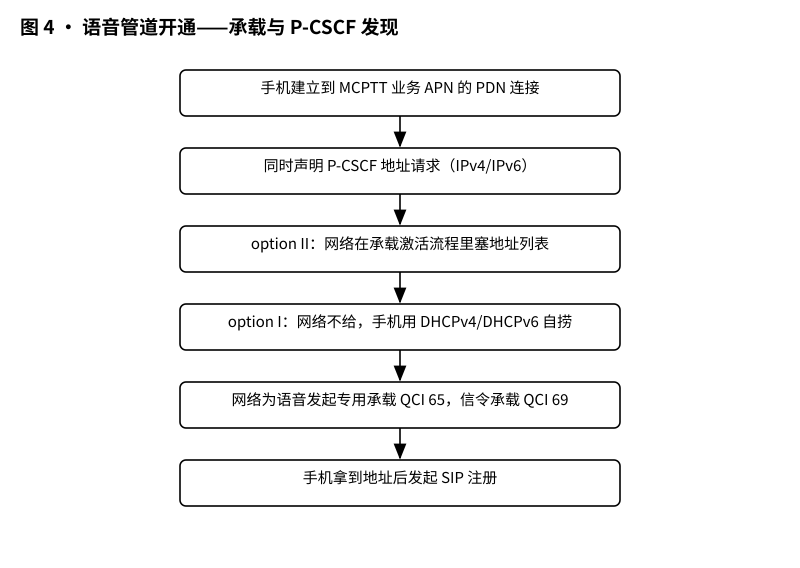

# 3GPP TR 24.980 解读：Gm 参考点上 MCPTT 的及格线——最低要求

> 版本：v1.0 ｜ 更新：2026-10-28 ｜ 基线：TR 24.980 v16.0.0（Rel-16，2020-07）｜ 原文：3GPP 官方 FTP 存档原文（.doc）

**TR 24.980 给 Gm 参考点上的 MCPTT 划了条及格线：手机、SIP 核心网、EPC 各自最低要做到什么。**

先说结论：这份 TR 不发明任何新技术，它干的是“裁剪”的活——把 3GPP 官方规范里几百页、几十个可选方案，剪成一条最小可行路径。你照着这条路径做手机、做核心网、做 EPC，三家的设备放在一起就能互相认出来、连得上去。反过来说，如果你想给 MCPTT 终端加一些“花活”（比如视频、比如提前把会话建好），TR 也顺带告诉你：要支持这些花活，Gm 上还得多配合哪几个选项。这份文档一共只有十三页，附录的变更历史占了两页多，正文其实薄得很——薄，是因为它是个“结论清单”，细节全挂在别的规范上。十三页的体量也提醒读者：别指望一份 TR 讲透所有 MCPTT 技术，它只是一块路标，路本身在 TS 24.229、24.301、24.379 那里。

- 文档全名：3GPP TR 24.980 V16.0.0（2020-07），标题 Minimum requirements for support of MCPTT Service over the Gm reference point。
- 性质：TR 是技术研究报告，不是规范（TS）。它把 24.229、24.301、24.379 里的一堆可选方案“裁剪”成一套推荐组合，目标是让 MCPTT 手机和网络只要都照做，就能拿到 MCPTT 业务。
- 覆盖范围：只讲网内（on-network）单播（unicast）这一种玩法，不涉及集群组呼。

## 1 它要解决什么问题

想象你是一家铁路公司的采购经理，要给司机们配“按住即讲”的对讲手机。供应商有的说“我用 24.229 的选项 A”，有的说“我用选项 B”，网络侧也是各说各话。结果就是：手机进了不同运营商的网，可能注册不上、鉴权失败、或通话建立不起来。TR 24.980 干的事，就是把 3GPP TS 24.229（IMS 呼叫控制协议）和 TS 24.301（EPC 非接入层协议）里的海量选项做了一次“选必修课”：哪些必须支持、哪些可以不做，写清楚，让两边照着做就能互通 [§1]。

为什么非得做这件事？因为 3GPP 的正式规范有个设计习惯：规范要照顾全球各种运营商的各种玩法，于是大量功能都写成“可选（optional）”。可选的意思是：厂商可以做，也可以不做；可以做 A 方案，也可以做 B 方案。这对标准化组织是美德，对采购经理是噩梦——你怎么知道哪家供应商的设备做了哪个选项？TR 24.980 把这种“自由度”收敛成“互操作最低要求”：凡是 24.229、24.301 里给出的选项，只要不支持就无法获得 MCPTT 业务，TR 就把它挑出来，标成“必须支持”。顺带说明：TR 明确把三种情况列为它的任务——24.229 里与网内 IMS 业务相关的选项要圈；24.301 和 stage 2 功能里给 MCPTT 服务所需的选项要圈；MCPTT 可选功能要求 Gm 额外选项的，也标出来“建议支持” [§1]。当然，它的语气是推荐性的（recommendations），措辞是“确保互操作需要定义建议”，而不是“必须执行”——这是 TR 和 TS 的分水岭。

它的核心逻辑是：Gm 参考点（即手机与 IMS 之间整个 LTE 信令通道的统称）上存在太多“要么这样、要么那样”的选项，如果手机选了 A、网络选了 B，互操作就失败 [§1]。所以 TR 的任务就是指出“确保互操作的那些选项”。同时，MCPTT 的某些可选功能（比如视频）需要 Gm 上额外的选项配合，这些也会被标注为“建议支持” [§1]。

## 2 它在 MCX 家族中的位置

MCPTT（Mission Critical Push To Talk over LTE，关键任务对讲）的家族图谱里，TS 23.179 是总架构（stage 2），TS 24.379 是信令协议（stage 3），TS 24.383 是手机配置对象（MO），TS 26.179 管编解码。TR 24.980 的角色像一本“接口考试大纲”：它不发明任何新协议，而是站在 24.229（SIP/SDP 呼叫控制）和 24.301（EPS 的 NAS 协议）之上，把 MCPTT 需要的最低 IMS profile 圈出来 [§1]。把 TR 放进家族里看：MCPTT 是 3GPP 从 Release 13 开始为关键任务组织（警察、消防、铁路、公用事业等）做的 LTE 对讲标准。TS 23.179 画出整张架构图（stage 2），TS 24.379 规定信令流程（stage 3），TS 24.383 管终端配置对象，TS 26.179 管语音编解码。TR 24.980 不在这条主线上，它是一条“侧线”：专管 MCPTT 手机和 IMS 之间那条 Gm 接口的“及格线”。有意思的是它的写法大量借用 VoLTE 的 IR.92——GSMA 早就用同样思路给普通手机语音定过 profile，MCPTT 相当于把这套思路搬到了关键任务场景，只是把管道参数（比如语音承载的 QCI 值）和可靠性要求按对讲业务重新调了一遍。

它还和 GSMA 的 IR.92（VoLTE 语音短信 profile）做了交叉对齐 [§Introduction]，相当于说：“MCPTT 的信令底线，和 VoLTE 是同一类产品”。

## 3 核心概念大白话

- **MCPTT UE**：跑 MCPTT 业务的终端（手机/终端设备），是 MCPTT 用户参与业务的入口 [§3.1]。
- **SIP core**：SIP 核心网，主要指 IMS 里的 P-CSCF（代理呼叫控制功能，相当于手机进 IMS 的“前台接待”）和 S-CSCF（服务呼叫控制功能，相当于“总机”）。如果某家 MCPTT 网络的 SIP 核心内部不按 23.228 的架构搭，那么这些要求就泛指地套在提供等效功能的实体上 [§Introduction]。
- **EPC**：演进分组核心网，LTE 的“数据总机房”，里面的 MME（移动管理实体）负责移动性与会话锚点。
- **Gm 参考点 / SIP-1**：TS 23.179 定义 MCPTT 手机与 SIP 核心之间的接口叫 SIP-1，它直接采用 3GPP 的 Gm 参考点（做了必要的增强和裁剪）[§Introduction]。
- **注册（registration）**：手机向 IMS“报到”，告诉网络“我来了、我的地址是这个”。
- **鉴权（authentication）**：网络验证手机身份，防蹭网。这里用的是 IMS-AKA（IMS 认证与密钥协商）这把“双向验证钥匙”，还支持完整性保护（integrity protection，即防篡改）[§4.3]。
- **EPS bearer（承载）**：手机到核心网的数据管道。TR 给 MCPTT 圈了两类管道：信令管道 QCI 69 和语音管道 QCI 65 [§6.2.2]。
- **UM 承载**：Unacknowledged Mode，不确认模式，语音数据走这条管道，丢了不重传——对讲机要的就是快，晚到的重传反而添乱 [§6.2.1]。
- **APN**：接入点名称，手机连入不同业务的“门牌号”。MCPTT 相关的门牌号有三家：MCPTT 业务 APN（走 SIP-1）、MC 公共核心业务 APN（走 HTTP-1）、MC 身份管理业务 APN（走 CSC-1）[§3.1]。
- **RTP/RTCP**：实时传输协议及其控制协议，就是装语音“快递”的集装箱和“签收回执”[§5.3]。
- **SDP**：会话描述协议，通话前双方交换“名片”——我的语音用什么编码、发到哪个地址、哪个端口，都写在这张名片上。
- **QCI**：服务特性等级，数字代号。QCI 69 专门给信令（SIP 消息）用，QCI 65 专门给会话语音用；按 TS 23.203 的优先级，69（0.5）高于 65（0.7），信令优先于语音 [§6.2.2]。
- **TAU**：跟踪区更新，手机在 LTE 里移动到新区域时向网络“打卡续命”的例行手续，TR 拿它举例说：手机就是在这类例行手续里发现 PDN 连接丢了的 [§4.5.1.1]。
- **PCRF**：策略与计费控制功能，网络里的“交通调度员”，决定给哪条管道配什么资源、什么时候掐断 [§4.5.2.1]。
- **完整性保护（integrity protection）**：给信令消息加“防篡改封条”，路上被偷改会被发现，鉴权双方都要支持 [§4.3]。
- **PDN 连接**：分组数据网连接，手机和核心网之间的一条数据通路。TR 里反复出现的“Loss of PDN connectivity”说的就是这条通路断掉。
- **GBR 承载**：保证比特率承载，语音专用管道，网络承诺给它保底带宽；MCPTT 语音走的就是这种管道 [§4.5.2.2]。
- **预建立会话（pre-established sessions）**：通话还没开始，先把管道和会话骨架搭好，用户一按按钮就能说话；要支持它，网络和 SIP 核心都得配合资源共享 [§6.2.2][§6.2.3]。

## 4 关键流程

先看全程，再看细节。MCPTT 手机从开机到能讲上话，要经历一连串“报到”：先连 LTE 网、建立 PDN 连接，再发现 P-CSCF 地址，再向 IMS 注册，再鉴权，最后才可能建立通话会话。这个过程里任何一步做岔了（比如选项选错、地址发现失败、鉴权方式对不上），后面全崩——所以 TR 的价值就在于把这一串步骤的“标准答案”定下来。TR 的 §4.2 管注册，§4.3 管鉴权，§4.4 一句话带过会话建立（细节交给 24.229 和 24.379），§4.5 管断线后资源管理和 SIP 怎么联动，§6 管承载管道，§7 管 IP 版本。下面四张图按原文条款的文字描述画出来。

*图 1 · 开机报到——注册流程（依据 §4.2.1/§4.2.2 文字绘制；原文无图）：REGISTER → 确认 → 触发时 IMS 注册。*

*图 2 · 验明正身——鉴权流程（依据 §4.3.1/§4.3.2 文字绘制；原文无图）：IMS-AKA 双向鉴权、Sec-Agree/IPSec。*

*图 3 · 断线重连——资源管理与 SIP 的结合（依据 §4.5.1.1/§4.5.2.1 文字绘制；原文无图）：PDN 断 → 重建 → IP 变则重注册。*

*图 4 · 语音管道开通——承载与 P-CSCF 发现（依据 §6.2/§6.3 文字绘制；原文无图）：option II 塞地址 / option I 用 DHCP；语音 QCI 65、信令 QCI 69。*

## 5 关键时刻的能力

**手机端（MCPTT UE）基线**：
- 把 24.229 要求 E-UTRAN 手机的全部必选能力和 24.301 的全部 UE 必选能力当作起点 [§4.1.1]。
- 语音编解码按 26.179，数据走 RTP，RTCP 也要实现 [§5.1.1][§5.2.1][§5.3.1]。
- 对 MCPTT 业务 APN，手机不自己激活语音媒体承载，而是把多路并发语音会话的媒体流“拼车”复用到一条 UM 承载上（IR.92 §4.3.2 的做法），因为最低要求就是支持一条语音 UM 承载 [§6.2.1]。
- 断网恢复时：重建 PDN；如果 IMS 注册在断网期间过期，回来后必须重新初始注册 [§4.5.1.1]。
- 媒体专用承载建立失败或中途丢失时，按 24.229 §6.1.1 的流程，根据自己的偏好“改、拒、断”这条 SIP 会话 [§4.5.1.2]。
- 收到不含当前所用 P-CSCF 地址的 Modify EPS Bearer Context Request 时，要换一个 P-CSCF 并发起新注册（IR.92 §4.4）[§6.3.1]。
- IPv4/IPv6 双栈全协议支持；注册用哪个 IP 版本，后续所有 SIP 通信就用它，SDP/RTP 要么沿用同一 IPv4 地址，要么用同一 IPv6 前缀的地址 [§7.1.1]。

**网络端（SIP core / EPC）基线**：
- P-CSCF 和 S-CSCF 在 Gm 上收发消息的 24.229 必选能力是基线 [§4.1.2]；MME 的 24.301 必选能力是基线 [§4.1.3]。
- SIP 核心中终结用户面的实体也要用 RTP 传语音媒体，且 RTCP 双方都要实现 [§5.2.2][§5.3.1]。
- 语音 GBR（保证比特率）承载失败或中途丢失时，网络必须按 24.229 §5.2.8 终止这条语音会话（PCRF 把承载丢失通知给 P-CSCF）。TR 给了个扎心的理由：这是系统能“快速”停掉 IMS 级计费的唯一办法 [§4.5.2.2 NOTE]。
- 断 PDN 连接时，网络要按 24.229 §5.2.8 终止该手机所有进行中的 SIP 会话（例如 PCRF 向 P-CSCF 发 abort session 请求）[§4.5.2.1]。
- 支持动态 PCC：语音媒体专用承载最多建一条；若支持预建立会话，网络要支持 29.214 规定的资源共享 [§6.2.2]。
- SIP 核心若经 Rx 接口与 PCC 交互，且支持预建立会话，就支持资源共享，并在首个 SIP REGISTER 请求里带 Resource-Share 头字段 [§6.2.3]。
- 用 option II 机制时，EPC 在 EPS 承载上下文激活流程里把 P-CSCF 地址列表传给手机，编码方式在 24.301 里 [§6.3.3]。
- P-CSCF 支持 IPv4/IPv6 双栈；跨 IP 版本互通建议对手机透明（IR.92 §5.1）[§7.1.2]。

## 6 边界（它不管什么）

- **它不是规范**：TR 的结论是研究报告性质，真正“必须”的约束要去看它引用的 TS 24.229、24.301、24.379 等正式规范。TR 的作用是“圈选必修”，告诉你哪些选项的组合能互通 [§1][§Introduction]。
- **不管组呼/集群面**：只覆盖网内单播，集群组呼能力不在其列 [§1]。
- **不管业务细节**：MCPTT 的按钮逻辑、群组管理、优先级抢占等业务面在 23.179/24.379/24.383 里，TR 只在“某可选功能需要 Gm 额外选项”时点一句 [§1]。
- **不管编解码算法本身**：语音用什么编码由 26.179 管，TR 只是要求“手机和 SIP 核心都支持 26.179 的音频编解码” [§5.1]。
- **部分小节是 Void**：比如参考文献 [8]、6.3.2（SIP core 的 P-CSCF 发现）都是 Void，即内容为空，说明这个位置没给要求 [§2][§6.3.2]。
- **原文没写的一律不猜**：本 TR 全文无示意图、无数据流量、无测试用例，超出文字结论的细节一律不写。

## 7 怎么往下读

如果你是第一次接触 MCPTT 深读系列，建议按这个顺序走：先建立 MCPTT 业务直觉（为什么对讲机要快、要优先级、要可靠性），再看 23.179 的总架构，把 Gm/SIP-1 这条接口线在脑子里钉牢，然后回来把 TR 24.980 当“接口考试大纲”用。读 TR 时手边常备 24.229 和 24.301 两份规范，因为 TR 每一句话几乎都是“指向别处”的引用，不翻原文是体会不到细节的。

1. 先看 TS 23.179 理解 MCPTT 总架构，再回来对照 TR 的 Gm 裁剪 [§Introduction]。
2. 把 TR 当“地图索引”用：每一条结论都挂着 24.229 / 24.301 / 33.203 / 26.179 的具体小节号，顺着编号去读正式规范 [§4]–[§7]。
3. 对照 IR.92（VoLTE profile）看异同——TR 明确说它交叉引用并对齐 IR.92，VoLTE 读者会很熟悉这套写法 [§Introduction]。
4. 做实现的读者重点盯 §4.2–§4.5（注册/鉴权/会话/资源管理结合）和 §6.2（QCI 69/65 双承载），这是互操作最容易出问题的地方 [§6.2]。
5. 想确认 TR 结论的“版本身世”，翻 Annex A 变更历史：从 2015 年 0.0.0 骨架一路走到 16.0.0（2020-07，仅升级到 Rel-16 的 MCC 更新）[§Annex A]。

## 版本说明

- 依据原文第一页与 ETSI 镜像页确认：标题为 Minimum requirements for support of MCPTT Service over the Gm reference point（LTE; 3GPP TR 24.980 version 16.0.0 Release 16），与任务预期一致。
- 版本 V16.0.0，2020-07 发布，对应 3GPP Release 16；Annex A 显示上一版 15.0.0，16.0.0 的变更说明为“Update to Rel-16 version (MCC)”，即仅版本号升级、无实质性技术改动。ETSI 镜像页同样标注 V16.0.0 (2020-07)，两边一致，交叉核对无差异。这份 TR 的另一个身世细节：它的骨架早在 2015 年 10 月就由 CT1 会议敲定，2016 年 3 月被 TSG 批准，此后三年纯挂版本号——可见 Gm 这条线的最低要求，业界很早就达成共识了。
- 原 .doc 共 13 页，纯文字报告，**原文不含任何插图**。因此文中 4 幅“见图 N”均为依据对应条款文字绘制的示意图，已逐幅注明所依据的条款号；不杜撰原文图号。
- 变更历史显示：2016-03 出现 13.0.0（TSG 批准版），2017-03 升级到 Rel-14，2018-06 升到 Rel-15（更新 MCC），2020-07 升到 Rel-16——后两次升级在 Annex A 里都只写“Update to Rel-XX version (MCC)”，没有实质技术变更。也就是说，这份 profile 的技术内容在 2016 年前后就基本定型，后面是“随大版本挂版本号”。
- 参考文献 [8] 为 Void；2017-03 之后 Rel-14/15/16 的更新见 Annex A 变更历史。

## 来源与参考

- 原文：3GPP TR 24.980 V16.0.0 (2020-07)，下载自 3GPP 官方 FTP：https://www.3gpp.org/ftp/Specs/archive/24_series/24.980/24980-g00.zip
- ETSI 镜像：https://www.etsi.org/deliver/etsi_tr/124900_124999/124980/16.00.00_60/tr_124980v160000p.pdf
- whatthespec.net 未能获取（404）。
- 文中引用的外部规范编号均转引自 TR 24.980 的 References 一节（[1]–[14]）：23.179、24.379、24.229、24.301、23.228、33.203、23.203、36.331、26.179、IR.92、24.383、29.214 等。

## 附录：关键条款速查

| 条款 | 标题 | 一句话要点 |
|---|---|---|
| [§1] Scope | 范围 | 为互操作的 MCPTT 实现圈定 Gm 上的最低 IMS profile；只覆盖网内单播 |
| [§4.1.1] MCPTT UE | UE 基线 | 24.229 与 24.301 中全部 UE 必选能力为最低起点 |
| [§4.1.2] SIP core | SIP 核心基线 | P-CSCF/S-CSCF 在 Gm 上收发消息的 24.229 必选能力为基线 |
| [§4.2] Registration | 注册 | 手机按 24.229 走 SIP 注册；条件满足时执行 IMS 注册；网络支持网络发起注销 |
| [§4.3] Authentication | 鉴权 | 双方按 24.229/33.203 用 IMS-AKA（含 Sec-Agree/IPSec），均支持完整性保护 |
| [§4.5.2.2] Loss of media bearer | 语音承载丢失 | 语音 GBR 承载丢失时网络按 24.229 §5.2.8 终止会话，是快速停 IMS 计费的唯一办法 |
| [§5.1] RTP and SDP considerations | 编解码 | 手机与 SIP 核心的音频编解码均须满足 26.179 |
| [§6.2.1] MCPTT UE | 语音承载 | 业务 APN 不激活媒体承载，多路语音媒体复用一条 UM 承载 |
| [§6.2.2] EPS | 承载参数 | 信令承载 QCI 69；语音专用承载 QCI 65；动态 PCC 下语音承载最多一条 |
| [§6.3] P-CSCF discovery | P-CSCF 发现 | 手机支持 option I/II；网络不给地址时手机用 DHCP 自捞；换 P-CSCF 须重新注册 |
