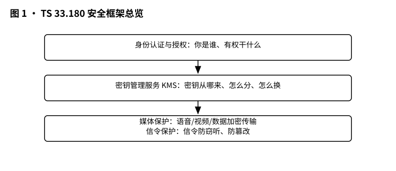
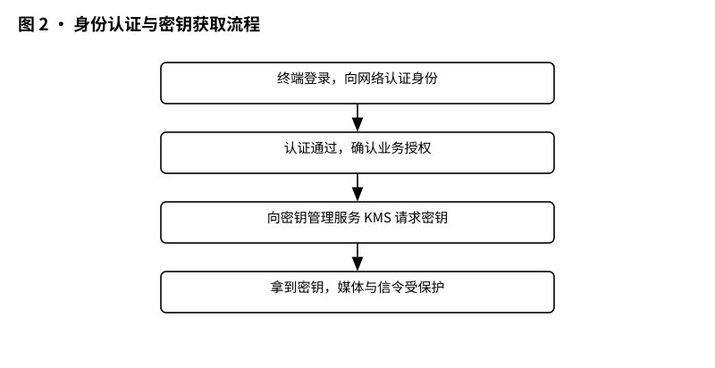
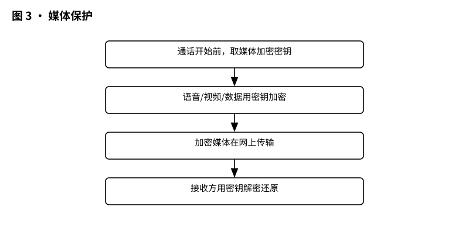
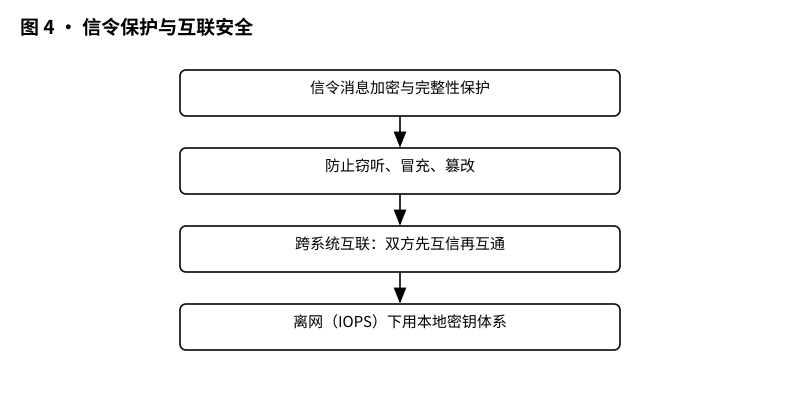

# 3GPP TS 33.180 解读：MCX 安全——关键任务通信的锁，是怎么一把把配上的

> 版本：v1.0 ｜ 更新：2026-10-28 ｜ 基线：TS 33.180 v20.1.0（Rel-20，2026-09）｜ 原文：whatthespec.net 抓取的关键条款

TS 33.180 是 3GPP 的 MCX（关键任务通信）安全规范：规定身份认证、密钥管理、媒体加密、信令保护怎么做。版本 TS 33.180 v20.1.0，Rel-20（2026-09）。

MCX 家族里的"锁匠手册"。它规定了关键任务通信（MCX）里的四件事怎么做：身份怎么验、密钥怎么发、媒体（语音、视频、数据）怎么加密、信令怎么保护 [§1]。

把它想成商场物业的安全规定：进门刷卡（身份认证）、钥匙由总台保管（密钥管理）、金库门要上保险（媒体加密）、监控信号线不能被剪（信令保护）。缺一把锁，整套系统就不算安全。

## 1. 它要解决什么问题

关键任务通信，就是警察、消防、救援、铁路、公用事业这些行业用来干活的通信。它跟普通打电话不同，一出错就是人命和公共事故。所以它有三个绝对不能出现的后果 [§4.1]：

- **被偷听**：通话被窃听，行动就废了。
- **被冒充**：一个假"班长"发假命令，后果不堪设想。
- **被篡改**：对讲机里收到"炸弹"两个字，那可能是真炸弹。

要防住这三样，就得回答四个问题：你是谁（身份认证与授权）、钥匙在哪（密钥管理）、声音画面怎么加密（媒体安全）、指令怎么防改（信令保护）[§4.1]。

注意一点：信令平面和应用平面的安全机制是相互独立的，但一套安全的 MCX 系统可能两者都需要 [§4.1]。好比门锁和保险柜锁，各管各的，但都不能少。

MCX 安全模型是照着公共安全环境设计的；规范自己也提醒：有些安全特性可能不适用于商业用途 [§1]。

*图 1 · 安全框架总览：认证、密钥管理、媒体保护、信令保护四道锁。*

## 2. 它在 MCX 家族中的位置

MCX 的"功能架构"由别的规范定义：通用架构在 TS 23.280，MCPTT 在 TS 23.379，MCVideo 在 TS 23.281，MCData 在 TS 23.282，用 5GS 跑 MC 业务在 TS 23.289。TS 33.180 是横切面——不管业务流程长什么样，它把安全功能织进每条业务线，覆盖网络内使用、离网使用、漫游、迁移、互联、互通、多安全域这些场景 [§1]。

覆盖 Stage 1/2/3 全链路。Stage 1 是"要什么"（需求），Stage 2 是"长什么样"（架构），Stage 3 是"消息怎么发"（协议细节）。TS 33.180 是安全领域的 Stage 3 规范，和业务流程的 24 系列协议配套使用。

钥匙的总管家是**密钥管理服务（KMS）**——后面取密钥、发密钥，都绕不开它 [§9.2.1.3]。

## 3. 核心概念大白话

**身份认证与授权。** 安全绑定的是"人"，不是"机器"：MC 系统安全绑定在用户上，而不是那部 MC 手机上 [§4.3.1]。所以必须先完成用户认证和授权，才能用大部分 MC 业务 [§4.3.1]。生活中也一样：进大楼刷的是工牌，不是看你手机壳。

负责发证的，是 MCX 公共业务核心里的**身份管理服务器（IdM 服务器）**；手机上跑的是 IdM 客户端。两者通过 CSC-1 接口直连，这是一个 HTTP 接口，要求支持 OpenID Connect 1.0 [§5.1.2.1]。OpenID Connect 是"通用的办证语言"：就像政务大厅规定了办证必须说普通话、填标准表格，大家才通用。

认证完成后，MCX 用户应用拿到一张 **token**（访问凭证），之后访问 MCX 业务时出示它。凭证通过 MCX 信令接口（HTTP 或 SIP）交给 MCX 网络实体，比如 MCX 服务器，服务器据此放行 [§4.3.2]。

**密钥管理服务（KMS）。** 全系统的"钥匙大管家"。客户端做加密前，要先从 KMS 拿到用户专属的密钥材料 [§9.2.1.3]。就像员工开保险柜，钥匙挂在总台，不随身带。

**密钥体系。** 两个主角：

- **CSK（客户端-服务器密钥）**：128 位，由客户端自己生成，和 CSK-ID 一起加密送进服务器 [§9.2.1.2]。记住"每把锁自己造，造好包好寄给前台"。
- **SPK（服务器公钥）**：保护 MCX 服务器之间的信令，靠**手动配置**，不走网络自动协商 [§9.1]。像两部对讲机手动对频码。

**媒体安全。** 保护的是语音、视频、数据这些"内容"本身，端到端加密——正常情况下，中间的 MCX 服务器是解不开的 [§4.3.1]。

**信令保护。** 保护的是"谁有权说话"这类指令：RTCP 信令（比如谁按住了通话键，叫"地板控制"）、XML 信令、MCData 数据信令 [§9.1]。指令被改一笔，结果可能天差地别，所以也要上锁。

## 4. 一次安全组呼怎么建起来

生活版：开机 → 刷卡进楼 → 办证窗口验身份、发卡 → 领钥匙 → 开会、锁门、通话 → 中途换钥匙。

对应到 MCX 用户手机开机后的流程 [§5.1.1]：

1. **网络接入认证**：MC UE 先按系统做 EPS 认证（TS 33.401）或 5GS 认证（TS 33.501）[§5.1.1]。相当于"大楼门禁刷门禁卡"。
2. **MCX 用户认证（步骤 A）**：通过 CSC-1 接口向 IdM 服务器证明自己是谁 [§5.1.2.1]。相当于"办证窗口验身份证"。
3. **SIP 注册与认证（步骤 B）**：在 SIP 核心注册信令身份 [§5.1.1]。相当于"登记通行证"。
4. **MCX 业务授权（步骤 C）**：拿到 token，授权使用 MCX 业务 [§5.1.1]。相当于"拿到工作证"。
5. **取密钥**：客户端从 KMS 拿到用户专属密钥材料 [§9.2.1.3]。
6. **上传 CSK**：客户端随机生成 CSK，用第 5 步拿到的密钥材料把它包装好，放进 SIP REGISTER 或 SIP PUBLISH 的消息体里，发给服务器的 PSI [§9.2.1.3]。这一步是"寄钥匙"——附赠一个 REGISTER 报文的示例，钥匙用 MIKEY 格式（application/mikey）打包 [§9.2.1.3]。
7. **建会话、加密媒体**：组呼建立，媒体端到端加密传输。
8. **通话**：正常进行。
9. **密钥更新**：CSK 用到"换新、拆会话、用户注销"等时机为止；会话中途若需要更新，由服务器生成新 CSK，按密钥下载流程（§5.8 定义的 Key download）交给客户端 [§9.2.1.2]。相当于"中途换锁芯"。

步骤 A 和 B 可以换顺序、可以并行；顺序影响身份绑定时，可以再做一次 SIP 注册把身份信息改过来 [§5.1.1]。

还有个贴心设计：先完成 SIP 注册、还没拿到 MCX 授权时，可以进入"**有限服务状态**"——这时还能用少量 MCX 业务，比如匿名 MCX 紧急通信 [§5.1.1]。就像大楼门禁已登记，但工作证还没办好，遇到火警可以先打紧急电话。

*图 2 · 身份认证与密钥获取流程：登录认证 → 向 KMS 取密钥 → 可用。*

## 5. 关键时刻的能力

**MCPTT / MCVideo 的媒体安全**。MCPTT（对讲）和 MCVideo（视频）的媒体端到端安全定义在 §7，MCData 定义在 §8 [§4.1]。可以点对点加密，也存在两种"过服务器"的例外：一对多推流时"客户端推一路到服务器"，多对一时"服务器拉一路出来" [§4.3.1]。但在正常情况下，MCX 服务器解不开媒体 [§4.3.1]——钥匙根本不在它手里。

**MCData 的数据安全**。MCData 信令的安全机制单独规定 [§4.1]。

**应用信令保护**。MC 特有的应用信令，对 MC 系统之外的所有实体保密，甚至包括中间的 SIP 核心 [§4.3.1]。客户端到自己的主 MCX 域必上这道锁，域间也可选 [§4.3.1]。

**信令与互联安全**。进 MCX 域的 HTTP 和 SIP 连接全部上信令平面保护；域内域间接口用网络域安全（NDS/IP）机制互锁 [§4.3.1]。细节见第六节。

**离网（IOPS）安全**。基站倒了，终端自己组网继续干活，是关键任务通信的硬需求。规范覆盖离网使用场景 [§1]，离网时的安全机制按规范的离网相关条款执行。

**录音与监听**。规范条款里出现的是"保护 MC 信令和媒体"，以及"有权限的监听/录音"这类能力描述；它的立场很明确：只有被授权的人才能看到明文，服务器正常情况下也看不到 [§4.3.1]。

*图 3 · 媒体保护：语音/视频/数据怎么加密传输。*

## 6. 安全规范 vs 业务协议的区别

**33.180 管"怎么锁"，24 系列管"话怎么说"。**

- **业务协议**（24.379/24.281/24.282）规定业务流程：组呼怎么发起、按键通话怎么协商、数据怎么发。
- **安全规范（33.180）**规定安全动作：认证按什么步骤、密钥怎么生成和分发、媒体和信令用什么机制保护。

比如 CSK 上传，安全规范告诉你"要生成 128 位密钥、放进 SIP REGISTER 发出去" [§9.2.1.2][§9.2.1.3]，业务协议告诉你这条 REGISTER 消息长什么样。一个设计锁和钥匙，一个规定送信流程，合起来才能跑。

*图 4 · 信令保护与互联安全：信令怎么防篡改、跨系统怎么互信。*

信令保护靠三件套 [§9.2]：客户端到服务器用 CSK（§5.4 定义的 CSK upload）；服务器发密钥给客户端用 Key download（§5.8）；服务器之间用手动配置的 SPK（§5.5）。配套的链路保护是：HTTP 走 TLS，证书或预共享密钥做认证 [§6.1]；SIP 走 IMS AKA 双向认证，信令本身按 Gm 接口的安全机制做机密性和完整性保护 [§6.2]。

## 7. 它不管什么

- **不管 Stage 1 需求**：MCX 业务"是什么、要什么"定义在别的规范里，TS 23.280 等 [§1]。33.180 只给安全答案，不写业务考题。
- **不管具体算法的实现选型**：它规定用哪些机制（TLS、证书认证、IMS AKA、CSK），算法细节交给所引用规范里的配置文件（profile），比如证书认证遵循 TS 33.310 的配置文件 [§6.1.1]。
- **不管非 3GPP 安全机制细节**：这些放在规范的附录 K 里。

## 8. 怎么往下读

推荐阅读顺序：先读本篇建立安全框架 → 再读 TS 24.379（MCPTT）、24.281（MCVideo）、24.282（MCData）看业务消息怎么传 → 最后读 TS 23.280 了解通用功能架构。安全机制看不懂时，回 33.180 查对应条款。

**版本**：TS 33.180 v20.1.0，3GPP Rel-20（2026-09）。

**来源**：whatthespec.net 抓取的规范关键条款（Scope、§4、§5、§6、§9）。条款引用以正式文本为准。
